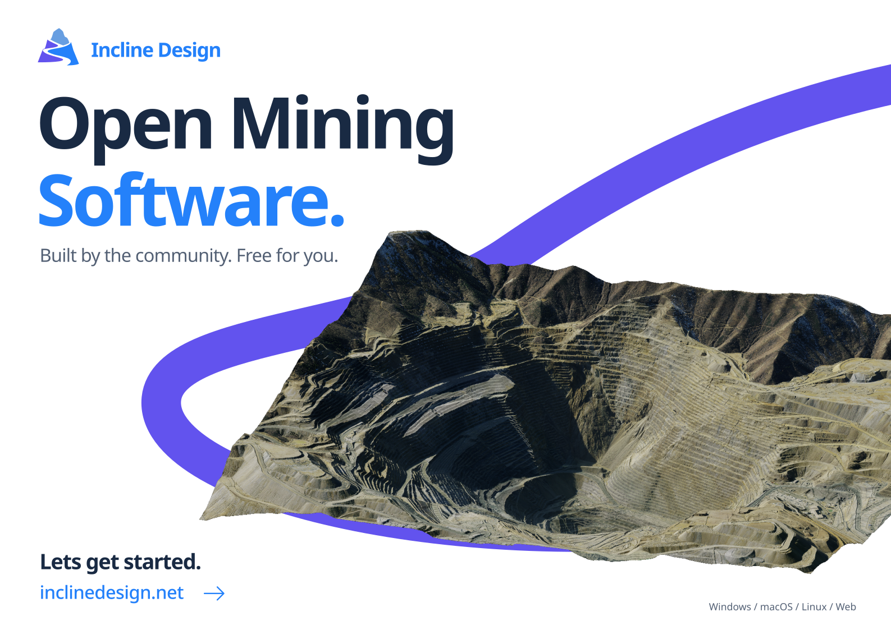

# Incline Design

[Incline Design](https://inclinedesign.net/) is a free open-source application for mine design, planning, geological modeling, and geospatial data.

Built for mine engineers, geologists, surveyors, researchers, and scientists, Incline provides capable mining software without expensive or restrictive licensing. Incline is developed openly by the community under the MIT License and provides a framework in which new mining technologies, workflows, and algorithms can be developed, and trialled.

Cross-platform, lightweight, and built for mining professionals. Incline Design is free for everyone.

## Getting Started

Check out the [releases page](https://inclinedesign.net/downloads/) and grab the latest version of Incline Design!

Incline is available for Windows, Linux, macOS, and WebAssembly.

## Features

### Mine Design

Create and edit mine designs using points, lines, polylines, circles, text, and triangulations. Incline features a suite of design tools such as pit and stockpile shell generation, offsets, chamfers, Bézier curves, and surface draping, alongside tools for clipping triangulations, generating contours, and merging pit and stockpile shells into terrain. Run pit optimisation scenarios on a block model and get nested pit shells by revenue factor as surfaces and solids.

### Drill & Blast

Lay out drill patterns inside blast boundaries, then move and rotate collars to suit the ground. Tie holes in with a palette of interhole delays, set initiation points, and charge holes from a library of explosive products and loading rules. Visualise the lines of equal firing time, burden relief, explosive weight per 8 ms window, powder factor, and a blast timeline.

### Geological Modeling

Import and inspect drillholes with their intervals, strata, seams and downhole geophysics. Estimate block models from drillhole samples by ordinary kriging, threshold block models into ore triangulations, and build reference surfaces from points picked down the holes.

### Geospatial Data & Survey

Transform data between mine grids and registry coordinate systems, and turn point clouds into terrain by joining, classifying ground and vegetation, and triangulating them.

### Mine Planning

Build pit, stockpile and dump solids, split them into blast cuts and dig strips, and report reserves from the block model. Lay out haul road networks with truck classes and grade speeds for cycle times, set up loaders, trucks, drills and dozers with their delays and rosters, and route material with destination rules, stockpile modes, crusher grade targets and cashflows. Incline schedules it all with an hourly dispatch solver, and presents the result in a calendar, Gantt chart, destination charts, exportable reports, and 3D animations that can be recorded to video.

### Localisation

Incline supports: English, Español, Português, Français, 简体中文, Bahasa Indonesia, Русский, العربية, فارسی, हिन्दी, Deutsch, Italiano, Polski, Türkçe, Tiếng Việt, Монгол, Kiswahili, 日本語, 한국어 and Українська.

## Example data

The [`examples`](examples/) directory contains a small OMF 2 project with a pit-shell design, mine surface triangulation, point cloud, drillholes, and an orthophoto raster. Create a project, then use **File → Import** to load [`pit_design.omf`](examples/pit_design.omf) and explore the datasets together.

## Citing Incline

If you use Incline Design in your research or publications, please cite it. Citation metadata is in [`CITATION.cff`](CITATION.cff).

## License

Incline Design is licensed under the [MIT License](LICENSE.md).

## Maintainers

- **Leo Timmins**, **GitHub:** [@leotimmins1974](https://github.com/leotimmins1974), email: `leo@inclinedesign.net`.
- **Lucas Timmins**, **GitHub:** [@trimental](https://github.com/trimental), email: `lucas@inclinedesign.net`.

## Committers

- **Denis Mikulich**, **GitHub** [@denismikulich91](https://github.com/denismikulich91).
- **Norman Heckscher**, **GitHub:** [@normanheckscher](https://github.com/normanheckscher).
