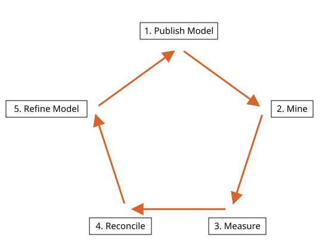

# Geology in Incline Design

Written for Incline Design **v0.4.0-dev**.

How the geology pages fit together: the geologist's work from the first drill hole to a published model, then through mining, measurement and reconciliation back into the model. Read this first, then the topic pages in the order at the end.

Incline's geology begins with coal: a stratigraphic, sedimentary deposit, seams laid down flat and since folded, faulted and weathered. Why coal first? Because it is the most primary resource of our civilisation. Coal sits only a few steps past the hunter-gatherer and the farmer, yet nearly everything we build still reaches back to it. Coke made from coal turns iron ore into steel, and steel is the truck, the digger, the dragline, the rail, the bridge and the wind tower. Coal fired the first engines and lit the first cities, and it still generates more of the world's electricity than any other single source. The industry that digs every other commodity runs on machines made with coal. Coal is not going away. What changes is how well it is mined, and that is a geologist's work. A seam is also the plainest geology there is to learn on: a roof, a floor, a thickness, continuous for kilometres, cut by a few faults. A geologist who can model a seam honestly can model anything stratiform, and Incline will grow into other commodities the way industry did, on the foundation coal laid.

## Contents

1. [What geology at a mine is](#1-what-geology-at-a-mine-is)
2. [The life cycle](#2-the-life-cycle)
3. [Where the evidence comes from](#3-where-the-evidence-comes-from)
4. [Publish Model](#4-publish-model)
5. [Mine](#5-mine)
6. [Measure](#6-measure)
7. [Reconcile](#7-reconcile)
8. [Refine Model](#8-refine-model)
9. [Reading order](#9-reading-order)

---

## 1. What geology at a mine is

Geology is not the search for more coal. The coal is known to be there. Geology is defining what is there well enough to mine it: where each seam's roof and floor run, how thick it is, where it is faulted, where it pinches out. The model is that definition, written down as surfaces, and it is only as good as the last time it was tested against the ground.

The test happens at the coal face. A working pit exposes the seam along kilometres of wall, the engineers drill blastholes metres apart through it, and the surveyors measure every surface before and after it is dug. Against that, exploration holes can be hundreds of metres apart and decades old. Historical exploration finds the deposit and gives the first model. Mining proves it, hole by hole and wall by wall, and the geologist who stands at the face is the one who learns fastest, because the answer arrives in days, not decades.

Incline is built for that geologist first: the tools on these pages make a model by hand, from evidence, with every judgement visible, and they take the same evidence from an exploration rig, a blasthole drill or a survey pickup.

## 2. The life cycle

A mine geologist works in a cycle of five stages. A model is published: the best current interpretation of the deposit, with a date. The operation mines against it. What comes out is measured. Reconciliation compares the prediction with the measurement, and the differences refine the model, which is published again.

The cycle does not end, and it is entered at the face. A geologist new to a deposit joins it at Mine, where the model meets the ground, and learns the deposit by watching the prediction hold or fail. Each pass should leave a better model than the last, and because the published model is dated, each pass also says who predicted what, and how it turned out.

The topic pages of this manual serve Publish Model and Refine Model. The three stages between them are where the evidence for the next model is made, and they are described here so the evidence is recognised when it arrives.

## 3. Where the evidence comes from

Three streams feed the model. The first is the one geologists are taught to think of as geology. The other two are larger, cheaper and faster, and they are what proves up, or disproves, what the first one saw.

| Stream                 | Who makes it                                          | How dense                                                                     | How soon it can be used       |
| ---------------------- | ----------------------------------------------------- | ----------------------------------------------------------------------------- | ----------------------------- |
| Exploration drilling   | Exploration geologist and the drill crew              | Holes hundreds of metres apart                                                | Months to years before mining |
| Mining and engineering | Mine geologist, drill and blast crew, mining engineer | Blastholes metres apart, every exposed wall mapped                            | Days                          |
| Survey                 | Surveyor                                              | Every surface before and after it is dug, scans of the pit and the stockpiles | Hours to days                 |

All three arrive as the same kinds of thing: holes with logged intervals, strings and points someone measured, and surfaces. Incline does not ask who made them. A blasthole pattern with its collars and what each hole logged loads as a drill hole set like any exploration hole, a surveyed pit floor is a surface, a mapped seam roof along a wall is a string, and all of them steer the next model exactly as the exploration holes did.

## 4. Publish Model

Publish Model is the long stage. It holds the exploration that gathers the first evidence and the modelling that interprets it, and it ends when the model is handed over. The topic pages of this manual serve this stage.

### Exploration

Holes are drilled and logged: what the geologist saw down each hole, seam by seam, with depths, and what the downhole geophysics recorded. The logs, collars and surveys are the evidence every later step rests on, so before anything is built from them they are loaded, checked against each other and corrected where a pick is wrong.

Drilling and logging happen in the field. Incline starts when the logs arrive as tables: a collar table (one row per hole), an optional survey table (which way the hole goes) and interval tables (from and to depth along the hole, with a logged value such as a seam code). A seam code is one logged value for a stretch of hole. A working section is a named set of seam or ply codes mined as one unit. The strat column is the order of the codes, top of the ground first, and Incline fills it at import from the order most holes give.

A correction never overwrites the log. The logged value is kept beside the new one, so the record shows what was changed, and the changes can be exported as a worksheet for review.

- [Drill Holes](drill-holes/README.md): importing holes, working sections, the borehole inspector, log curves, the strat column and linking geophysics.
- [Drill Hole Corrections](drill-hole-corrections/README.md): renaming seams, moving roofs and floors, inserting and deleting intervals, and exporting the holes and the corrections worksheet.

### Modelling

Modelling turns hole picks into seams in space. The steps are the same for every seam and every evidence stream:

1. **Picks become points.** Reference Points puts one point per hole on the roof or floor of a seam, at the height the log gives. The point is the first thing you can look at and question.
2. **Strings steer the surface between the holes.** A control string is an open line drawn where you know, or have decided, where the surface runs: a roof traced between holes, a subcrop, a fault. Every vertex carries a height. Where a string and a pick sit at the same place, the string wins and the build reports the difference. A closed string is the extent. Strings of one surface live on one layer.
3. **A surface is built through the points and the strings.** Build Surface fits a smooth surface that passes through every point and string it is given, gridded at 5 m by default, and reports what it cleaned, left out and overrode. A surface that passes exactly through its points is only as good as the points and strings, so a refusal is marked on the strings with rings, and Clean Strings joins small height disagreements at crossings and rings the rest for you.
4. **The surface is checked in section.** A vertical section through the holes shows at once whether the surface passes through each logged interval or rides above or below it. The line a surface cuts on a section can be saved as a string and edited in the plane of the section for the next build.
5. **Thickness gives the other side.** A vertical hole through a dipping seam logs more than the seam is thick. True thickness is the vertical intercept multiplied by the cosine of the dip, and the dip comes from the reference surface under each hole. Thickness Points measures it, Thickness Surfaces grids it into the seam's other surface, and Clip to Surface limits the roof and floor pair to a ceiling and a base, such as the base of weathering, and makes a closed solid between them.

Every step is a judgement, and the pages say which part Incline decides and which part you do. Incline fits the surface and reports what it did. You choose the picks, draw the strings, accept or correct a refusal, and decide when the model is good enough.

- [Control Strings](control-strings/README.md): what a control string is, drawing strings, cleaning them and draping them on a surface.
- [String Vertices](string-vertices/README.md): cutting strings where they cross, and working on single vertices and their spacing.
- [Surfaces](surfaces/README.md): reference points at the holes, and Build Surface through the points and strings.
- [Sections](sections/README.md): surface lines on a section, saving them as strings, editing strings in the plane of the section.
- [Seam Thickness](thickness/README.md): true thickness at the holes, the seam's second surface, and Clip to Surface.

### Publishing

The model is published when it is good enough to plan against: each seam's roof, floor and thickness, limited to where the seam is, with the date it was handed over. Publishing fixes the prediction that every later measurement is compared with.

This manual covers no separate publishing tool. What is published is what the modelling pages make.

## 5. Mine

The operation digs to a plan made from the published model. The geologist's work here is watching the model meet the ground: mapping the seam roofs, floors and faults exposed in the pit walls, marking where coal ends and waste starts, and noting where the ground disagrees with the model. An exposed wall is the largest and cheapest observation of the deposit there is, and the blasthole pattern drilled through the seam before every shot is the densest drilling the deposit will ever get.

Incline takes this evidence as it takes any other: a blasthole pattern loads as a drill hole set from its collar and interval tables, and a mapped roof or fault trace is drawn as a string in the plane of a section or in plan. There is no tool here that belongs only to this stage.

## 6. Measure

What comes out is measured: survey pickups of the void, scans of the pit and the stockpiles, tonnes over the belt scales, the plant's figures, samples of what was mined. These are the other side of the comparison. A measurement is only as good as its base: a stockpile volume means nothing without the ground the pile sits on.

Surveyed surfaces and strings come into Incline through the Import window in the open formats it lists, and scans as point clouds. The tonnes, plant figures and samples stay in the systems that record them. This manual does not cover tools for this stage.

## 7. Reconcile

Reconciliation sets the prediction beside the measurement for the same block of ground and asks where they differ and why. A difference can come from the shape of a seam, from its quality, or from how it was mined: loss and dilution. Only the first two point back at the model. Done soon after the ground is mined, it tells the geologist what to change while the change still matters, and because the model carries a date and a name, it also tells the geologist how good their last prediction was.

This manual does not cover tools for this stage.

## 8. Refine Model

Refining puts what was learned back into the model. A pick shown to be wrong is corrected, the blastholes and mapped walls join the evidence, control strings are redrawn where the ground disagreed, and the surfaces are built again. The refined model is published, dated, and the cycle starts again.

Within this manual, refining uses the tools already met: the corrections on the [Drill Hole Corrections](drill-hole-corrections/README.md) page, which keep the logged value beside the new one, then [Control Strings](control-strings/README.md), [Surfaces](surfaces/README.md) and [Seam Thickness](thickness/README.md) to rebuild.

## 9. Reading order

For a first walk-through, read the topic pages in this order. Each page builds on the pages before it. Most examples use the same three synthetic holes, S1 to S3, with seams A and B, loaded on the first page.

1. [Drill Holes](drill-holes/README.md): the holes and their working sections, which Surfaces and Seam Thickness read.
2. [Drill Hole Corrections](drill-hole-corrections/README.md): fixing a wrong pick before anything is built from it.
3. [Control Strings](control-strings/README.md): strings drawn and cleaned before the first surface is built.
4. [String Vertices](string-vertices/README.md): the finer string tools, used as the strings need them.
5. [Surfaces](surfaces/README.md): points at the holes, then a surface through the points and the strings.
6. [Sections](sections/README.md): needs a built surface to draw its lines on a section.
7. [Seam Thickness](thickness/README.md): needs a built surface to measure against.
