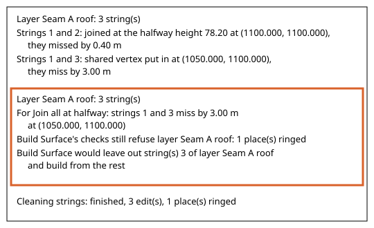
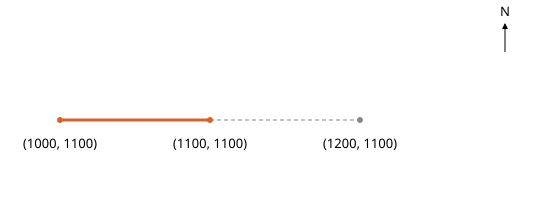
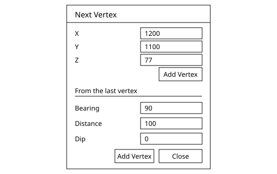
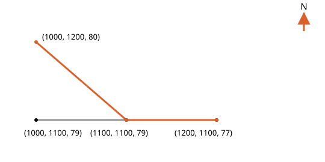
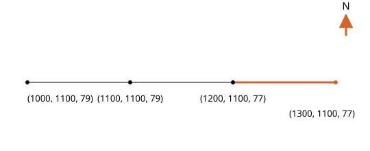
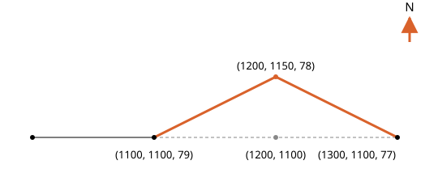
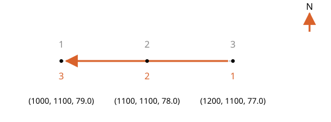
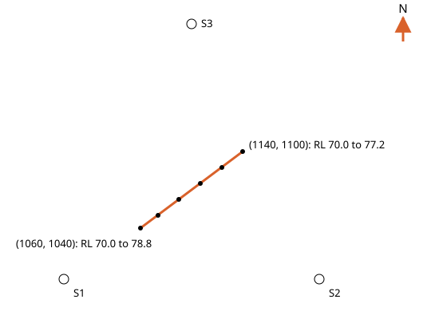

# Control Strings in Incline Design

Written for Incline Design **v0.4.0-dev**.

This page covers what a control string is, drawing strings, cleaning them and draping them on a surface: the strings that interpolate a seam surface between the drill holes. It is for geologists and students who build the surface by hand.

## Contents

1. [Concepts](#1-concepts)
2. [Clean Strings](#2-clean-strings)
3. [Remove Last Vertex](#3-remove-last-vertex)
4. [Next Vertex](#4-next-vertex)
5. [Copy Along a String](#5-copy-along-a-string)
6. [Carry On a String](#6-carry-on-a-string)
7. [Redraw Between Vertices](#7-redraw-between-vertices)
8. [Reverse String Direction](#8-reverse-string-direction)
9. [Drape Following Triangles](#9-drape-following-triangles)

---

## 1. Concepts

Where this fits: these tools serve [Modelling](../README.md#modelling), in the Publish Model stage of the geologist's life cycle: its step 2, strings that interpolate the surface between the holes, and the cleaning of step 3. The strings are drawn and cleaned before the first surface is built, and they carry the geologist's interpretation into the published model. Next in the flow: [String Vertices](../string-vertices/README.md).

A control string is an open line you draw where you know, or have decided, where a seam surface runs: along a roof you traced from the holes, along a subcrop, along a fault trace. The surface you build later passes through the strings, so the strings interpolate it between the holes. A string has a height on every vertex. A pick at a hole is the stronger evidence: it was measured from the hole's log and downhole geophysics, where most strings are interpreted. Where a string and a pick sit at the same place in plan, **Build Surface** uses the string's height and reports the pick it overrode and by how much, so check every override against the hole: a string should only win where an observation stands behind it. Two strings that cross in plan should agree in height where they cross, as the surface cannot be at two heights at one place.

Strings of one layer are used together, so keep the strings of one surface on one layer, and one surface per layer. A closed string is the extent: the deposit, or the area being mined. **Build Surface** takes at most one, selected with the points, and shows it on its own **Extent** line.

The Geology workspace has a menu called **Geology Design**. Its top half, headed **Production Design**, is the **Design** menu of the Production workspace. Its lower half, headed **Geology Design**, groups the string tools by what each does to a string, in five submenus:

- **Draw**: make a string and keep drawing it.
- **Edit**: change a whole string.
- **Join and Split**: cut strings where they meet, or break one apart.
- **Vertices**: work on single vertices and the spacing between them.
- **Surface**: lay a string on a surface.

**Draw**, **Edit** and **Surface** are on this page. **Join and Split** and **Vertices** are on [String Vertices](../string-vertices/README.md).

Each example draws its own strings. Before each one, delete the strings of the examples before it, unless its steps say to use them, so a click finds the string the example names.

The string tools below are in the Geology workspace only, except **Clean Strings**, which the **Design** menu of the Production workspace also carries. The plain drawing tools are in the same menu and are not described here: **Create Point**, **Create Line**, **Create Polyline**, **Create Circle**, **Create Text**, **Move Design**, **Set X...**, **Set Y...**, **Set Z...**, **Offset**, **Relimit Line**, **Bezier Polyline**, **Chamfer Polyline Corners**, **Fuse Polylines**, **Split Polyline At Points**, **Explode Polyline to Lines**, **Delete Points**, **Insert Points at Crossings**, **Insert Points at Elevation...**, **Drape to Topology**, **Create Triangulation**, **Strike and Dip**, and **Measure Distance**. Only the segment readout **Measure Distance** shows in Geology has a section, on [String Vertices](../string-vertices/README.md#14-measure-distance-segment-readout).

Tools that work in the plane of a section are on the [sections page](../sections/README.md).

Select first, then act: tools that work on whole strings take the selected strings.

Where this page says the console, it means the activity console. It is closed at first; **View > Show Console** shows and hides it and remembers your choice. A warning or an error also opens an alert with its words.

---

## 2. Clean Strings
### What it does
Fixes the small flaws and disagreements in the selected open strings themselves, and rings the rest for you to fix by hand.
### Why a geologist uses it
A string drawn by hand picks up small flaws: a point clicked twice, a spike, a stretch that doubles back, two strings that meet a few centimetres apart in height. **Build Surface** cleans these in its own copy at each build and leaves the strings as drawn. **Clean Strings** does the plain tidying in the strings themselves in one step and names every place it did not dare to change, so your judgement goes to the places that need it, such as two strings that miss each other by metres.
### Where it is
- Geology workspace: **Geology Design > Edit > Clean Strings**. It is also in the top half of the same menu, under **Production Design**.
- Production workspace: **Design > Clean Strings**.
- Right click anywhere on the canvas while open strings are selected: **Clean Strings**.
### Before you start
Select one or more open strings (closed lines are not taken). The entry is greyed while none is selected. A project must be open. Each layer is cleaned on its own, so strings are never compared with another layer's. Strings are numbered from 1 among the selected strings of each layer, in the order they were made, and the console uses those numbers. **Clean this string** on a ring cleans one string, so it reports it as String 1.
### Steps
Set-up: the S1 to S3 set loaded as in [Import drill holes](../drill-holes/README.md#2-import-drill-holes). Make a layer called `Seam A roof` and draw three open polylines on it, in this order, with two vertices each. Set the vertices (X, Y, RL) in the object's vertex table:

- String 1: (1000, 1100, 79.0) to (1200, 1100, 77.0).
- String 2: (1100, 1000, 78.4) to (1100, 1200, 78.4).
- String 3: (1050, 1000, 81.5) to (1050, 1200, 81.5).

1. Select the three strings.
2. Choose **Geology Design > Edit > Clean Strings**.
3. Open the console and click the **Clean Strings** row to read its lines. Strings 1 and 2 cross at (1100, 1100), where string 1 is at 78.00 and string 2 at 78.40. They miss by 0.40 m, so they are joined at the halfway height:
   - "Layer Seam A roof: 3 string(s)"
   - "Strings 1 and 2: joined at the halfway height 78.20 at (1100.000, 1100.000), they missed by 0.40 m"
4. Strings 1 and 3 cross at (1050, 1100), where string 1 is at 78.50 and string 3 at 81.50. A shared vertex goes in, the heights stay as they are, and a ring is drawn at the place. The console says "Strings 1 and 3: shared vertex put in at (1050.000, 1100.000), they miss by 3.00 m". It then warns, under the layer line again: "For Join all at halfway: strings 1 and 3 miss by 3.00 m at (1050.000, 1100.000)", "Build Surface's checks still refuse layer Seam A roof: 1 place(s) ringed" and "Build Surface would leave out string(s) 3 of layer Seam A roof and build from the rest". Those two lines do not count the joins **Build Surface** makes in its own copy: a build joins this 3 m miss itself and uses all three strings. The run ends with "Cleaning strings: finished, 3 edit(s), 1 place(s) ringed". As the run warned, an alert titled **Clean Strings** opens too, and its **Details** hold the same lines. The whole run is one undo step.
5. Decide the ring yourself. If the two strings are one horizon, right click the ring and choose **Join here at halfway**, or right click anywhere on the canvas and choose **Join all at halfway** to join every ring that misses by 5 m or less, except rings on a hidden or locked string. They join at the mean height: "Strings 1 and 3: joined at the halfway height 80.00 at (1050.000, 1100.000), they missed by 3.00 m". If they are two blocks, leave it.

**Rings and the ring menu.** **Clean Strings** and **Build Surface** both ring the places they leave for you. Right click a ring for the rows that repair it. Vertices are numbered from one, as the **Vertices** table numbers them.

- **Join here at halfway**: only on a ring where two strings cross and miss by 5 m or less.
- **Delete vertex N** and **Show vertex N in the table**: one pair for each ringed string that has a vertex at the ring, N being that vertex.
- **Clean this string**: only on a ring that concerns one string.
- A ring that touches a hidden string is not drawn, so it cannot be right clicked.
- No row edits a locked string: on a locked string only **Show vertex N in the table** is offered, and **Join here at halfway** needs both strings unlocked.
- Right click anywhere on the canvas, on a ring or not: **Join all at halfway** while any ring can be joined, and **Clear rings** while any ring is kept.
- Rings stay until **Clear rings**, an undo or redo, the next **Build Surface**, or leaving the project. A ring also goes when a ring row repairs it, or when an edit to its string removes the place it marked. A **Clean Strings** run or a join takes its strings whole: it drops every ring that lies only on strings it took, not just the one joined, and rings again what those strings still show. Rings that touch a string it did not take stay, as does a ring that names no string. Rings are not saved in the project and are not in the undo history; what a ring row changes is.

### Options and defaults
| Option | Default | What it does |
| --- | --- | --- |
| Joined by **Clean Strings** itself | 0.5 m or less in height | Strings meeting within this are joined at the halfway height. |
| Joined by **Join all at halfway** or **Join here at halfway** | 5 m or less | Strings missing by more are left for hand fixing, usually two fault blocks. |
| Repeated points merged | 0.5 m or less apart in height | Points on one place in plan merge to their mean height. Further apart they are ringed. |
| Height dropped | 20 m off both neighbours | A single vertex this far off is dropped, as is a vertex at RL 0 in a string that is not all at 0. |

**Clean Strings** has no dialog, so these are fixed. The pass runs in this order on each layer: repeated points, spikes, doubling back and loops in each string; bad heights; stretches where two strings run along each other, where the shorter loses the shared stretch; then crossings. A last check names what would still stop a build.
### What it refuses and why
- Greyed when no open string is selected.
- "Nothing to clean in the selected strings": the run found nothing to change. When nothing in the selection was an open string, the same line is a warning.
- "String 4 left as drawn: it has arcs" and "String 4 left as drawn: it has non-finite coordinates": that string is skipped, the number is the object's own.
- Flaws it does not change are listed as "For hand fixing: ..." warnings and ringed: a string with fewer than two distinct vertices, one that ends where it starts, turns back or crosses itself, two points at one place and far apart in height, strings running along each other, strings that pass close without meeting, and strings missing by more than 5 m. Strings missing by more than 0.5 m and up to 5 m get "For Join all at halfway: ..." instead. "For hand fixing: Build Surface still refuses ..." has no place, so it is listed but not ringed.
- After the list, either "Build Surface's checks pass on layer Seam A roof" or "Build Surface's checks still refuse layer Seam A roof: 1 place(s) ringed". A string that misses at least two others by more than 5 m each, all above or all below them by about the same amount, is named as the likely one to fix.
- A ring offers only the rows its strings allow: see Rings and the ring menu, under Steps above.
### Related tools
- [Split at Crossings](../string-vertices/README.md#2-split-at-crossings), [Remove Between Crossings](../string-vertices/README.md#3-remove-between-crossings)
- [Thin Strings](../string-vertices/README.md#11-thin-strings), [Smooth Strings](../string-vertices/README.md#12-smooth-strings)
- Build a surface from the cleaned strings: [surfaces page](../surfaces/README.md)

---

## 3. Remove Last Vertex
### What it does
Takes back the last vertex of the string you are drawing.
### Why a geologist uses it
Hand drawing slips. A click lands in the wrong place and you want that one vertex gone without losing the string so far.
### Where it is
Geology workspace: **Geology Design > Draw > Remove Last Vertex**. The Backspace key does the same.
### Before you start
Make a layer active, choose **Create Polyline** and place at least one vertex. On **Create Line** each segment is saved as it is drawn, so this deletes the segment just saved, as one undo step, and you draw on from its start.
### Steps
1. Choose **Geology Design > Draw > Create Polyline** and click three points in plan, near (1000, 1100), (1100, 1100) and (1200, 1100).
2. Choose **Geology Design > Draw > Remove Last Vertex**. The third vertex goes. The string being drawn has two vertices and ends at the second.
3. Click a new third point, press Enter and choose **Open**. The string is saved with the vertices you see.

### Options and defaults
None.
### What it refuses and why
- Greyed while no vertex is placed, and while the **Open** or **Closed** menu for finishing the polyline is up.
- Carrying on or redrawing a string, it stops at that string's own vertex: greyed when only that vertex is left.
### Related tools
[Next Vertex](#4-next-vertex), [Carry On a String](#6-carry-on-a-string)

---

## 4. Next Vertex
### What it does
Opens a panel that adds the next vertex of the string you are drawing from numbers you type, instead of from a click.
### Why a geologist uses it
A click is only as exact as your hand. When you know where the next vertex goes, as an X, Y and RL or as a bearing, a distance and a dip from the last vertex, you type it and it lands exactly there.
### Where it is
Geology workspace: **Geology Design > Draw > Next Vertex...**
### Before you start
Make a layer active and choose **Create Polyline** or **Create Line** first. The entry is greyed for any other tool. The panel starts at the string's last vertex, or at the cursor before there is one. It closes when you change to a tool that does not draw strings.
### Steps
1. Choose **Create Polyline**, then **Geology Design > Draw > Next Vertex...** In the **Next Vertex** panel type **X** 1000, **Y** 1100, **Z** 79 and click **Add Vertex**. The first vertex is (1000, 1100, 79).
2. Under **From the last vertex** set **Bearing** 90, **Distance** 100, **Dip** 0 and click that group's **Add Vertex**. The second vertex is (1100, 1100, 79). Type **X** 1200, **Y** 1100, **Z** 77 in the top fields and click the top **Add Vertex** for the third. Click **Close**, press Enter and choose **Open**.

### Options and defaults
| Option | Default | What it does |
| --- | --- | --- |
| **X**, **Y**, **Z** | The last vertex, else the cursor | The point to add as typed. **Z** is the height. |
| **Bearing**, **Distance**, **Dip** | 0, 0, 0 | A step from the last vertex: degrees clockwise from grid north, level metres, where a negative distance steps back, and degrees above level. **Dip** 0 keeps the height. |
### What it refuses and why
- **Add Vertex** is greyed while the **Open** or **Closed** menu is up, and the one under **From the last vertex** until a vertex is placed. Nothing is added when no layer is active, or when the point is where the string already ends. On a section the bearing field is replaced by "The bearing follows the section; a negative distance goes left." and a point off the plane is moved onto it with a console line such as "Moved 0.40 m onto the section".
### Related tools
[Remove Last Vertex](#3-remove-last-vertex), [Copy Along a String](#5-copy-along-a-string)

---

## 5. Copy Along a String
### What it does
Appends the vertices between two vertices of an existing string to the string you are drawing.
### Why a geologist uses it
A new string often runs along a boundary you have already drawn for part of its length. Copying the run keeps the two exactly together, with no second line of clicks that nearly matches.
### Where it is
Geology workspace: **Geology Design > Draw > Copy Along a String**
### Before you start
Locked strings can be copied from. Hidden strings cannot. If no polyline is being drawn, the entry starts one with the **Create Polyline** tool, so the copied run begins the new string. A layer must be active.
### Steps
1. Choose **Create Polyline** and add (1000, 1200, 80) with **Next Vertex**, then close the panel. Have the string of section 4 on the layer.
2. Choose **Geology Design > Draw > Copy Along a String**. The banner reads "Click the vertex where the copy starts", with "Esc cancels". Click vertex 2 of that string, (1100, 1100, 79).
3. The banner reads "Click the vertex where the copy ends, on the same string". Click vertex 3, (1200, 1100, 77). The console says "Copied 2 vertices along the string". The polyline being drawn has three vertices, (1000, 1200, 80), (1100, 1100, 79) and (1200, 1100, 77), and you can go on drawing. Press Enter, choose **Open**, then delete the copy before the next example.

### Options and defaults
None.
### What it refuses and why
- Greyed while the **Open** or **Closed** menu for finishing the polyline is up.
- A click away from every vertex of a string is ignored, and so is a second click on the vertex the copy started from. The banner stays until you pick or press Esc.
### Related tools
[Carry On a String](#6-carry-on-a-string), [Redraw Between Vertices](#7-redraw-between-vertices)

---

## 6. Carry On a String
### What it does
Continues an existing open string from one of its ends, so the new vertices join the same string.
### Why a geologist uses it
A string drawn to the edge of the data often has to go further when a new hole or section comes in. Carrying on keeps one string, with its name, layer and colour, where a second string would have to be fused to it.
### Where it is
Geology workspace: **Geology Design > Draw > Carry On a String**
### Before you start
Pick an open string on an unlocked layer. Nothing may be half drawn. Locked and hidden strings are not picked. Esc before the pick drops the request.
### Steps
1. Choose **Carry On a String**. The banner reads "Click near the end of a string". Click the section 4 string near its right end, (1200, 1100, 77). The end nearer the click starts the line.
2. Choose **Geology Design > Draw > Next Vertex...**, set **Bearing** 90, **Distance** 100, **Dip** 0, click **Add Vertex** under **From the last vertex** and **Close** the panel. The new point is (1300, 1100, 77).
3. Press Enter. With one new point the string is finished open at once. The same string has four vertices, (1000, 1100, 79), (1100, 1100, 79), (1200, 1100, 77) and (1300, 1100, 77). One undo takes the new vertex off.

### Options and defaults
None.
### What it refuses and why
- Greyed while a string is half drawn and while the **Open** or **Closed** menu is up.
- On a closed string: "A closed string has no end to carry on from". The string is unchanged.
- If the string is edited before you finish: "The string changed, pick it again". Nothing is written.
### Related tools
[Redraw Between Vertices](#7-redraw-between-vertices), [Copy Along a String](#5-copy-along-a-string)

---

## 7. Redraw Between Vertices
### What it does
Replaces the run of a string between two of its vertices with new points you draw.
### Why a geologist uses it
Part of an interpreted string is wrong but its ends are right. Redrawing the middle keeps the two good vertices and the one string, where deleting vertices and redrawing the line by hand would not.
### Where it is
Geology workspace: **Geology Design > Draw > Redraw Between Vertices**
### Before you start
Pick a vertex of a string on an unlocked layer. Closed strings are taken too, and a closed string is redrawn the shorter way round. Nothing may be half drawn. Esc before the first pick drops the request.
### Steps
1. Take the four-vertex string of section 6. Choose **Redraw Between Vertices**. The banner reads "Click the vertex where the redraw starts". Click vertex 2, (1100, 1100, 79).
2. The banner reads "Draw the new part, then click the vertex where it ends". Choose **Geology Design > Draw > Next Vertex...**, type **X** 1200, **Y** 1150, **Z** 78, click the top **Add Vertex** and **Close** the panel.
3. Click vertex 4, (1300, 1100, 77). The console says "Redrew 1 vertices". Vertex 3 is gone and the string runs (1000, 1100, 79), (1100, 1100, 79), (1200, 1150, 78), (1300, 1100, 77). One undo puts it back.

### Options and defaults
None.
### What it refuses and why
- Greyed while a string is half drawn and while the **Open** or **Closed** menu is up.
- Enter and a right click do not finish a redraw. The console repeats "Draw the new part, then click the vertex where it ends".
- If the string is edited meanwhile: "The string changed, pick it again". Nothing is written.
### Related tools
[Carry On a String](#6-carry-on-a-string), [Copy Along a String](#5-copy-along-a-string)

---

## 8. Reverse String Direction
### What it does
Turns each selected string round, so its last vertex becomes its first, and leaves its shape and heights where they are.
### Why a geologist uses it
The vertex table numbers a string's vertices from its first. Reversing lets you make a set of strings run the same way, or put the end you want to work on first.
### Where it is
Geology workspace: **Geology Design > Edit > Reverse String Direction**. The left toolbar in the Geology workspace has a button with the tooltip *Reverse String Direction*.
### Before you start
Select first, then act: select one or more strings, open or closed. The entry and the button are greyed while no string is selected. Strings that are hidden, on a locked layer or frozen are left alone. For the example, on the layer `Seam A roof` draw one open string and set its vertices in the vertex table as X, Y and RL: 1 (1000, 1100, 79.0), 2 (1100, 1100, 78.0), 3 (1200, 1100, 77.0).
### Steps
1. Select the string and choose **Geology Design > Edit > Reverse String Direction**.
2. Open the vertex table. Row 1 is now (1200, 1100, 77.0), row 2 is (1100, 1100, 78.0) and row 3 is (1000, 1100, 79.0). The line on the canvas has not moved.
3. Read the console: "Reversed 1 string(s)". The run is one undo step, however many strings were selected.

### Options and defaults
None.
### What it refuses and why
- Greyed when no string is selected.
- Console "No selected string can be reversed (hidden or locked)": every selected string was hidden, locked or frozen. Nothing changes.
### Related tools
[Clean Strings](#2-clean-strings), [Carry On a String](#6-carry-on-a-string)

---

## 9. Drape Following Triangles
### What it does
Lays the selected strings on the selected surface, adding a vertex wherever a string crosses a triangle edge, so each string follows the surface between its vertices.
### Why a geologist uses it
**Drape to Topology** moves only the vertices a string has, so a long span stays a straight line between two draped heights while the surface bends under it. This one lays the string on the surface along its whole length.
### Where it is
Geology workspace: **Geology Design > Surface > Drape Following Triangles**.
### Before you start
A surface must be loaded in the project, so this section comes after **Build Surface** in the flow: come back to it once you have a surface. Arming the tool clears the selection, so choose the strings and then the surface after you arm it. For the example, build the surface as on the [surfaces page](../surfaces/README.md#3-build-surface) from the three points of `A Roof points` only, and type `A Roof plane` in **Output name**, as the [thickness page](../thickness/README.md#1-concepts) does. With three points it is the plane RL = 80 - 0.02 x (X - 1000). On `Seam A roof` draw one string from (1060, 1040, 70.0) to (1140, 1100, 70.0).
### Steps
1. Choose **Geology Design > Surface > Drape Following Triangles**. The banner reads "Select designs" and "Strings will follow the surface between their vertices". Click the string. A panel titled **Drape to Topology** shows "1 selected". Press **Confirm Selection** or Enter.
2. The banner reads "Select topologies". Click the surface `A Roof plane`, then **Confirm Selection**. With more than one surface selected, each place takes the uppermost.
3. The string now has many more vertices, one at each triangle edge it crosses. Every vertex sits on the plane, so the ends read (1060, 1040, 78.8) and (1140, 1100, 77.2). The console line "Draped ... vertices; ... changed elevation" gives one count twice: the two ends plus every vertex added, as each changed height. The tool is put down and the string is selected. One undo restores it.

### Options and defaults
None.
### What it refuses and why
- **Confirm Selection** is greyed with nothing selected. Enter then warns "Select one or more design objects to drape" or "Select one or more topologies to drape onto". Esc cancels the tool. A circle cannot be selected.
- Console "None of the selected design vertices intersect the selected topologies": no vertex lies over the surface, so nothing changes.
- A vertex outside the surface stays as drawn. A span with a bulge gets no added vertices.
### Related tools
[Build Surface](../surfaces/README.md#3-build-surface), [Thin Strings](../string-vertices/README.md#11-thin-strings)
