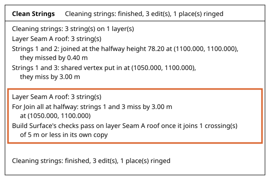
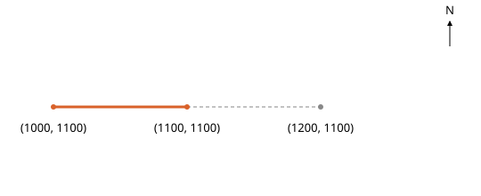
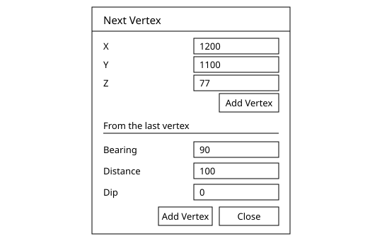
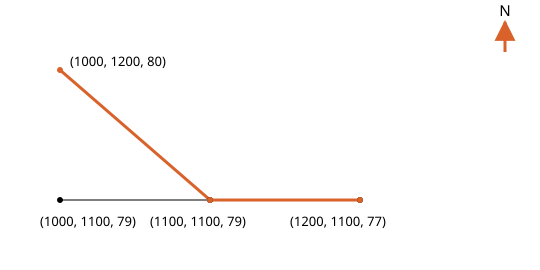
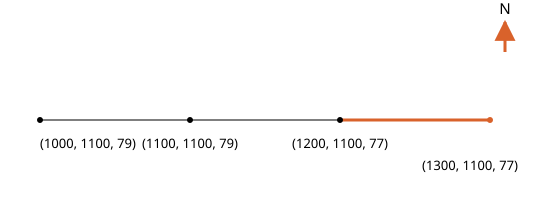
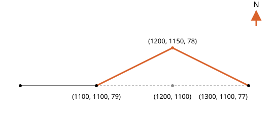
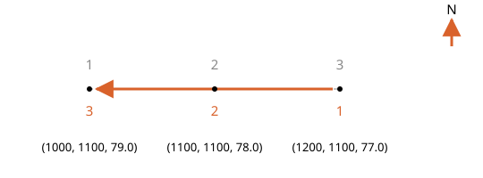
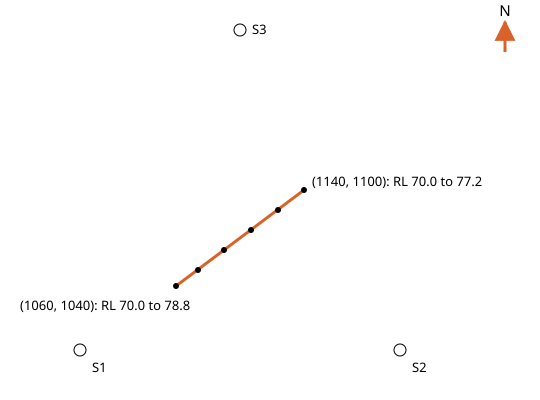

# Control Strings in Incline Design

Written for Incline Design **v0.4.0-dev**.

This page covers what a control string is, drawing strings, cleaning them and draping them on a surface: the strings that interpolate a seam surface between the drill holes. It is for geologists and students who build the surface by hand.

## Contents

1. [Concepts](#1-concepts)
2. [Clean Strings](#2-clean-strings)
3. [Remove Last Vertex](#3-remove-last-vertex)
4. [Next Vertex](#4-next-vertex)
5. [Copy Along a String](#5-copy-along-a-string)
6. [Carry On a String](#6-carry-on-a-string)
7. [Redraw Between Vertices](#7-redraw-between-vertices)
8. [Reverse String Direction](#8-reverse-string-direction)
9. [Drape Following Triangles](#9-drape-following-triangles)

---

## 1. Concepts

Where this fits: these tools serve [Modelling](../README.md#modelling), in the Publish Model stage of the geologist's life cycle: its step 2, strings that interpolate the surface between the holes, and the cleaning of step 3. The strings are drawn and cleaned before the first surface is built, and they carry the geologist's interpretation into the published model. Next in the flow: [String Vertices](../string-vertices/README.md).

Why draw strings at all? Before computers, a geologist drew cross sections by hand, in coloured pen on paper, from a road cutting, a hillside or a highwall. Those drawings were how geology was conveyed: what the ground is doing, and how it came to be that way. A control string is that drawing, made on the computer. Each string is a line of your interpretation, and a set of them, section by section, turns scattered holes into a model of the ground in three dimensions. A section is two dimensions, so anyone who can read one can draw what they see on it, and the sections together make the model. The drawing is done with CAD tools, so this page and the next teach a little CAD: only as much as drawing a section needs.

A control string is an open line you draw where you know, or have decided, where a seam surface runs: along a roof you traced from the holes, along a subcrop, along a fault trace. The surface you build later passes through the strings, so the strings interpolate it between the holes. A string has a height on every vertex. A pick at a hole is the stronger evidence: it was measured from the hole's log and downhole geophysics, where most strings are interpreted. Where a string and a pick sit at the same place in plan, **Build Surface** uses the string's height and reports the pick it overrode and by how much, so check every override against the hole: a string should only win where an observation stands behind it. Two strings that cross in plan should agree in height where they cross, as the surface cannot be at two heights at one place.

Strings of one layer are used together, so keep the strings of one surface on one layer, and one surface per layer. A closed string is the extent: the deposit, or the area being mined. **Build Surface** takes at most one, selected with the points, and shows it on its own **Extent** line.

The Geology workspace has a menu called **Geology Design**. It groups the string tools by what each does to a string, in five submenus:

- **Draw**: make a string and keep drawing it.
- **Edit**: change a whole string.
- **Join and Split**: cut strings where they meet, or break one apart.
- **Vertices**: work on single vertices and the spacing between them.
- **Surface**: lay a string on a surface.

**Draw**, **Edit** and **Surface** are on this page. **Join and Split** and **Vertices** are on [String Vertices](../string-vertices/README.md).

The string tools below are in the Geology workspace only, except **Clean Strings**, which the **Design** menu of the Production workspace also carries. The plain drawing tools are in the same menu and are not described here: **Create Point**, **Create Line**, **Create Polyline**, **Create Circle**, **Create Text**, **Move Design**, **Set X...**, **Set Y...**, **Set Z...**, **Offset**, **Trim/Extend Line**, **Bezier Polyline**, **Chamfer Polyline Corners**, **Join Polylines**, **Split Polyline At Points**, **Explode Polyline to Lines**, **Delete Points**, **Insert Points at Crossings**, **Insert Points at Elevation...**, **Drape to Topography**, **Create Triangulation**, **Strike and Dip**, and **Measure Distance**. Only the segment readout **Measure Distance** shows in Geology has a section, on [String Vertices](../string-vertices/README.md#14-measure-distance-segment-readout).

Tools that work in the plane of a section are on the [sections page](../sections/README.md).

Tools that work on whole strings take the selected strings. They are always enabled; with nothing suitable selected, **Clean Strings** and **Reverse String Direction** open a **Pick from View** prompt instead.

Where this page says the console, it means the activity console. It is closed at first; **View > Show Console** shows and hides it and remembers your choice. A warning or an error also opens an alert with its words.

---

## 2. Clean Strings
### What it does
Fixes the small flaws and disagreements in the selected open strings themselves, and rings the rest for you to fix by hand.
### Why a geologist uses it
A string drawn by hand picks up small flaws: a point clicked twice, a spike, a stretch that doubles back, two strings that meet a few centimetres apart in height. **Build Surface** cleans these in its own copy at each build and leaves the strings as drawn. **Clean Strings** does the plain tidying in the strings themselves in one step and names every place it did not dare to change, so your judgement goes to the places that need it, such as two strings that miss each other by metres.
### Where it is
- Geology workspace: **Geology Design > Edit > Clean Strings**.
- Production workspace: **Design > Clean Strings**.
- Right click anywhere on the canvas while open strings are selected: **Clean Strings**.
### Before you start
Select one or more open strings (closed lines are not taken); they are cleaned at once. The entry is always enabled. With no open string selected it opens the **Pick from View** prompt "Select the open polylines to clean."; **Done** stays disabled until at least one is picked, then the tool runs. A project must be open. Each layer is cleaned on its own, so strings are never compared with another layer's. Strings that are hidden or locked are left out, as **Reverse String Direction** leaves them: the console logs "2 selected string(s) left out: hidden or locked" before the run. Strings are numbered from 1 among the selected strings of each layer, in the order they were made, and the console uses those numbers. A string left as drawn keeps its place in the numbering, so the strings cleaned may read 1, 2 and 4. **Clean this string** on a ring cleans one string and keeps the number the ring's run gave it; a new **Clean Strings** run numbers afresh from 1.
### Steps
1. Select the open strings to clean. They may be on more than one layer.
2. Choose **Geology Design > Edit > Clean Strings**.
3. Open the console and click the **Clean Strings** row to read its lines. The run starts with "Cleaning strings:" and the count of strings and layers it took. Each layer with a change has a line "Layer" with its name and count of strings, then one line for each change. Strings that cross in plan and miss each other by 0.5 m or less in height there are joined at the halfway height, for example:
   - "Layer Roof: 3 string(s)"
   - "Strings 1 and 2: joined at the halfway height 78.20 at (1100.000, 1100.000), they missed by 0.40 m"
4. Where crossing strings miss by more than 0.5 m, a shared vertex goes into each, the heights stay as they are, and a ring is drawn at the place. The console says, for example, "Strings 1 and 3: shared vertex put in at (1050.000, 1100.000), they miss by 3.00 m".
5. Read what is left for you. When anything is, the run warns, with each layer line again above its own lines: "For Join all at halfway:" for a crossing that misses by more than 0.5 m and up to 5 m, and "For hand fixing:" for the other flaws listed under What it refuses and why. For each layer it then judges the copy **Build Surface** makes, which joins every crossing that misses by 5 m or less itself. It says "Build Surface's checks pass on layer" and the layer's name, or "Build Surface's checks still refuse layer" with the name and the count of places ringed, and "Build Surface would leave out string(s)" with their numbers when the build would leave strings out after its joins and build from the rest. When that copy joins at least one crossing in the layer, the lines read "Build Surface's checks pass on layer Roof once it joins 1 crossing(s) of 5 m or less in its own copy" or "Build Surface's checks still refuse layer Roof after it joins 1 crossing(s) of 5 m or less in its own copy: 1 place(s) ringed". Each layer is judged on its own, so a clash between layers, or with the picks, is not in these lines: a build of several layers checks them together. The run ends with "Cleaning strings: finished," and the counts of edits and of places ringed. When the run warned, an alert titled **Clean Strings** opens too, and it lists the same lines. The whole run is one undo step.
6. Decide each ring yourself. If the strings are one horizon, right click the ring and choose **Join here at halfway**, or right click anywhere on the canvas and choose **Join all at halfway** to join every ring that misses by 5 m or less, except rings on a hidden or locked string. They join at the mean height, and the console says, for example, "Strings 1 and 3: joined at the halfway height 80.00 at (1050.000, 1100.000), they missed by 3.00 m". If they are two blocks, leave it.

**Rings and the ring menu.** **Clean Strings** and **Build Surface** both ring the places they leave for you. Right click a ring for the rows that repair it. Vertices are numbered from one, as the **Vertices** table numbers them.

- **Join here at halfway**: only on a ring where the strings meeting at that place together miss by 5 m or less (highest minus lowest) and are all on one layer. It joins every one of them at their mean height. Where more than two meet and the console has numbered every one, the row reads "Join strings 1, 2 and 3 here at halfway".
- **Delete vertex N** and **Show vertex N in the table**: one pair for each ringed string that has a vertex at the ring, N being that vertex. On a ring of two strings or more each row names its string by the number the console gave it, for example "Delete vertex 3 of string 1" and "Show vertex 3 of string 1 in the table".
- **Clean this string**: only on a ring that concerns one string.
- A ring that touches a hidden string is not drawn, so it cannot be right clicked.
- No row edits a locked string: on a locked string only **Show vertex N in the table** (or **Show vertex N of string S in the table**) is offered, and **Join here at halfway** needs every string meeting there unlocked.
- Right click anywhere on the canvas, on a ring or not: **Join all at halfway** while any ring can be joined, and **Clear rings** while any ring is kept.
- Rings stay until **Clear rings**, an undo or redo, the next **Build Surface**, or leaving the project. A ring also goes when a ring row repairs it, or when an edit to its string removes the place it marked. An edit to any other string meeting at a crossing ring removes that ring too. A **Clean Strings** run or a join takes its strings whole: it drops every ring that lies only on strings it took, not just the one joined, and rings again what those strings still show. Rings that touch a string it did not take stay, as does a ring that names no string. Rings are not saved in the project and are not in the undo history; what a ring row changes is.

### Options and defaults
| Option | Default | What it does |
| --- | --- | --- |
| Joined by **Clean Strings** itself | 0.5 m or less in height | Strings meeting within this are joined at the halfway height. |
| Joined by **Join all at halfway** or **Join here at halfway** | 5 m or less | Strings missing by more are left for hand fixing, usually two fault blocks. |
| Repeated points merged | 0.5 m or less apart in height | Points on one place in plan merge to their mean height. Further apart they are ringed. |
| Height dropped | 20 m off both neighbours | A single vertex this far off is dropped, as is a vertex at RL 0 in a string that is not all at 0. |

**Clean Strings** has no dialog, so these are fixed. The pass runs in this order on each layer: repeated points, spikes, doubling back and loops in each string; bad heights; stretches where two strings run along each other, where the shorter loses the shared stretch; then crossings. A last check names what would still stop a build.
### What it refuses and why
- With no open string selected the tool opens the **Pick from View** prompt, and **Done** stays disabled until one is picked. The canvas right-click entry is shown only while open strings are selected.
- "Nothing to clean: Build Surface's checks pass on layer(s) Roof and Floor": the run changed nothing, warned about nothing and every layer passes. A run that took one string, such as **Clean this string**, names the string instead, for example "Nothing to clean: Build Surface's checks pass on string 3 of layer Roof". When it changes nothing but leaves something, there is no such line: the warnings and the finished line's "0 edit(s)" say it. "Nothing to clean in the selected strings" is a warning when nothing in the selection was an open string.
- Hidden and locked strings are left out. When none of the selected strings is left, it warns "No selected string can be cleaned (hidden or locked)" and does not run.
- "String 4 left as drawn: it has arcs" and "String 4 left as drawn: it has non-finite coordinates": that string is skipped but keeps its place in its layer's numbering, and the layer line counts it.
- Flaws it does not change are listed as "For hand fixing: ..." warnings and ringed: a string with fewer than two distinct vertices, one that ends where it starts, turns back or crosses itself, two points at one place and far apart in height, strings running along each other, strings that pass close without meeting, and strings missing by more than 5 m. Where all the strings meeting at a place miss by 5 m or less together, and by more than 0.5 m, they get "For Join all at halfway: ..." instead; a crossing pair inside a meeting that misses by more than 5 m in all is "For hand fixing: ...", even when that pair alone misses by 5 m or less. "For hand fixing: Build Surface still refuses ..." has no place, so it is listed but not ringed.
- After the list, for each layer, either "Build Surface's checks pass on layer" with the layer's name, or "Build Surface's checks still refuse layer" with the name and the count of places ringed, for example "Build Surface's checks still refuse layer Roof: 1 place(s) ringed". The count is the rings drawn, so a refusal with no place is listed but not counted. When the build's own copy joins crossings first, the lines read "Build Surface's checks pass on layer Roof once it joins 1 crossing(s) of 5 m or less in its own copy" or "Build Surface's checks still refuse layer Roof after it joins 1 crossing(s) of 5 m or less in its own copy: 1 place(s) ringed". A string that misses at least two others by more than 5 m each, all above or all below them by about the same amount, is named as the likely one to fix.
- A ring offers only the rows its strings allow: see Rings and the ring menu, under Steps above.
### Related tools
- [Split at Crossings](../string-vertices/README.md#2-split-at-crossings), [Remove Between Crossings](../string-vertices/README.md#3-remove-between-crossings)
- [Thin Strings](../string-vertices/README.md#11-thin-strings), [Smooth Strings](../string-vertices/README.md#12-smooth-strings)
- Build a surface from the cleaned strings: [surfaces page](../surfaces/README.md)

---

## 3. Remove Last Vertex
### What it does
Takes back the last vertex of the string you are drawing.
### Why a geologist uses it
Hand drawing slips. A click lands in the wrong place and you want that one vertex gone without losing the string so far.
### Where it is
Geology workspace: **Geology Design > Draw > Remove Last Vertex**. The Backspace key does the same.
### Before you start
Make a layer active, choose **Create Polyline** and place at least one vertex. On **Create Line** each segment is saved as it is drawn, so this deletes the segment just saved, as one undo step, and you draw on from its start.
### Steps
1. Choose **Geology Design > Draw > Create Polyline** and click the vertices of the string.
2. Choose **Geology Design > Draw > Remove Last Vertex**, or press Backspace. The last vertex placed goes, and the string being drawn ends at the vertex before it. Each further use takes back one more.
3. Click on from there, press Enter and choose **Open** or **Closed**. The string is saved with the vertices you see. A string of two vertices is saved open at once, with no menu.

### Options and defaults
None.
### What it refuses and why
- Greyed while no vertex is placed, and while the **Open** or **Closed** menu for finishing the polyline is up.
- Carrying on or redrawing a string, it stops at that string's own vertex: greyed when only that vertex is left.
### Related tools
[Next Vertex](#4-next-vertex), [Carry On a String](#6-carry-on-a-string)

---

## 4. Next Vertex
### What it does
Opens a panel that adds the next vertex of the string you are drawing from numbers you type, instead of from a click.
### Why a geologist uses it
A click is only as exact as your hand. When you know where the next vertex goes, as an X, Y and RL or as a bearing, a distance and a dip from the last vertex, you type it and it lands exactly there.
### Where it is
Geology workspace: **Geology Design > Draw > Next Vertex...**
### Before you start
Make a layer active and choose **Create Polyline** or **Create Line** first. The entry is greyed for any other tool. The panel starts at the string's last vertex, or at the cursor before there is one. It closes when you change to a tool that does not draw strings.
### Steps
1. Choose **Create Polyline** or **Create Line**, then **Geology Design > Draw > Next Vertex...**
2. To place a vertex at a known point, type its **X**, **Y** and **Z** in the top fields of the **Next Vertex** panel and click the top **Add Vertex**.
3. To step from the last vertex, set **Bearing**, **Distance** and **Dip** under **From the last vertex** and click that group's **Add Vertex**. For example, from (1000, 1100, 79), **Bearing** 90, **Distance** 100 and **Dip** 0 add (1100, 1100, 79).
4. Go on adding vertices, by either group or by clicking. After each one the top fields show the string's new last vertex.
5. Click **Close** and finish the string as usual: on **Create Polyline**, press Enter and choose **Open** or **Closed**. Enter in a field of the panel adds a vertex from that group, as its **Add Vertex** does, and never finishes the string.

### Options and defaults
| Option | Default | What it does |
| --- | --- | --- |
| **X**, **Y**, **Z** | The last vertex, else the cursor | The point to add as typed. **Z** is the height. |
| **Bearing**, **Distance**, **Dip** | 0, 0, 0 | A step from the last vertex: degrees clockwise from grid north, level metres, where a negative distance steps back, and degrees above level. **Dip** 0 keeps the height. |
### What it refuses and why
- **Add Vertex** is greyed while the **Open** or **Closed** menu is up, and the one under **From the last vertex** until a vertex is placed. Nothing is added when no layer is active, or when the point is where the string already ends. On a section the bearing field is replaced by "The bearing follows the section; a negative distance goes left." and a point off the plane is moved onto it with a console line such as "Moved 0.40 m onto the section".
### Related tools
[Remove Last Vertex](#3-remove-last-vertex), [Copy Along a String](#5-copy-along-a-string)

---

## 5. Copy Along a String
### What it does
Appends the vertices between two vertices of an existing string to the string you are drawing.
### Why a geologist uses it
A new string often runs along a boundary you have already drawn for part of its length. Copying the run keeps the two exactly together, with no second line of clicks that nearly matches.
### Where it is
Geology workspace: **Geology Design > Draw > Copy Along a String**
### Before you start
Locked strings can be copied from. Hidden strings cannot. If no polyline is being drawn, the entry starts one with the **Create Polyline** tool, so the copied run begins the new string. A layer must be active.
### Steps
1. Optionally choose **Create Polyline** and place the vertices that come before the copied run.
2. Choose **Geology Design > Draw > Copy Along a String**. The banner reads "Click the vertex where the copy starts", with "Esc cancels". Click the vertex of the existing string where the run starts.
3. The banner reads "Click the vertex where the copy ends, on the same string". Click the vertex where the run ends. The run, both clicked vertices included, is added to the polyline being drawn in the order you clicked them, with the heights it has on that string. An arc is copied as points along it. An open string is copied back along itself when the end vertex comes before the start; on a closed string the run goes the shorter way round. A vertex already at the end of the polyline being drawn is not added twice, and a run that comes back to the polyline's first vertex closes the polyline there. On a section the run is moved onto the section's plane.
4. The console gives the count of vertices added, for example "Copied 2 vertices along the string". Go on drawing, then press Enter and choose **Open** or **Closed**.

### Options and defaults
None.
### What it refuses and why
- Greyed while the **Open** or **Closed** menu for finishing the polyline is up.
- A click away from every vertex of a string is ignored, and so is a second click on the vertex the copy started from. The banner stays until you pick or press Esc.
### Related tools
[Carry On a String](#6-carry-on-a-string), [Redraw Between Vertices](#7-redraw-between-vertices)

---

## 6. Carry On a String
### What it does
Continues an existing open string from one of its ends, so the new vertices join the same string.
### Why a geologist uses it
A string drawn to the edge of the data often has to go further when a new hole or section comes in. Carrying on keeps one string, with its name, layer and colour, where a second string would have to be fused to it.
### Where it is
Geology workspace: **Geology Design > Draw > Carry On a String**
### Before you start
Pick an open string on an unlocked layer. Nothing may be half drawn. Locked and hidden strings are not picked. Esc before the pick drops the request.
### Steps
1. Choose **Geology Design > Draw > Carry On a String**. The banner reads "Click near the end of a string". Click the string near the end to carry on from. The end nearer the click starts the line.
2. Add the new vertices by clicking, or with **Geology Design > Draw > Next Vertex...**
3. Press Enter. With one new point the string is finished open at once; with more, choose **Open** or **Closed**. The new vertices join the same string. Carried on from its last vertex they follow it; carried on from its first they go in front of it, so the string keeps its direction. **Closed** joins the far end to the last point drawn. One undo takes the new vertices off.

### Options and defaults
None.
### What it refuses and why
- Greyed while a string is half drawn and while the **Open** or **Closed** menu is up.
- On a closed string: "A closed string has no end to carry on from". The string is unchanged.
- If the string is edited before you finish: "The string changed, pick it again". Nothing is written.
### Related tools
[Redraw Between Vertices](#7-redraw-between-vertices), [Copy Along a String](#5-copy-along-a-string)

---

## 7. Redraw Between Vertices
### What it does
Replaces the run of a string between two of its vertices with new points you draw.
### Why a geologist uses it
Part of an interpreted string is wrong but its ends are right. Redrawing the middle keeps the two good vertices and the one string, where deleting vertices and redrawing the line by hand would not.
### Where it is
Geology workspace: **Geology Design > Draw > Redraw Between Vertices**
### Before you start
Pick a vertex of a string on an unlocked layer. Closed strings are taken too, and a closed string is redrawn the shorter way round. Nothing may be half drawn. Esc before the first pick drops the request.
### Steps
1. Choose **Geology Design > Draw > Redraw Between Vertices**. The banner reads "Click the vertex where the redraw starts". Click the vertex of the string where the new part starts.
2. The banner reads "Draw the new part, then click the vertex where it ends". Place the new points by clicking, or with **Geology Design > Draw > Next Vertex...**
3. Click the vertex of the same string where the new part ends. The vertices between the two clicked vertices go, and the points you drew take their place; the two clicked vertices stay. The console gives the vertices taken out and the points drawn in, for example "Redrew the run: 1 vertex taken out, 1 point drawn in". One undo puts the string back.

### Options and defaults
None.
### What it refuses and why
- Greyed while a string is half drawn and while the **Open** or **Closed** menu is up.
- Enter and a right click do not finish a redraw. The console repeats "Draw the new part, then click the vertex where it ends".
- If the string is edited meanwhile: "The string changed, pick it again". Nothing is written.
### Related tools
[Carry On a String](#6-carry-on-a-string), [Copy Along a String](#5-copy-along-a-string)

---

## 8. Reverse String Direction
### What it does
Turns each selected string round, so its last vertex becomes its first, and leaves its shape and heights where they are.
### Why a geologist uses it
The vertex table numbers a string's vertices from its first. Reversing lets you make a set of strings run the same way, or put the end you want to work on first.
### Where it is
Geology workspace: **Geology Design > Edit > Reverse String Direction**. The left toolbar in the Geology workspace has a button with the tooltip *Reverse String Direction*.
### Before you start
Select one or more strings, open or closed, and the tool runs at once. The entry and the button are always enabled; with no polyline selected they open the **Pick from View** prompt "Select the polylines to reverse.", and **Done** stays disabled until at least one is picked, then the tool runs. Strings that are hidden, on a locked layer or frozen are left alone.
### Steps
1. Select the strings and choose **Geology Design > Edit > Reverse String Direction**, or click the toolbar button.
2. Open the vertex table. The rows run the other way: the former last vertex is row 1 and the former first vertex is the last row. The line on the canvas has not moved.
3. Read the console: "Reversed" with the count of strings turned round, for example "Reversed 2 strings". The run is one undo step, however many strings were selected.

### Options and defaults
None.
### What it refuses and why
- With no polyline selected, the **Pick from View** prompt opens and **Done** stays disabled until one is picked. Strings selected and then hidden are counted as hidden, not picked again.
- Console "No selected string was reversed", followed by a line for each reason: on a locked layer, locked (frozen strings included), hidden, or reads the same reversed, for example "Left 1 locked string as it was". Nothing changes. A mixed selection reverses the rest and lists the strings it left out the same way.
### Related tools
[Clean Strings](#2-clean-strings), [Carry On a String](#6-carry-on-a-string)

---

## 9. Drape Following Triangles
### What it does
Lays the selected strings on the selected surface, adding a vertex wherever a string crosses a triangle edge, so each string follows the surface between its vertices.
### Why a geologist uses it
**Drape to Topography** moves only the vertices a string has, so a long span stays a straight line between two draped heights while the surface bends under it. This one lays the string on the surface along its whole length.
### Where it is
Geology workspace: **Geology Design > Surface > Drape Following Triangles**.
### Before you start
A surface must be loaded in the project: any loaded triangulation, for example one made by [Build Surface](../surfaces/README.md#3-build-surface). Arming the tool clears the selection, so choose the strings and then the surface after you arm it.
### Steps
1. Choose **Geology Design > Surface > Drape Following Triangles**. The banner reads "Select designs" and "Strings will follow the surface between their vertices". Select the strings. A panel titled **Drape to Topography** shows how many are selected, for example "1 selected". Press **Confirm Selection** or Enter.
2. The banner reads "Select topographies", still with "Strings will follow the surface between their vertices". Click the surface, then **Confirm Selection**. With more than one surface selected, each place takes the uppermost.
3. Each string gains a vertex at every triangle edge it crosses in plan, and every vertex over the surface takes the surface's height there. The console line "Draped" gives two counts: the vertices that lie over the surface, added ones included, then those whose height changed, for example "Draped 12 vertices; 12 changed elevation". The tool is put down and the strings are selected. One undo restores them.

### Options and defaults
None.
### What it refuses and why
- **Confirm Selection** is greyed with nothing selected. Enter then warns "Select one or more design objects to drape" or "Select one or more topographies to drape onto". Esc cancels the tool. A circle cannot be selected.
- Console "None of the selected design vertices intersect the selected topographies": no vertex lies over the surface, so nothing changes.
- A vertex outside the surface stays as drawn. A span with a bulge gets no added vertices.
### Related tools
[Build Surface](../surfaces/README.md#3-build-surface), [Thin Strings](../string-vertices/README.md#11-thin-strings)
