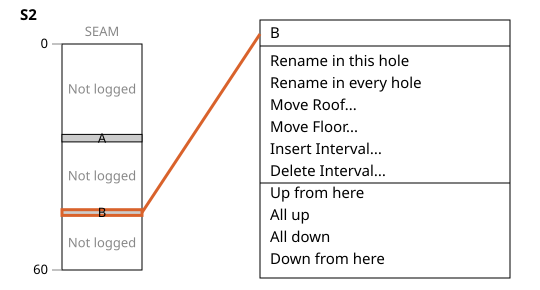
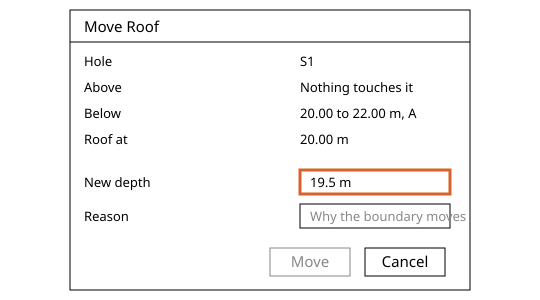
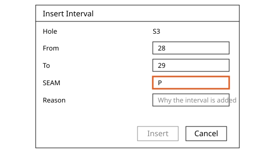
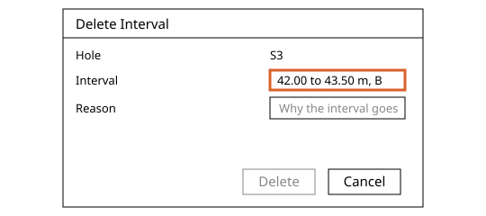
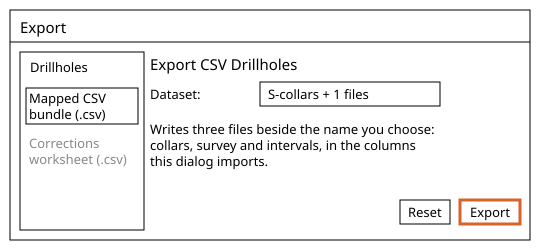
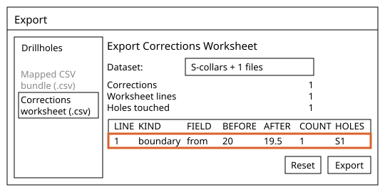

# Drill Hole Corrections in Incline Design

Written for Incline Design **v0.4.0-dev**.

How to correct a logged hole without losing the log: rename a seam, move a roof or floor, insert or delete an interval, then export the holes and the corrections worksheet. It follows [Drill Holes](../drill-holes/README.md), where the holes are loaded.

## Contents

1. [Concepts](#1-concepts)
2. [Rename Seam and Shift Names](#2-rename-seam-and-shift-names)
3. [Move Roof and Move Floor](#3-move-roof-and-move-floor)
4. [Insert Interval](#4-insert-interval)
5. [Delete Interval](#5-delete-interval)
6. [Export CSV Drillholes](#6-export-csv-drillholes)
7. [Export Corrections Worksheet](#7-export-corrections-worksheet)

---

## 1. Concepts

Where this fits: these tools serve [Exploration](../README.md#exploration), in the [Publish Model](../README.md#4-publish-model) stage, where a wrong pick is fixed before anything is built from it, and [Refine Model](../README.md#8-refine-model), where a pick shown to be wrong is corrected and the surfaces are built again. Next in the flow: [Control Strings](../control-strings/README.md).

A correction never overwrites the log. The new value is shown and the logged one is kept beside it, so the record shows what was changed. The holes can be exported as CSV again, and the corrections as a worksheet for review. Where this page says the console, it means the activity console. It is closed at first; **View > Show Console** shows and hides it and remembers your choice. A warning or an error also opens an alert with its words.

Undo of a correction from any tool on this page puts the old value or depth back and withdraws its record. Where it cannot, it says so once in an alert. "The correction to", the interval's depths, "of", the hole, and "could not be undone, so it is kept." means the change is still in place and its record stays. "was put back, but no record of it was found to withdraw." in place of the ending means the value went back but its record was missing, and "has no record and could not be put back." that neither happened. With several corrections the alert gives their count and names the first. Undo and redo of a deletion have alerts of their own, in [Delete Interval](#5-delete-interval).

## 2. Rename Seam and Shift Names

### What it does
Renames a seam in one hole or in every hole, or slides the seam names of one hole one run along it, as corrections that keep the logged names.
### Why a geologist uses it
A mislogged seam name, or a hole logged one seam out of step, is fixed on the spot and stays traceable to what the site logged.
### Where it is
Geology workspace > **Drillhole Inspector** > **Log** tab: right-click a seam in the strat column, then **Rename in this hole**, **Rename in every hole**, **Up from here**, **All up**, **All down** or **Down from here**.
### Before you start
Pick a hole as in [Drillhole Inspector](../drill-holes/README.md#5-drillhole-inspector) and open the **Log** tab. The strat column reads the field chosen under **Strat**, and the corrections act on that field. The four shift rows need a strat column for that field. The seam menu is not offered while another correction dialog is open.
### Steps
1. Right-click a seam in the strat column and choose **Rename in this hole** or **Rename in every hole**. **Rename Seam** shows the **Seam**. For one hole it shows the **Hole** and **Intervals in this horizon**: the clicked interval and the touching intervals either side that hold the same name. For every hole it shows **Every hole of** and the set's name, then **Intervals** and **Holes**: every interval of that name in the set.
2. **New name** starts as the seam's name. Type the new name and a **Reason**, then press **Rename**. Enter while no text box has focus renames; Enter in a text box only finishes typing in it. The console reads "Renamed", the old and new names, and "correction records proposed:" with one record for each interval renamed, for example "Renamed B to C; correction records proposed: 3". The **Data** tab shows each renamed cell as the new name with the logged one beside it, for example "C (B)".
3. To slide the names of one hole instead, right-click a seam and choose **All up** or **All down**. **Shift Names Up** or **Shift Names Down** shows the **Hole**, the **Field** and three counts of intervals: **Names moved**, **Named UNK** and **Not in the column, left alone**. Give a **Reason** and press **Shift**. Enter while no text box has focus shifts; Enter in a text box only finishes typing in it. Up, each run of one name takes the name of the run below it, and the deepest run takes the name that follows its own in the strat column, or UNK where the column has none. Down is the mirror. A run named UNK keeps its intervals until it is renamed. Depths never change. The console reads, for example, "Shifted the names of H1 up the hole: 1 moved, 1 named UNK, 0 not in the column left as they were".
4. **Up from here** and **Down from here** slide only the clicked horizon and the names on the side they move to, and name the clicked horizon UNK. The names on the other side stay.

### Options and defaults
None.
### What it refuses and why
- **Rename** stays greyed while **New name** is empty or unchanged, or **Reason** is empty. **Shift** stays greyed while **Reason** is empty or no name would move.
- A rename that would put the name out of the strat column's order in the hole first opens **Out of Sequence**. It reads "Renaming", the two names, and "puts it out of the strat column's order in this hole." For **Rename in every hole** it ends "in", the number of holes, and "hole." or "holes." (one hole reads "hole"). **OK** renames anyway, **Cancel** goes back.
- A new name that is the name of one of the field's working sections, in any case, while that section does not hold the code, is refused with a warning: "The code", the code, "of", the field, "is the name of the working section", the section, then ", which does not hold it; a section may share its name only with a code it holds." A rename in one hole and a shift put the hole in quotes first, for example "'H1': The code C of SEAM is the name of the working section C, which does not hold it; a section may share its name only with a code it holds." A shift is refused the same way when a name it would move clashes.
- If no interval holds the old name when **Rename** runs, the console warns "No interval holds", the name, and "any more; nothing was renamed". If the field has lost its strat column when **Shift** runs, it warns the field and "has no strat column; nothing was shifted". If no interval of the hole names a code in the column, it warns "No interval of", the hole, "names a code in the column;", the count, and "not in the column left as they were".
- **Up from here** and **Down from here** are greyed when the name is not in the strat column, hover *This name is not in the field's strat column, so there is no horizon to move from*. All four are greyed when the field has no column, hover *This field has no strat column yet; build one in the inspector's Column tab*.
- Each is one undo step and is kept when the project is saved and reopened.
### Related tools
[Strat Column](../drill-holes/README.md#7-strat-column), [Working Sections](../drill-holes/README.md#4-working-sections), [Move Roof and Move Floor](#3-move-roof-and-move-floor), [Export Corrections Worksheet](#7-export-corrections-worksheet).

## 3. Move Roof and Move Floor

### What it does
Moves the roof or floor of one logged interval to a new depth, as a correction that keeps the logged depth.
### Why a geologist uses it
A pick that reads too high or too low is corrected where it is read, and the site's logged depth stays beside it.
### Where it is
Geology workspace > **Drillhole Inspector** > **Log** tab: right-click a seam in the strat column, then **Move Roof...** or **Move Floor...**
### Before you start
Pick the hole as in [Drillhole Inspector](../drill-holes/README.md#5-drillhole-inspector) and open the **Log** tab. The strat column reads the field chosen under **Strat**, and the correction acts on that field. The seam menu is not offered while another correction dialog is open.
### Steps
1. Right-click a seam in the strat column and choose **Move Roof...** or **Move Floor...** The dialog shows the **Hole**, the interval **Above** and the interval **Below** the boundary, each as its depths and name or "Nothing touches it", and the boundary's present depth as **Roof at** or **Floor at**.
2. Type the new depth under **New depth** and a **Reason**. The field stops at 0 and at the hole's end: its total depth, or its deepest interval or survey station where that is deeper. The log draws the move at the depth typed, with a dashed guide across it. The note below says what the move does. Where an interval touches the boundary on the other side it reads "The touching interval on the other side follows, so no gap or overlap opens." Where nothing touches it reads "Nothing touches this interval above, so its roof moves alone." or "Nothing touches this interval below, so its floor moves alone." Each ends "The depths as logged are kept; the new depth is proposed as a correction."
3. Press **Move**. It is one undo step, kept when the project is saved and reopened. The console reads "Moved a boundary of", the hole, and the old and new depths, for example "Moved a boundary of H1 from 20.00 m to 19.50 m; correction records proposed: 1". The **Data** tab shows the moved depth with the logged one beside it, for example **From** as "19.50 (20.00)". **Move Floor** works the same on the **To** side.

### Options and defaults
| Option | Default | What it does |
| --- | --- | --- |
| **New depth** | The current depth | Where the boundary goes, 0 to the hole's end. A **Reason** is also required. |

### What it refuses and why
- **Move** stays greyed while **Reason** is empty, the depth is unchanged or the depth is refused. A touching interval on the other side follows, so no gap or overlap opens. Any change to the data closes the dialog. The dialog's note says why a depth is refused. A depth at the far edge of the interval above or below the boundary gives "The interval", its depths, and "would be left with no thickness.", for example "The interval 20.00 to 22.00 m would be left with no thickness." A depth beyond that edge gives "The depth is past the far edge of the interval" and its depths. A floor with nothing touching below, moved into the next interval, gives "Nothing touches this interval below, and the depth runs into the next one, which starts at" and that interval's roof. A roof with nothing touching above, moved into the interval before it, gives "Nothing touches this interval above, and the depth runs into the one before it, which ends at" and that interval's floor. "The interval is no longer in the hole." means the picked interval has gone.
- If the boundary has moved since the dialog opened, **Move** changes nothing and the console warns "The boundary of", the hole, and "has changed since the dialog opened; nothing was moved". A depth refused when **Move** runs warns "Boundary of", the hole, "not moved:" and the reason, in the words of the notes above.
### Related tools
[Insert Interval](#4-insert-interval), [Delete Interval](#5-delete-interval), [Drillhole Inspector](../drill-holes/README.md#5-drillhole-inspector), [Export Corrections Worksheet](#7-export-corrections-worksheet).

## 4. Insert Interval

### What it does
Adds an interval the site never logged to one hole, trimming or splitting what it overlaps, as a correction.
### Why a geologist uses it
A seam the log missed, or a parting inside one, is put into the hole where it belongs, marked as never logged.
### Where it is
Geology workspace > **Drillhole Inspector** > **Log** tab: right-click a seam in the strat column, or a stretch where nothing is logged, then **Insert Interval...** The second menu is titled **Not logged**.
### Before you start
Pick the hole as in [Drillhole Inspector](../drill-holes/README.md#5-drillhole-inspector) and open the **Log** tab. The strat column reads the field chosen under **Strat**, and the new interval takes a code of that field. The menu is not offered while another correction dialog is open.
### Steps
1. Right-click the strat column on a seam, or on a stretch where nothing is logged, and choose **Insert Interval...** **Insert Interval** shows the **Hole**. From the **Not logged** menu, **From** and **To** start filled in with the whole unlogged stretch. From a seam's menu both start blank, with the hint "0 to" and the hole's end.
2. Type **From** and **To**, a code beside the field's own name (for example `SEAM`), and a **Reason**. The code field offers the field's codes as you type; a code not among them is typed in full. Where the interval's table has other code fields, each has a field of its own: only the first must be given, and the others take the values of an interval the new one splits.
3. Over a logged interval the note says what changes: **Trims** with each interval of the field the new one overlaps at one edge, whose roof or floor moves to the new interval's edge, and **Splits** with one it falls inside, which is cut in two. Under them it reads "The new interval is marked never logged and proposed as a correction. An interval of this field it overlaps is trimmed, and one it falls inside is split; the depths as logged are kept."
4. Press **Insert**. The console reads "Inserted", the code, the depths and the hole, then "correction records proposed:" and the count, which grows with each interval trimmed or split, for example "Inserted P from 28.00 m to 29.00 m in H1; correction records proposed: 1". The **Data** tab lists the new row with "(not logged)" after its **From**, for example "28.00 (not logged)". It is one undo step, kept when the project is saved and reopened.

### Options and defaults
None.
### What it refuses and why
- **Insert** stays greyed while **Reason** is empty or a note below refuses. Notes: "Type the depths the new interval runs from and to." / "From is not a depth. Type a number of metres with a decimal point, such as 40.5; a comma is not read as a decimal." (or "To is not a depth.") / "Give the interval a code." / "From must be above To." / "The depth is outside the hole, 0 to" and the hole's end / "The interval would cover", an interval of the field with its depths and name, and "whole; that is a deletion, not an insertion.", for example "The interval would cover 22.00 to 24.00 m, A, whole; that is a deletion, not an insertion." / "The interval would overlap", the depths of a row of the field's table that holds other data but no value in the field, then ", a row of this table with no value in this field, which is never trimmed." / "The hole is no longer in the set."
- A code that is the name of one of its field's working sections, in any case, while that section does not hold the code, is refused in the note and **Insert** stays greyed: "The code", the code, "of", the field, "is the name of the working section", the section, then ", which does not hold it; a section may share its name only with a code it holds."
- A refusal met when **Insert** runs changes nothing and warns "Interval not inserted in", the hole, then ":" and the reason, in the words of the notes above.
- A code out of the strat column's order in the hole, for example a deeper seam's code inserted above a shallower seam, opens **Out of Sequence**: "Inserting", the code, and "puts it out of the strat column's order in this hole." **OK** inserts anyway, **Cancel** goes back.
### Related tools
[Delete Interval](#5-delete-interval), [Move Roof and Move Floor](#3-move-roof-and-move-floor), [Strat Column](../drill-holes/README.md#7-strat-column), [Working Sections](../drill-holes/README.md#4-working-sections).

## 5. Delete Interval

### What it does
Takes one whole interval out of the interpreted data of a hole, as a correction that holds the row.
### Why a geologist uses it
A row that should never have been logged is removed where it is read, and what the site logged is kept.
### Where it is
Geology workspace > **Drillhole Inspector** > **Log** tab: right-click a seam in the strat column, then **Delete Interval...**
### Before you start
Pick the hole as in [Drillhole Inspector](../drill-holes/README.md#5-drillhole-inspector) and open the **Log** tab. The strat column reads the field chosen under **Strat**. The menu is not offered while another correction dialog is open.
### Steps
1. Right-click a seam in the strat column and choose **Delete Interval...** **Delete Interval** shows the **Hole** and the **Interval**, its depths and name. Give a **Reason** and press **Delete**.
2. The console reads "Deleted", the depths and the hole, for example "Deleted 42.00 m to 43.50 m in H1; correction records proposed: 1". The row leaves the interpreted data with every field it holds, and its ground reads as not logged. The **Data** tab keeps the logged row, listed after the hole's own rows with "(deleted)" after its **From**, for example "42.00 (deleted)". A row that was inserted and then deleted is not listed, as it was never logged. It is one undo step, kept when the project is saved and reopened.

### Options and defaults
None.
### What it refuses and why
- **Delete** stays greyed while **Reason** is empty. Any change to the dataset closes the dialog. If the row is no longer the one picked, the note reads "This row is no longer the one picked. Close the dialog and pick the interval again." and **Delete** stays greyed; met when **Delete** runs, nothing is deleted and the console warns the hole and "has changed since the dialog opened; nothing was deleted".
- Undo that cannot put the row back says so once in an alert, and keeps the correction: "The deleted row", its depths and hole, and "could not be put back, so its correction is kept.", for example "The deleted row 42.00 to 43.50 m of H1 could not be put back, so its correction is kept." Redo of a row that is no longer there warns "The row", its depths and hole, and "is no longer the one deleted, so it was not taken out." With several rows the alert gives their count and names the first.
### Related tools
[Insert Interval](#4-insert-interval), [Move Roof and Move Floor](#3-move-roof-and-move-floor), [Drillhole Inspector](../drill-holes/README.md#5-drillhole-inspector), [Export Corrections Worksheet](#7-export-corrections-worksheet).

## 6. Export CSV Drillholes

### What it does
Writes one loaded drill hole set as three CSV files: collars, survey and intervals.
### Why a geologist uses it
The set, with its corrected depths and names, can be read in a spreadsheet, kept, or imported again with nothing to map.
### Where it is
Any workspace: **File > Export...** In the window, click **Mapped CSV bundle (.csv)** under **Drillholes** in the left list.
### Before you start
A project is open and a drill hole set is loaded, as in [Import Drill Holes](../drill-holes/README.md#2-import-drill-holes).
### Steps
1. Choose **File > Export...** and click **Mapped CSV bundle (.csv)** under **Drillholes**. The right side is headed **Export CSV Drillholes**. Choose the set under **Dataset**, click **Export** and choose a folder. The suggested name is built from the set's name and ends `_collars.csv`.
2. Three files are written there, named from your name less a trailing `_collars`: for example the name `holes_collars.csv` writes `holes_collars.csv`, `holes_survey.csv` and `holes_intervals.csv`. The collars file has `HOLEID`, `EAST`, `NORTH`, `RL`, `DIAMETER` and `TOTAL_DEPTH`; a hole with no diameter or no total depth leaves that cell empty, for example `H1,1000,1000,100,,60`. The survey file has `HOLEID`, `DEPTH`, `AZIMUTH` and `DIP`; a hole that came in with no survey writes no survey row, so it reads back the same way. The intervals file has `HOLEID`, `FROM` and `TO`, then one column for each field of the set under its name, holding the corrected depths and values. The console reports "Exported three drillhole CSVs to" and the folder.

On the web build each file is a separate browser download with the same names, and there is no folder to choose.
### Options and defaults
None beyond the **Dataset** list, which starts on the first loaded set.
### What it refuses and why
- **Export** stays greyed while no dataset is chosen, and **File > Export...** is greyed with no project open.
- An alert says "Drillhole CSV export failed:" and the reason when a file cannot be written, or "The selected drillhole dataset is no longer loaded" if the set was unloaded first.
### Related tools
[Import Drill Holes](../drill-holes/README.md#2-import-drill-holes), [Export Corrections Worksheet](#7-export-corrections-worksheet).

## 7. Export Corrections Worksheet

### What it does
Writes a set's corrections as a worksheet for review, and beside it a file with every correction record this build can read.
### Why a geologist uses it
A senior can read the changes as a short list, one line per group of alike changes, and write a decision on each line. The logged values are never touched.
### Where it is
Any workspace: **File > Export...** In the window, click **Corrections worksheet (.csv)** under **Drillholes** in the left list.
### Before you start
A project is open and a loaded drill hole set holds at least one correction, made with the tools on this page. A set with none has nothing to export.
### Steps
1. Choose **File > Export...** and click **Corrections worksheet (.csv)** under **Drillholes**. Choose the set under **Dataset**. The window shows **Corrections** (the number of records), **Worksheet lines** and **Holes touched**, and a table of the lines. With more than 20 lines the table shows the first 20 and says "The first 20 of" the number of "lines."
2. Click **Export** and choose a folder. The suggested name is built from the set's name and ends `_worksheet.csv`. Beside it Incline writes the corrections file, named from your name less a trailing `_worksheet` and ending `_corrections.csv`: one row per record with the worksheet `LINE` it falls on. The console reports "Exported the corrections worksheet to" the worksheet path "and the corrections beside it to" the other.
3. The worksheet columns are `LINE`, `KIND`, `FIELD`, `BEFORE`, `AFTER`, `COUNT`, `HOLES`, `FROM`, `TO`, `AUTHOR`, `DATE`, `REASON`, `STATUS` and `DECISION`. Value changes with the same field, before, after and reason share one line, with `COUNT` and the `HOLES` listed. Each roof or floor move, insertion and deletion is a line of its own. `KIND` is value, boundary, insertion or deletion. A boundary's `FIELD` is from for a roof nothing touches above, and to for a floor or a shared roof. `FROM` and `TO` are the logged depths of the interval on a line of one record, and empty on a line of several. `AUTHOR` is empty, `DATE` is the time of the change, `STATUS` reads proposed for a new correction, and `DECISION` is left empty for the senior. For example, a roof with nothing touching above, moved from 20 to 19.5 on the interval 20 to 22 of H1, reads line 1, boundary, from, 20, 19.5, 1, H1, 20, 22, an empty `AUTHOR`, the time of the change, the reason, proposed and an empty `DECISION`.

On the web build the two files are separate browser downloads with the same names, and there is no folder to choose.
### Options and defaults
None beyond the **Dataset** list, which starts on the first loaded set.
### What it refuses and why
- **Export** stays greyed while the set has no corrections, and the window says "This set has no corrections to review." If they are undone while the save dialog is open, an alert says the set's name and "has no corrections to export", or "has no corrections this build can read" when the set holds only records this build cannot read.
- Correction records this build cannot read, from a later build or a damaged file, are kept in the project as saved but are not exported: after the files are written an alert says "The corrections worksheet of" the set "leaves out" their number.
- An alert says "Corrections worksheet export failed:" and the reason, when a file cannot be written.
### Related tools
[Move Roof and Move Floor](#3-move-roof-and-move-floor), [Export CSV Drillholes](#6-export-csv-drillholes).
