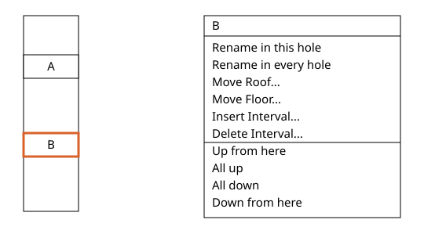
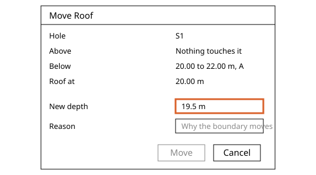
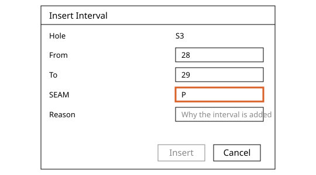
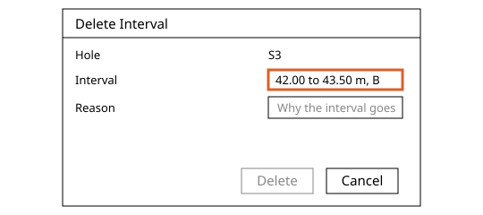
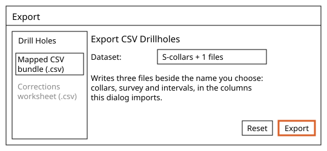
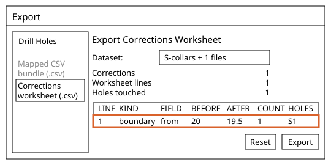

# Drill Hole Corrections in Incline Design

Written for Incline Design **v0.4.0-dev**.

How to correct a logged hole without losing the log: rename a seam, move a roof or floor, insert or delete an interval, then export the holes and the corrections worksheet. It follows [Drill Holes](../drill-holes/README.md), which loads the holes used here.

## Contents

1. [Concepts](#1-concepts)
2. [Rename Seam and Shift Names](#2-rename-seam-and-shift-names)
3. [Move Roof and Move Floor](#3-move-roof-and-move-floor)
4. [Insert Interval](#4-insert-interval)
5. [Delete Interval](#5-delete-interval)
6. [Export CSV Drillholes](#6-export-csv-drillholes)
7. [Export Corrections Worksheet](#7-export-corrections-worksheet)

---

## 1. Concepts

Where this fits: these tools serve [Exploration](../README.md#exploration), in the [Publish Model](../README.md#4-publish-model) stage, where a wrong pick is fixed before anything is built from it, and [Refine Model](../README.md#8-refine-model), where a pick shown to be wrong is corrected and the surfaces are built again. Next in the flow: [Control Strings](../control-strings/README.md).

A correction never overwrites the log. The new value is shown and the logged one is kept beside it, so the record shows what was changed. The holes can be exported as CSV again, and the corrections as a worksheet for review. Where this page says the console, it means the activity console. It is closed at first; **View > Show Console** shows and hides it and remembers your choice. A warning or an error also opens an alert with its words.

The examples use the S1 to S3 set loaded on the [Drill Holes](../drill-holes/README.md#2-import-drill-holes) page, with seams A and B as tabled there. Each example starts from the holes as loaded: undo it before the next one, as each correction is one undo step. Leave the holes as loaded when you go on, because the pages after this one use the logged picks.

## 2. Rename Seam and Shift Names

### What it does
Renames a seam in one hole or in every hole, or slides the seam names of one hole one run along it, as corrections that keep the logged names.
### Why a geologist uses it
A mislogged seam name, or a hole logged one seam out of step, is fixed on the spot and stays traceable to what the site logged.
### Where it is
Geology workspace > **Borehole Inspector** > **Log** tab: right-click a seam in the strat column, then **Rename in this hole**, **Rename in every hole**, **Up from here**, **All up**, **All down** or **Down from here**.
### Before you start
Pick a hole as in [Borehole Inspector](../drill-holes/README.md#5-borehole-inspector), open the **Log** tab and keep `SEAM` as the **Strat** field. The seam menu is not offered while another correction dialog is open.
### Steps
1. Pick S2, right-click B in the strat column and choose **Rename in this hole**. **Rename Seam** shows **Seam** B, **Hole** S2, **Intervals in this horizon** 1. **New name** starts as B. Replace it with C, give a **Reason**, press **Rename**. The console reads "Renamed B to C; correction records proposed: 1". The **Data** tab shows the cell as "C (B)", the new name with the logged one beside it. Had you chosen **Rename in every hole**, the dialog shows **Every hole of** `S-collars + 1 files`, **Intervals** 3, **Holes** 3, and the console ends "correction records proposed: 3".
2. Pick S1, right-click A and choose **All up**. **Shift Names Up** shows **Hole** S1, **Field** `SEAM`, **Names moved** 1, **Named UNK** 1, **Not in the column, left alone** 0. Give a **Reason**, press **Shift**. The console reads "Shifted the names of S1 up the hole: 1 moved, 1 named UNK, 0 not in the column left as they were". A now reads B and the last run reads UNK, until renamed. Depths never change. **Up from here** and **Down from here** slide only the names on one side of the clicked seam and name it UNK.

### Options and defaults
None.
### What it refuses and why
- **Rename** stays greyed while **New name** is empty or unchanged, or **Reason** is empty. **Shift** stays greyed while **Reason** is empty or no name would move.
- A rename that would put the name out of the strat column's order in the hole first opens **Out of Sequence**. It reads "Renaming", the two names, and "puts it out of the strat column's order in this hole." **OK** renames anyway, **Cancel** goes back.
- **Up from here** and **Down from here** are greyed when the name is not in the strat column, hover *This name is not in the field's strat column, so there is no horizon to move from*. All four are greyed when the field has no column, hover *This field has no strat column yet; build one in the inspector's Column tab*.
- Each is one undo step and is kept when the project is saved and reopened.
### Related tools
[Strat Column](../drill-holes/README.md#7-strat-column), [Working Sections](../drill-holes/README.md#4-working-sections), [Move Roof and Move Floor](#3-move-roof-and-move-floor), [Export Corrections Worksheet](#7-export-corrections-worksheet).

## 3. Move Roof and Move Floor

### What it does
Moves the roof or floor of one logged interval to a new depth, as a correction that keeps the logged depth.
### Why a geologist uses it
A pick that reads too high or too low is corrected where it is read, and the site's logged depth stays beside it.
### Where it is
Geology workspace > **Borehole Inspector** > **Log** tab: right-click a seam in the strat column, then **Move Roof...** or **Move Floor...**
### Before you start
Pick the hole as in [Borehole Inspector](../drill-holes/README.md#5-borehole-inspector), open the **Log** tab and keep `SEAM` as the **Strat** field. The seam menu is not offered while another correction dialog is open.
### Steps
1. Pick S1, right-click A in the strat column and choose **Move Roof...** **Move Roof** shows **Hole** S1, **Above** "Nothing touches it", **Below** "20.00 to 22.00 m, A", **Roof at** 20.00 m. Type 19.5 under **New depth** and a **Reason**. The field stops at 0 and at the hole's end, 60 m. The log draws a dashed guide at that depth.
2. Press **Move**. It is one undo step, kept when the project is saved and reopened. The console reads "Moved a boundary of S1 from 20.00 m to 19.50 m; correction records proposed: 1". The **Data** tab shows **From** as "19.50 (20.00)", the new depth with the logged one beside it. **Move Floor** works the same on the **To** side.

### Options and defaults
| Option | Default | What it does |
| --- | --- | --- |
| **New depth** | The current depth | Where the boundary goes, 0 to the hole's end. A **Reason** is also required. |

### What it refuses and why
- **Move** stays greyed while **Reason** is empty, the depth is unchanged or the depth is refused. A touching interval on the other side follows, so no gap or overlap opens. Any change to the data closes the dialog. In the dialog's note, on S1, a roof of A at 22 gives "The interval 20.00 to 22.00 m would be left with no thickness.", at 23 "The depth is past the far edge of the interval 20.00 to 22.00 m.". A floor of A at 41 gives "Nothing touches this interval below, and the depth runs into the next one, which starts at 40.00 m." A roof of B at 21 gives "Nothing touches this interval above, and the depth runs into the one before it, which ends at 22.00 m."
### Related tools
[Insert Interval](#4-insert-interval), [Delete Interval](#5-delete-interval), [Borehole Inspector](../drill-holes/README.md#5-borehole-inspector), [Export Corrections Worksheet](#7-export-corrections-worksheet).

## 4. Insert Interval

### What it does
Adds an interval the site never logged to one hole, trimming or splitting what it overlaps, as a correction.
### Why a geologist uses it
A seam the log missed, or a parting inside one, is put into the hole where it belongs, marked as never logged.
### Where it is
Geology workspace > **Borehole Inspector** > **Log** tab: right-click a seam in the strat column, or a stretch where nothing is logged, then **Insert Interval...** The second menu is titled **Not logged**.
### Before you start
Pick the hole as in [Borehole Inspector](../drill-holes/README.md#5-borehole-inspector), open the **Log** tab and keep `SEAM` as the **Strat** field. The menu is not offered while another correction dialog is open.
### Steps
1. Pick S3 and right-click the strat column between A and B, at 30 m. Choose **Insert Interval...** **Insert Interval** shows **Hole** S3, with **From** 24 and **To** 42 filled in as the whole unlogged stretch. From a seam's menu both start blank, hint "0 to 60 m". Type **From** 28, **To** 29, `SEAM` P and a **Reason**, then press **Insert**. The console reads "Inserted P from 28.00 m to 29.00 m in S3; correction records proposed: 1". The **Data** tab lists the row as "28.00 (not logged)".
2. Over a logged seam the note says what changes. **From** 23 **To** 25 with code A shows "Trims 22.00 to 24.00 m, A": that floor moves to 23.00 and the console ends "correction records proposed: 2". A new interval inside a seam shows "Splits" and the seam is cut in two. It is one undo step, kept when the project is saved and reopened.

### Options and defaults
None.
### What it refuses and why
- **Insert** stays greyed while **Reason** is empty or a note below refuses. Notes: "Type the depths the new interval runs from and to." / "From is not a depth. Type a number of metres with a decimal point, such as 40.5; a comma is not read as a decimal." / "Give the interval a code." / "From must be above To." / "The depth is outside the hole, 0 to 60 m." / "The interval would cover 22.00 to 24.00 m, A, whole; that is a deletion, not an insertion." for A from 22 to 25 in S3.
- A code out of the strat column's order, such as B at 10 to 12 in S1 above A, opens **Out of Sequence**: "Inserting B puts it out of the strat column's order in this hole." **OK** inserts anyway, **Cancel** goes back.
### Related tools
[Delete Interval](#5-delete-interval), [Move Roof and Move Floor](#3-move-roof-and-move-floor), [Strat Column](../drill-holes/README.md#7-strat-column), [Working Sections](../drill-holes/README.md#4-working-sections).

## 5. Delete Interval

### What it does
Takes one whole interval out of the interpreted data of a hole, as a correction that holds the row.
### Why a geologist uses it
A row that should never have been logged is removed where it is read, and what the site logged is kept.
### Where it is
Geology workspace > **Borehole Inspector** > **Log** tab: right-click a seam in the strat column, then **Delete Interval...**
### Before you start
Pick the hole as in [Borehole Inspector](../drill-holes/README.md#5-borehole-inspector), open the **Log** tab and keep `SEAM` as the **Strat** field. The menu is not offered while another correction dialog is open.
### Steps
1. Pick S3, right-click B in the strat column and choose **Delete Interval...** **Delete Interval** shows **Hole** S3 and **Interval** "42.00 to 43.50 m, B". Give a **Reason** and press **Delete**.
2. The console reads "Deleted 42.00 m to 43.50 m in S3; correction records proposed: 1". The row leaves the interpreted data with every field it holds, and its ground reads as not logged. The **Data** tab keeps the logged row, marked "42.00 (deleted)". It is one undo step, kept when the project is saved and reopened.

### Options and defaults
None.
### What it refuses and why
- **Delete** stays greyed while **Reason** is empty. Any change to the dataset closes the dialog.
- Undo that cannot put the row back says so once in an alert, and keeps the correction: "The deleted row 42.00 to 43.50 m of S3 could not be put back, so its correction is kept." Redo of a row that is no longer there warns "The row 42.00 to 43.50 m of S3 is no longer the one deleted, so it was not taken out."
### Related tools
[Insert Interval](#4-insert-interval), [Move Roof and Move Floor](#3-move-roof-and-move-floor), [Borehole Inspector](../drill-holes/README.md#5-borehole-inspector), [Export Corrections Worksheet](#7-export-corrections-worksheet).

## 6. Export CSV Drillholes

### What it does
Writes one loaded drill hole set as three CSV files: collars, survey and intervals.
### Why a geologist uses it
The set, with its corrected depths and names, can be read in a spreadsheet, kept, or imported again with nothing to map.
### Where it is
Any workspace: **File > Export...** In the window, click **Mapped CSV bundle (.csv)** under **Drill Holes** in the left list.
### Before you start
Load the S1 to S3 set from [Import Drill Holes](../drill-holes/README.md#2-import-drill-holes). A project must be open.
### Steps
1. Choose **File > Export...** and click **Mapped CSV bundle (.csv)** under **Drill Holes**. The right side is headed **Export CSV Drillholes** and **Dataset** reads `S-collars + 1 files`. Click **Export**, choose a folder and keep the suggested name `S-collars + 1 files_collars.csv`.
2. Three files are written there, named from your name less a trailing `_collars`: `S-collars + 1 files_collars.csv`, `S-collars + 1 files_survey.csv` and `S-collars + 1 files_intervals.csv`. The collars file has `HOLEID`, `EAST`, `NORTH`, `RL`, `DIAMETER` and `TOTAL_DEPTH`, so S1 reads `S1,1000,1000,100,,60`. The survey file has `HOLEID`, `DEPTH`, `AZIMUTH` and `DIP`, with no rows here as S1 to S3 have no hole surveys. The intervals file has `HOLEID`, `FROM`, `TO` and `SEAM`. The console reports "Exported three drillhole CSVs to" and the folder.

On the web build each file is a separate browser download with the same names, and there is no folder to choose.
### Options and defaults
None beyond the **Dataset** list, which starts on the first loaded set.
### What it refuses and why
- **Export** stays greyed while no dataset is chosen, and **File > Export...** is greyed with no project open.
- An alert says "Drillhole CSV export failed:" and the reason when a file cannot be written, or "The selected drillhole dataset is no longer loaded" if the set was unloaded first.
### Related tools
[Import Drill Holes](../drill-holes/README.md#2-import-drill-holes), [Export Corrections Worksheet](#7-export-corrections-worksheet).

## 7. Export Corrections Worksheet

### What it does
Writes a set's corrections as a worksheet for review, and beside it a file with every correction record.
### Why a geologist uses it
A senior can read the changes as a short list, one line per group of alike changes, and write a decision on each line. The logged values are never touched.
### Where it is
Any workspace: **File > Export...** In the window, click **Corrections worksheet (.csv)** under **Drill Holes** in the left list.
### Before you start
Make one correction, for example the S1 seam A roof moved from 20.0 to 19.5 as in [Move Roof and Move Floor](#3-move-roof-and-move-floor). A set with none has nothing to export.
### Steps
1. Choose **File > Export...** and click **Corrections worksheet (.csv)** under **Drill Holes**. **Dataset** reads `S-collars + 1 files`, with **Corrections** 1, **Worksheet lines** 1, **Holes touched** 1 and a table of the lines.
2. Click **Export**, choose a folder and keep `S-collars + 1 files_worksheet.csv`. Beside it Incline writes `S-collars + 1 files_corrections.csv`, one row per record with the worksheet `LINE` it falls on. The console reports "Exported the corrections worksheet to" the worksheet path "and the corrections beside it to" the other.
3. The worksheet columns are `LINE`, `KIND`, `FIELD`, `BEFORE`, `AFTER`, `COUNT`, `HOLES`, `FROM`, `TO`, `AUTHOR`, `DATE`, `REASON`, `STATUS` and `DECISION`. The example is line 1, boundary, from, 20, 19.5, 1, S1, 20, 22, an empty `AUTHOR`, the time of the change, your reason, proposed and an empty `DECISION` for the senior. Value changes with the same field, before, after and reason share one line, with `COUNT` and the `HOLES` listed. Each roof or floor move, insertion and deletion is a line of its own.

On the web build the two files are separate browser downloads with the same names, and there is no folder to choose.
### Options and defaults
None beyond the **Dataset** list, which starts on the first loaded set.
### What it refuses and why
- **Export** stays greyed while the set has no corrections, and the window says "This set has no corrections to review." If they were undone before saving, an alert says "S-collars + 1 files has no corrections to export".
- An alert says "Corrections worksheet export failed:" and the reason, when a file cannot be written.
### Related tools
[Move Roof and Move Floor](#3-move-roof-and-move-floor), [Export CSV Drillholes](#6-export-csv-drillholes).
