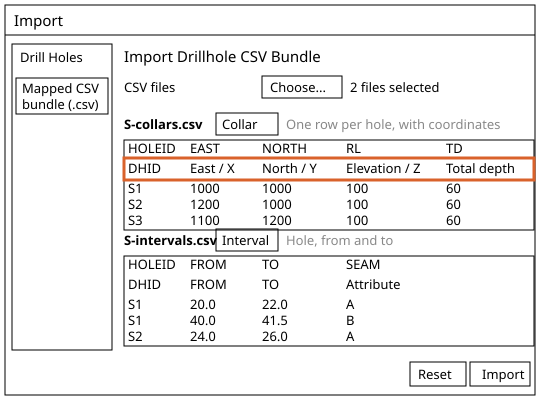
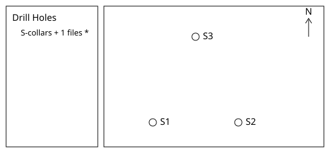
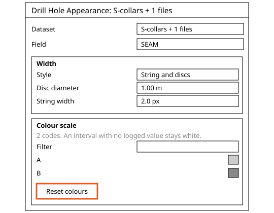
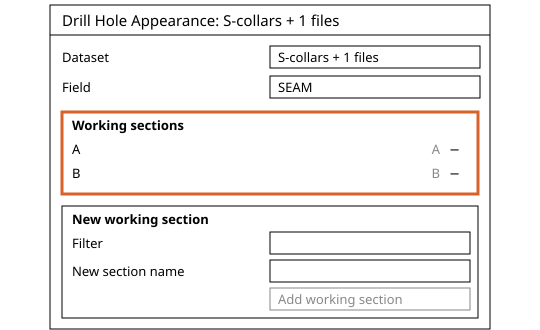
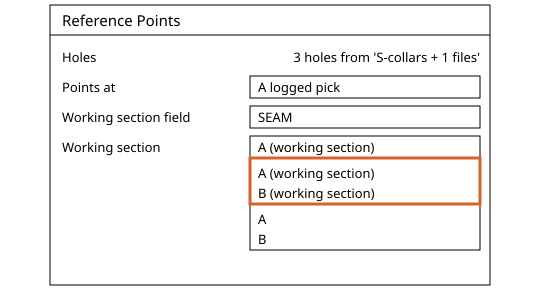
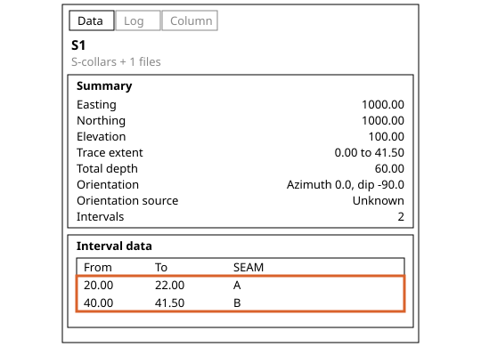
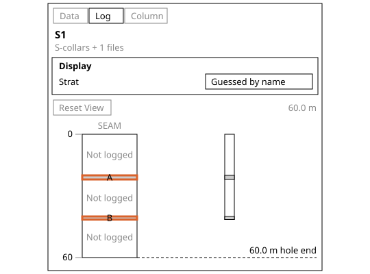
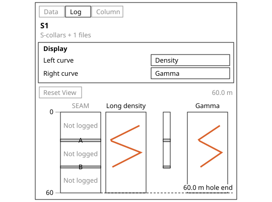
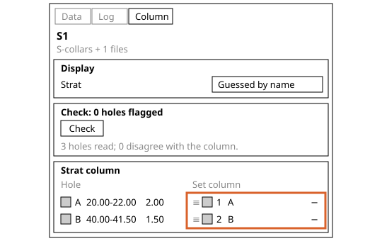
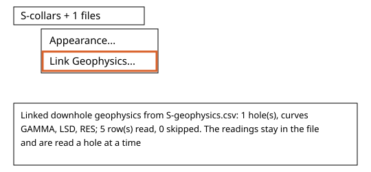

# Drill Holes in Incline Design

Written for Incline Design **v0.4.0-dev**.

How to load drill holes from CSV, group their seams into working sections, check the logged roof and floor picks in the borehole inspector against the log curves and the strat column, and link downhole geophysics. For geologists and students working in the Geology workspace.

## Contents

1. [Concepts](#1-concepts)
2. [Import Drill Holes](#2-import-drill-holes)
3. [Drill Hole Appearance](#3-drill-hole-appearance)
4. [Working Sections](#4-working-sections)
5. [Borehole Inspector](#5-borehole-inspector)
6. [Log Curves](#6-log-curves)
7. [Strat Column](#7-strat-column)
8. [Link Geophysics](#8-link-geophysics)

---

## 1. Concepts

Where this fits: these tools serve [Exploration](../README.md#exploration), in the [Publish Model](../README.md#4-publish-model) stage of the geologist's life cycle: the logged holes are loaded and checked against each other before anything is built from them. Surfaces and Seam Thickness read the holes and their working sections. Next in the flow: [Drill Hole Corrections](../drill-hole-corrections/README.md), where a wrong pick is corrected.

### Drill hole data
A drill hole set is a few tables: a **collar** table (one row per hole: where it starts and, if known, its total depth), an optional **survey** table (which way the hole goes), and **interval** tables (from and to depth along the hole, with a logged value such as a seam code). Downhole geophysics is a separate file linked afterwards.

- Depths are metres along the hole. An interval's **roof** is its **From** depth, its **floor** is its **To** depth.
- A **seam code** is one logged value for a stretch of hole. A **working section** is a named set of seam or ply codes mined as one unit, for example plies A1 and A2 as seam A.
- The **strat column** is the order of the codes of one field, top of the ground first. Incline fills it at import from the order most holes give.
- A change made by hand is a **correction**, and a correction never overwrites the log: the new value is shown and the logged one is kept beside it, so the record shows what was changed.
- Holes with no survey table are drawn straight down.
- Where this page says the console, it means the activity console. It is closed at first; **View > Show Console** shows and hides it and remembers your choice. A warning or an error also opens an alert with its words.

The examples on this page use three synthetic vertical holes, collar elevation 100 m, total depth 60 m:

| Hole | East | North | Seam A (m) | Seam B (m) |
| --- | --- | --- | --- | --- |
| S1 | 1000 | 1000 | 20.0 to 22.0 | 40.0 to 41.5 |
| S2 | 1200 | 1000 | 24.0 to 26.0 | 44.0 to 45.5 |
| S3 | 1100 | 1200 | 22.0 to 24.0 | 42.0 to 43.5 |

The **Drill Holes** menu of the Geology workspace holds one entry, **Create Block Model...**, an estimation tool that takes one selected drill hole collection. It is not covered here. **Reference Points** and **Thickness Points**, which read the working sections made below, are on the **Modelling** menu.

## 2. Import Drill Holes

### What it does
Reads collar, survey and interval CSV files together as one drill hole set.
### Why a geologist uses it
Holes enter Incline as plain tables that can be typed, checked and re-exported. Incline works out which file is which and which column is which.
### Where it is
Any workspace: **File > Import...** In the window, open the **Drill Holes** group in the left list and click **Mapped CSV bundle (.csv)**.
### Before you start
Save these two files as UTF-8 text, named `S-collars.csv` and `S-intervals.csv`. No survey file is needed for vertical holes.
```
HOLEID,EAST,NORTH,RL,TD
S1,1000,1000,100,60
S2,1200,1000,100,60
S3,1100,1200,100,60
```
```
HOLEID,FROM,TO,SEAM
S1,20.0,22.0,A
S1,40.0,41.5,B
S2,24.0,26.0,A
S2,44.0,45.5,B
S3,22.0,24.0,A
S3,42.0,43.5,B
```
### Steps
1. Choose **File > Import...** and click **Mapped CSV bundle (.csv)** under **Drill Holes**.
2. Click **Choose...** beside **CSV files** and select both files together.
3. Check each file's purpose, shown beside its name. `S-collars.csv` reads **Collar** ("One row per hole, with coordinates"), `S-intervals.csv` reads **Interval** ("Hole, from and to"). Nothing needs mapping by hand: `HOLEID` is **DHID**, `EAST`, `NORTH` and `RL` are **East / X**, **North / Y** and **Elevation / Z**, `TD` is **Total depth**, and `SEAM` is an **Attribute**.
4. Click **Import**. No alert opens. In the console the row **Import Drillholes** ends with "Strat column filled for SEAM: 2 names; 0 holes disagree on SEAM. Check to review." Click the row to see "Loaded drillhole dataset 'S-collars + 1 files': 3 holes, 1 colour fields" above it.
5. With no survey table each hole is drawn straight down to its deepest logged interval (S1 to 41.5 m), not to its total depth of 60 m. The total depth is kept and shown in the inspector.





On the web build the files are chosen through the browser's file dialog; the rest is the same.
### Options and defaults
| Option | Default | What it does |
| --- | --- | --- |
| **File purpose** | Worked out from the rows and headers | **Choose purpose…**, **Collar**, **Survey**, **Interval**, **Explicit segments**, **Downhole geophysics** or **Ignore file**. |
| **Column role** | Worked out from the header | Per header: **Ignore**, **DHID**, **East / X**, **North / Y**, **Elevation / Z**, **Diameter**, **Total depth**, and for the other purposes **Depth**, **Azimuth**, **Dip**, **Inclination**, **FROM**, **TO**, **Start X**, **Start Y**, **Start Z**, **End X**, **End Y**, **End Z**, **Gamma (API)**, **Long-spaced density (g/cc)**, **Short-spaced density (g/cc)** or **Attribute**. |
| **Interval columns not recognised** | **Attribute** | Each becomes a field named by its header, numeric or coded by its values. |
| **Reset** | Button | Clears the chosen files and mappings. |

Headers read by themselves, any case, spaces and punctuation ignored: hole as `DHID`, `HOLEID`, `HOLE` or `ID`; `East`, `Easting` or `X`; `North`, `Northing` or `Y`; `Elevation`, `Elev`, `RL` or `Z`; **Total depth** as `TD`, `TotalDepth`, `HoleDepth`, `EOH` or `MaxDepth`.
### What it refuses and why
- **Import** stays greyed while a file still reads **Choose purpose…** (the window says "Choose a file purpose to map its columns."), while every file is ignored, or while geophysics has no collar file ("Add the collar file (or an explicit-segments file): downhole geophysics attaches to the holes it defines.").
- A second collar file is set to **Ignore file**; the one with most holes keeps **Collar**.
- "CSV file is empty" and "CSV headers must be nonblank and unique" show in the window as soon as the files are chosen; no file is listed for mapping and **Import** stays greyed. A row with From past To, or a negative From, is skipped, and an alert titled **Import Drillholes** opens; its **Details** list "Skipped a row: .../S-intervals.csv row 3 has invalid interval 22..20 for DHID 'S1'". If more than half of a file's rows fail, nothing is loaded and the warning reads "Failed to load drillholes:" and the reason.
- A total depth that is blank, zero, negative, not a number, or one of the no-data values 9999 and 99999 is left out, and the alert's **Details** count them per file; the hole is kept without a total depth.
### Related tools
[Drill Hole Appearance](#3-drill-hole-appearance), [Working Sections](#4-working-sections), [Borehole Inspector](#5-borehole-inspector), [Link Geophysics](#8-link-geophysics).

## 3. Drill Hole Appearance

### What it does
Sets how one drill hole dataset is drawn: the field that colours it, the hole width and the colour of each code.
### Why a geologist uses it
Holes coloured by seam code show where each seam sits across the area. The same dialog holds the working sections.
### Where it is
Any workspace: right-click a loaded dataset in the explorer, or right-click a hole in the viewport, then **Appearance...**
### Before you start
Load the S1 to S3 set from [Import Drill Holes](#2-import-drill-holes). The viewport entry acts on the whole dataset of the hole you click.
### Steps
1. Right-click the dataset and choose **Appearance...** The title reads **Drill Hole Appearance: S-collars + 1 files**. Under **Field** choose `SEAM`. The **Colour scale** card lists A and B and says "2 codes. An interval with no logged value stays white."
2. Click a colour to change it. The holes change at once, with nothing to confirm. **Reset colours** gives every code its starting colour. A numeric field shows **Preset**, **Add stop** and **Reset preset** instead. Escape or the close button shuts the dialog.


### Options and defaults
| Option | Default | What it does |
| --- | --- | --- |
| **Field** | **Uniform white** | Colours the holes by a field. A coded field also offers **SEAM by working section** once sections exist. |
| **Style** | **String and discs** | **Disc diameter** 1.00 m and **String width** 2.0 px. Or **True diameter**: **Of drilled diameter** 1.00x and **Never thinner than** 2.0 px. |

### What it refuses and why
- On **Uniform white** there is no **Colour scale** card, only "All rendered intervals are opaque white." The dialog closes if its dataset is unloaded.
### Related tools
[Working Sections](#4-working-sections), [Import Drill Holes](#2-import-drill-holes), [Borehole Inspector](#5-borehole-inspector).

## 4. Working Sections

### What it does
Names a set of seam or ply codes as one working section, which **Reference Points**, **Thickness Points** and colouring then treat as one unit.
### Why a geologist uses it
A seam logged as plies is one mining unit. A section lets a tool pick the whole seam, not one ply.
### Where it is
Any workspace: **Appearance...** on a drill hole dataset (right-click the dataset in the explorer, or right-click a hole in the viewport), then the **Working sections** and **New working section** cards.
### Before you start
Load the S1 to S3 set from [Import Drill Holes](#2-import-drill-holes). Set the **Field** to `SEAM`: the cards only show for a coded field.
### Steps
1. Right-click the dataset in the explorer and choose **Appearance...** The title reads **Drill Hole Appearance: S-collars + 1 files**.
2. Set **Field** to `SEAM`.
3. In **New working section**, tick A, type A in **New section name**, click **Add working section**. A appears under **Working sections** with its codes. A section may share its name with a code it holds, so the later layers keep the plain seam name.
4. Tick B, type B, click **Add working section**.
5. Open the **Field** list again: **SEAM by working section** is offered. Choose it to give each section one colour.



6. In Geology, select the dataset (or the three holes), choose **Modelling > Reference Points...**, and the **Working section** list offers **A (working section)** and **B (working section)** before the single codes A and B.



### Options and defaults
| Option | Default | What it does |
| --- | --- | --- |
| **Filter** | Empty | Narrows the code list by part of a code. |
| **New section name** | Empty | The section's name; Enter also adds it. |
| **Ticked codes** | None | Codes the section holds; a code in another section is not offered. |
| **Suggested from code names** | Collapsed, offered only when codes share a root of two or more characters (P1 and P1A); the header carries a count, for example **Suggested from code names (1)** | Add one suggestion, or **Add all**. Never applied unasked. |
| **Minus button** | One per section | Removes that section. |

Each change is one undo step. A hole set imported with a parent field can start with sections already made.
### What it refuses and why
- **Add working section** stays greyed until a code is ticked and the name passes.
- "Another working section of this field has that name." / "A code outside this section has that name. A section may share its name only with a code it holds." (so a section called A holding B is refused; A holding A is fine). An empty name leaves **Add working section** greyed.
- "A is already in working section A." when the new name is a code that another section already holds.
- Anything dropped on the way in opens an alert reading "Working sections not kept in 'S-collars + 1 files'." and the reasons.
### Related tools
[Drill Hole Appearance](#3-drill-hole-appearance), [Strat Column](#7-strat-column), [Borehole Inspector](#5-borehole-inspector).

## 5. Borehole Inspector

### What it does
Shows one hole in a panel down the right edge: its summary, its interval table and its log.
### Why a geologist uses it
It is where the logged roof and floor of every seam are read against the typed data, before anything is built from them.
### Where it is
Geology workspace only. Viewport bar: **Show Borehole Inspector (B)**, or press B. Canvas right-click on a hole: **Borehole Inspector**. **Hide Borehole Inspector (B)** or the close button shuts it.
### Before you start
Load a drill hole set and keep it visible. Click a hole in the viewport, or right-click it. The panel is hidden when you start the program.
### Steps
1. Switch to the Geology workspace and press B (not while a text box has focus).
2. Click hole S1. The panel names S1 and, below it, the dataset. The **Data** tab is open.
3. Under **Summary** read **Easting** 1000.00, **Northing** 1000.00, **Elevation** 100.00, **Trace extent** 0.00 to 41.50, **Total depth** 60.00, **Orientation** Azimuth 0.0, dip -90.0, **Orientation source** Unknown, **Intervals** 2.
4. Under **Interval data** read the rows: **From** 20.00, **To** 22.00, `SEAM` A; **From** 40.00, **To** 41.50, `SEAM` B. **From** is the roof, **To** the floor. Compare with the typed file.



5. Click the **Log** tab. The seam names A and B stand in the strat column beside the depth scale, each at its depths. Roll the wheel over the log to zoom, drag to walk down the hole, double-click to see the whole hole.



6. Click S2: the panel follows the pick. Click the lock button to hold one hole while you pick others.
### Options and defaults
| Option | Default | What it does |
| --- | --- | --- |
| **Tab** | **Data** | **Data**, **Log** or **Column**. |
| **Lock** | Off | *Hold this hole while you work on the ones around it.* |
| **Colour** (Log tab) | **Uniform white** until a field is chosen | What the hole ribbon is coloured by. |
| **Strat** (Log tab) | **Guessed by name** | The coded field whose names stand in the strat column. |

### What it refuses and why
- "No hole inspected" until a hole is picked.
- A hidden dataset hides its inspected hole too.
- Outside Geology there is no panel and no **Borehole Inspector** entry on the right-click.
- The **Data** tab lists nothing under **Interval data** for a hole with no intervals.
### Related tools
[Strat Column](#7-strat-column), [Log Curves](#6-log-curves), [Move Roof and Move Floor](../drill-hole-corrections/README.md#3-move-roof-and-move-floor), [Import Drill Holes](#2-import-drill-holes).

## 6. Log Curves

### What it does
Chooses which two linked geophysics curves the **Borehole Inspector** log draws, one either side of the hole.
### Why a geologist uses it
A seam logged in the intervals is read against its density and gamma response at the same depth. Another curve can take the place of either.
### Where it is
Geology workspace only: **Borehole Inspector** > **Log** tab > **Display**, the **Left curve** and **Right curve** lists.
### Before you start
Link the file `S-geophysics.csv` as in [Link Geophysics](#8-link-geophysics). It holds rows for S1 only. Without a link the two lists are not offered.
### Steps
1. Press B, click S1 and open the **Log** tab. **Left curve** reads **Density** and **Right curve** reads **Gamma**, drawn either side of the hole beside the strat column.
2. Open **Right curve**: the list reads **Density**, **Gamma**, `RES` and **None**. Choose `RES` and the right column draws `RES`. **None** drops a column. Click S2: the log says "No downhole geophysics for this hole", as the file holds no rows for S2.


### Options and defaults
| Option | Default | What it does |
| --- | --- | --- |
| **Left curve** | **Density** | **Density**, **Gamma**, any other numeric curve of the linked file, or **None**. A file curve named like a built-in one is listed as **Density (from file)** or **Gamma (from file)**. |
| **Right curve** | **Gamma** | The same list for the right column. |

### What it refuses and why
- A hole with curves but neither density nor gamma, both lists on their defaults: "No density or gamma log for this hole. Pick one of its other curves above." A chosen curve the hole lacks is named under the log, for example "No RES log for this hole". With the default curves, a panel too narrow leaves the right column out first with the note "Widen the panel to show gamma", then both with "Widen the panel to show density and gamma".
### Related tools
[Link Geophysics](#8-link-geophysics), [Borehole Inspector](#5-borehole-inspector), [Strat Column](#7-strat-column).

## 7. Strat Column

### What it does
Shows the order of a field's codes, top of the ground first, beside the inspected hole, and lets you reorder it, add codes and check which holes disagree.
### Why a geologist uses it
The column is the one stack every hole is read against. A hole that gives a seam in the wrong place stands out, and shifting seam names moves along this order.
### Where it is
Geology workspace only: **Borehole Inspector** > **Column** tab. The **Strat** list under **Display** chooses the field.
### Before you start
Load the S1 to S3 set, switch to the Geology workspace and click S1 with the **Borehole Inspector** open (B shows and hides it). Import has already filled the column; the console reads "Strat column filled for SEAM: 2 names; 0 holes disagree on SEAM. Check to review."
### Steps
1. Click the **Column** tab. The **Set column** side lists 1 A and 2 B. The **Hole** side shows S1's seams beside them as from, to and thickness: A 20.00-22.00 2.00 and B 40.00-41.50 1.50. The **Check** section is headed **Check: 0 holes flagged** and reads "3 holes read; 0 disagree with the column."
2. Click **Check**. The console adds "Checked SEAM of S-collars + 1 files: 3 holes, 0 flagged". **Flagged holes (0)** reads "No hole disagrees with the column."
3. Drag the handle beside a code to reorder, or click its minus button to remove it. A removed code sits under **Not in the column (1)**: **Add** puts it back at the bottom. Each change is one undo step. With the column set to B above A, **Check** shows a table of **Place**, **Now** and **Proposed**, with "moved" beside the rows that change. **Accept** sets the column to the order most holes give, **Cancel** leaves it.


### Options and defaults
| Option | Default | What it does |
| --- | --- | --- |
| **Strat** | **Guessed by name** | The coded field whose codes the column orders. |

### What it refuses and why
- With no column yet: "No strat column yet. Check to fill it with the order most holes give, or add the codes below and order them by hand." After a correction to the holes: "The holes have changed since the last check. Check again." After a change to the column: "The column has changed since the last check. Check again to see which holes disagree with it." A hole that gives codes in another order is flagged **Out of place** or **Overturned**, one that repeats a code **Repeated**. Each is listed under **Flagged holes** with an **Inspect** button.
### Related tools
[Working Sections](#4-working-sections), [Rename Seam and Shift Names](../drill-hole-corrections/README.md#2-rename-seam-and-shift-names), [Borehole Inspector](#5-borehole-inspector).

## 8. Link Geophysics

### What it does
Links a downhole geophysics CSV file to a drill hole dataset so its curves can be drawn beside each hole.
### Why a geologist uses it
Seams logged in the intervals are read against the geophysics of the same hole. The file stays where it is and is read a hole at a time.
### Where it is
Any workspace: right-click a loaded dataset in the explorer, or right-click a hole in the viewport, then **Link Geophysics...**
### Before you start
Load the S1 to S3 set from [Import Drill Holes](#2-import-drill-holes). Save these rows as `S-geophysics.csv`, UTF-8 text: five depths in S1 only, sorted by depth, low gamma and density in the coal.
```
HOLEID,DEPTH,GAMMA,LSD,RES
S1,10.0,85,2.45,40
S1,20.5,25,1.40,600
S1,21.5,28,1.42,550
S1,30.0,90,2.50,35
S1,40.75,30,1.45,500
```
### Steps
1. Right-click the dataset and choose **Link Geophysics...** Pick `S-geophysics.csv` in the file window, filtered to "Downhole geophysics CSV". Several files can be picked together. They are linked in name order and replace any link the dataset had.
2. When indexing finishes the console reports "Linked downhole geophysics from S-geophysics.csv: 1 hole(s), curves GAMMA, LSD, RES; 5 row(s) read, 0 skipped. The readings stay in the file and are read a hole at a time".
3. Headers are read by name, any case. `GAMMA` is the gamma curve, also read as `GAM` or `GR`. `LSD` is the long density, also `DENL`. `SSD` or `DENB` is the short density. `RES` is kept as a further curve because its cells are numbers. See [Log Curves](#6-log-curves).


### Options and defaults
None.
### What it refuses and why
- An alert reads "Load the drillhole dataset before linking geophysics to it" when the dataset is not loaded.
- A file that is empty, has no hole id or depth column, has no numeric curve, or is not grouped by hole is refused with an alert: "Downhole geophysics for 'S-collars + 1 files' could not be linked:" and the reason. Rows for holes the dataset does not define are not linked, and a warning counts them.
- If the file has moved by the next time the dataset is opened or loaded, the desktop app opens an alert that says it cannot be read, and the **Log** tab says "S-geophysics.csv is not where it was linked from." with a **Link Geophysics...** button. In a browser the file has to be picked again each time the project is opened: no alert opens, and the **Log** tab says "Pick S-geophysics.csv again to show its geophysics: a browser page cannot reopen a file by itself." with a **Pick S-geophysics.csv...** button.
### Related tools
[Log Curves](#6-log-curves), [Import Drill Holes](#2-import-drill-holes), [Borehole Inspector](#5-borehole-inspector).
