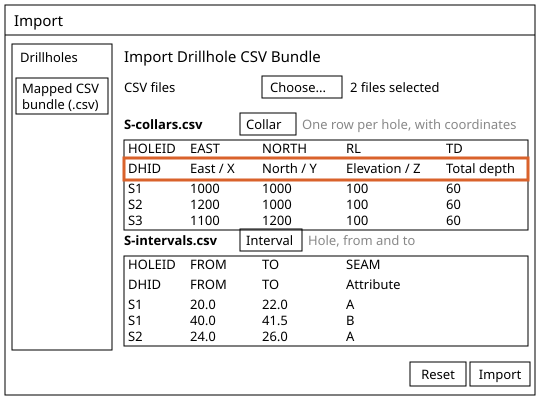
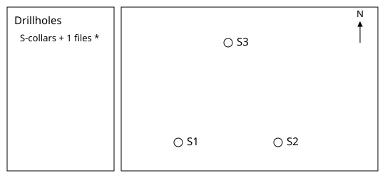
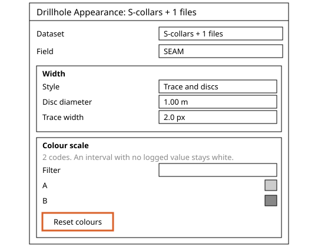
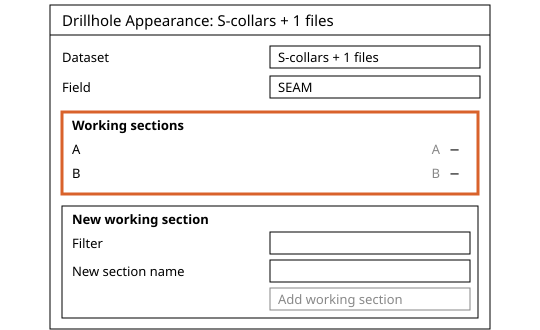
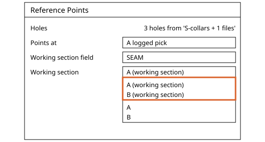
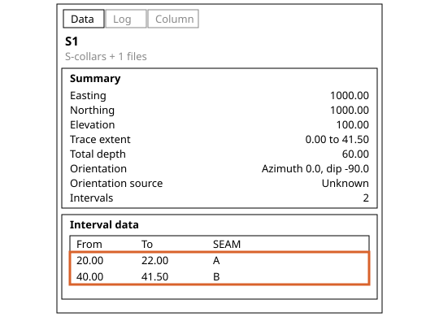
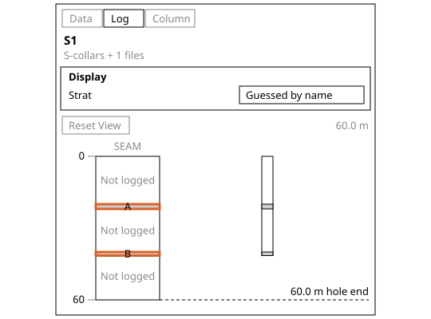
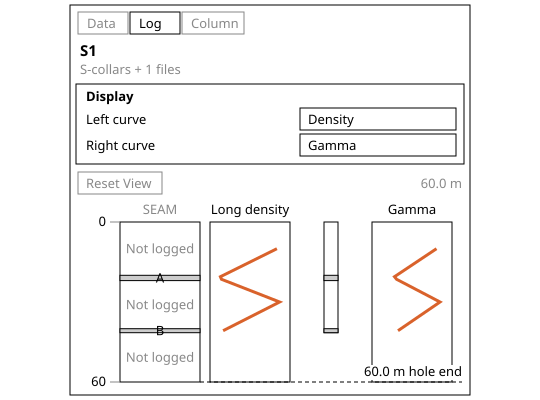
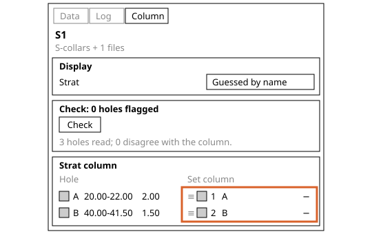
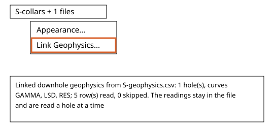

# Drill Holes in Incline Design

Written for Incline Design **v0.4.0-dev**.

How to load drill holes from CSV, group their seams into working sections, check the logged roof and floor picks in the **Drillhole Inspector** against the log curves and the strat column, and link downhole geophysics. For geologists and students working in the Geology workspace.

## Contents

1. [Concepts](#1-concepts)
2. [Import Drill Holes](#2-import-drill-holes)
3. [Drill Hole Appearance](#3-drill-hole-appearance)
4. [Working Sections](#4-working-sections)
5. [Drillhole Inspector](#5-drillhole-inspector)
6. [Log Curves](#6-log-curves)
7. [Strat Column](#7-strat-column)
8. [Link Geophysics](#8-link-geophysics)

---

## 1. Concepts

Where this fits: these tools serve [Exploration](../README.md#exploration), in the [Publish Model](../README.md#4-publish-model) stage of the geologist's life cycle: the logged holes are loaded and checked against each other before anything is built from them. Surfaces and Seam Thickness read the holes and their working sections. Next in the flow: [Drill Hole Corrections](../drill-hole-corrections/README.md), where a wrong pick is corrected.

### Drill hole data
A drill hole set is a few tables: a **collar** table (one row per hole: where it starts and, if known, its total depth), an optional **survey** table (which way the hole goes), and **interval** tables (from and to depth along the hole, with a logged value such as a seam code). Downhole geophysics is a separate file linked afterwards.

- Depths are metres along the hole. An interval's **roof** is its **From** depth, its **floor** is its **To** depth.
- A **seam code** is one logged value for a stretch of hole. A **working section** is a named set of seam or ply codes mined in one pass, for example plies A1 and A2 as seam A.
- The **strat column** is the order of the codes of one field, top of the ground first. Incline fills it at import from the order most holes give.
- A change made by hand is a **correction**, and a correction never overwrites the log: the new value is shown and the logged one is kept beside it, so the record shows what was changed.
- Holes with no survey table are drawn straight down.
- Where this page says the console, it means the activity console. It is closed at first; **View > Show Console** shows and hides it and remembers your choice. A warning or an error also opens an alert with its words.

The **Drillholes** menu of the Geology workspace holds one entry, **Create Block Model...**, an estimation tool that takes one selected drill hole collection. It is not covered here. **Reference Points** and **Thickness Points**, which read the working sections made below, are on the **Modelling** menu.

## 2. Import Drill Holes

### What it does
Reads collar, survey and interval CSV files together as one drill hole set.
### Why a geologist uses it
Holes enter Incline as plain tables that can be typed, checked and re-exported. Incline works out which file is which and which column is which.
### Where it is
Any workspace: **File > Import...** In the window, open the **Drillholes** group in the left list and click **Mapped CSV bundle (.csv)**.
### Before you start
A project is open. The tables are CSV files saved as UTF-8 text, each with one header row. A set needs a collar table, or an explicit-segments table in its place; a survey table and interval tables are added as the holes have them. The smallest set is a collar table and one interval table:
```
HOLEID,EAST,NORTH,RL,TD
H1,1000,1000,100,60
H2,1200,1000,100,60
```
```
HOLEID,FROM,TO,SEAM
H1,20.0,22.0,A
H1,40.0,41.5,B
H2,24.0,26.0,A
```
### Steps
1. Choose **File > Import...** and click **Mapped CSV bundle (.csv)** under **Drillholes**.
2. Click **Choose...** beside **CSV files** and select every file of the set together.
3. Check each file's purpose, shown beside its name with the reason for it: **Collar** ("One row per hole, with coordinates"), **Survey** ("Hole, depth and direction"), **Interval** ("Hole, from and to"). Where one is wrong, choose the right purpose from its list.
4. Check each column's role, shown under its header, and change any that is wrong. An interval column that is not recognised comes in as an **Attribute**.
5. Click **Import**. The dataset appears under **Drillholes** in the explorer, named after the collar file and the number of other files, for example `collars + 1 files`.
6. Read the result in the console, on the row **Import Drillholes**: "Loaded drillhole dataset", with the count of holes and colour fields, then "Strat column filled for", with the field the column was filled from, the count of its names and the count of holes that disagree with their order. An import with nothing skipped or left out opens no alert.

Each hole is drawn to its deepest logged interval, not to its total depth, and straight down when the set has no survey table. The total depth is kept and shown in the **Drillhole Inspector**.





On the web build the files are chosen through the browser's file dialog; the rest is the same.
### Options and defaults
| Option | Default | What it does |
| --- | --- | --- |
| **File purpose** | Worked out from the rows and headers | **Choose purpose…**, **Collar**, **Survey**, **Interval**, **Explicit segments**, **Downhole geophysics** or **Ignore file**. |
| **Column role** | Worked out from the header | Per header: **Ignore**, **DHID**, **East / X**, **North / Y**, **Elevation / Z**, **Diameter**, **Total depth**, and for the other purposes **Depth**, **Azimuth**, **Dip**, **Inclination**, **FROM**, **TO**, **Start X**, **Start Y**, **Start Z**, **End X**, **End Y**, **End Z**, **Gamma (API)**, **Long-spaced density (g/cc)**, **Short-spaced density (g/cc)** or **Attribute**. |
| **Interval columns not recognised** | **Attribute** | Each becomes a field named by its header, numeric or coded by its values. |
| **Reset** | Button | Clears the chosen files and mappings. |

Headers read by themselves, any case, spaces and punctuation ignored: hole as `DHID`, `HOLEID`, `HOLE` or `ID`; `East`, `Easting` or `X`; `North`, `Northing` or `Y`; `Elevation`, `Elev`, `RL` or `Z`; **Total depth** as `TD`, `TotalDepth`, `HoleDepth`, `EOH` or `MaxDepth`.
### What it refuses and why
- **Import** stays greyed while a file still reads **Choose purpose…** (the window says "Choose a file purpose to map its columns."), while every file is ignored, or while geophysics has no collar file ("Add the collar file (or an explicit-segments file): downhole geophysics attaches to the holes it defines.").
- A second collar file is set to **Ignore file**; the one with most holes keeps **Collar**.
- "CSV file is empty" and "CSV headers must be nonblank and unique" show in the window as soon as the files are chosen; no file is listed for mapping and **Import** stays greyed. A row with From past To, or a negative From, is skipped, and an alert titled **Import Drillholes** opens and lists each one, for example "Skipped a row: .../intervals.csv row 3 has invalid interval 22..20 for DHID 'H1'". If more than half of a file's rows fail, nothing is loaded and the warning reads "Failed to load drillholes:" and the reason.
- A total depth that is blank, zero, negative, not a number, or one of the no-data values 9999 and 99999 is left out, and the alert counts them per file; the hole is kept without a total depth.
### Related tools
[Drill Hole Appearance](#3-drill-hole-appearance), [Working Sections](#4-working-sections), [Drillhole Inspector](#5-drillhole-inspector), [Link Geophysics](#8-link-geophysics).

## 3. Drill Hole Appearance

### What it does
Sets how one drill hole dataset is drawn: the field that colours it, the hole width and the colour of each code.
### Why a geologist uses it
Holes coloured by seam code show where each seam sits across the area. The same dialog holds the working sections.
### Where it is
Any workspace: right-click a loaded dataset in the explorer, or right-click a hole in the viewport, then **Appearance...**
### Before you start
A drill hole dataset is loaded: the explorer does not offer **Appearance...** on a dataset that is not loaded. The viewport entry acts on the whole dataset of the hole you click.
### Steps
1. Right-click the dataset in the explorer, or a hole in the viewport, and choose **Appearance...** The title reads **Drillhole Appearance:** and the dataset's name.
2. Under **Field** choose the field to colour by. For a coded field the **Colour scale** card lists each code with its colour, under a note that counts the codes, for example "2 codes. An interval with no logged value stays white."
3. Click a colour to change it. The holes change at once, with nothing to confirm. **Reset colours** gives every code its starting colour; while a **Filter** is typed it reads **Reset shown colours** and resets only the codes shown. A numeric field shows **Preset**, **Add stop** and **Reset preset** instead.
4. Escape, Enter while no text box has focus, or the close button shuts the dialog.


### Options and defaults
| Option | Default | What it does |
| --- | --- | --- |
| **Dataset** | The dataset right-clicked | Switches the dialog to another loaded dataset. |
| **Field** | **Uniform white** | Colours the holes by a field. A coded field also offers the field's name followed by **by working section**, for example **SEAM by working section**, once it has sections. |
| **Style** | **Trace and discs** for imported holes | **Disc diameter** 1.00 m and **Trace width** 2.0 px. Or **True diameter**: **Of drilled diameter** 1.00x and **Never thinner than** 2.0 px. |
| **Filter** | Empty | Narrows the code list by part of a code. |

### What it refuses and why
- On **Uniform white** there is no **Colour scale** card, only "All rendered intervals are opaque white." The dialog closes if its dataset is unloaded.
### Related tools
[Working Sections](#4-working-sections), [Import Drill Holes](#2-import-drill-holes), [Drillhole Inspector](#5-drillhole-inspector).

## 4. Working Sections

### What it does
Names a set of seam or ply codes as one working section, which **Reference Points**, **Thickness Points** and colouring then treat as one unit.
### Why a geologist uses it
A working section is what the pit takes in one pass. Operations and engineering plan by the section, not by the plies in the log: plies thinner than the digger's teeth cannot be mined apart, so they go together as one section. Where the quality changes at a ply boundary and the difference matters, the section stops at that boundary and the plies either side are separate sections. A section lets a tool pick the whole mined unit, not one ply.
### Where it is
Any workspace: **Appearance...** on a drill hole dataset (right-click the dataset in the explorer, or right-click a hole in the viewport), then the **Working sections** and **New working section** cards.
### Before you start
A drill hole dataset is loaded and has a coded field, such as a seam or ply code: the cards only show while **Field** is a coded field.
### Steps
1. Right-click the dataset in the explorer, or a hole in the viewport, and choose **Appearance...**
2. Set **Field** to the coded field that holds the seam or ply codes.
3. In **New working section**, tick the codes the section holds, type its name in **New section name** and click **Add working section**. The section appears under **Working sections**, its name beside its codes. A section may share its name with a code it holds, so the points layer that **Reference Points** makes from it can keep the plain seam name.
4. Repeat for each section. A code already in a section is no longer offered.
5. Open the **Field** list again: the field's name followed by **by working section** is offered, for example **SEAM by working section**. Choose it to give each section one colour; a code in no section keeps its own.



6. In Geology, select the dataset or its holes and choose **Modelling > Reference Points...** The **Working section** list offers each section as its name followed by **(working section)**, for example **A (working section)**, before the single codes. **Thickness Points** offers the same list.



### Options and defaults
| Option | Default | What it does |
| --- | --- | --- |
| **Filter** | Empty | Narrows the code list by part of a code. |
| **New section name** | Empty | The section's name; Enter also adds it. |
| **Ticked codes** | None | Codes the section holds; a code in another section is not offered. |
| **Suggested from code names** | Collapsed, offered only when codes share a root of two or more characters (P1 and P1A); the header carries a count, for example **Suggested from code names (1)** | Add one suggestion, or **Add all**. Never applied unasked. |
| **Minus button** | One per section | Removes that section. |

Each change is one undo step. A hole set imported with a parent field can start with sections already made.
### What it refuses and why
- **Add working section** stays greyed until a code is ticked and the name passes.
- "Another working section of this field has that name." / "A code outside this section has that name. A section may share its name only with a code it holds." (so a section called A holding B is refused; A holding A is fine). An empty name leaves **Add working section** greyed.
- When the new name is a code that another section already holds, the message names the code and that section, for example "A is already in working section A."
- A section that cannot be kept when the sections are set, for example by **Add all**, is dropped, and an alert reads "Working sections not kept in", the dataset's name, and each dropped section's name with its reason. A section a saved project cannot restore is reported when the project is opened, with the dataset's name, the count of sections and the reasons.
### Related tools
[Drill Hole Appearance](#3-drill-hole-appearance), [Strat Column](#7-strat-column), [Drillhole Inspector](#5-drillhole-inspector).

## 5. Drillhole Inspector

### What it does
Shows one hole in a panel down the right edge: its summary, its interval table and its log.
### Why a geologist uses it
It is where the logged roof and floor of every seam are read against the typed data, before anything is built from them.
### Where it is
Geology workspace only. Viewport bar: **Show Drillhole Inspector (B)**, or press B. Canvas right-click on a hole: **Drillhole Inspector**. **Hide Drillhole Inspector (B)** or the close button shuts it.
### Before you start
A drill hole dataset is loaded and visible. The panel is hidden when you start the program.
### Steps
1. Switch to the Geology workspace and press B (not while a text box has focus).
2. Click a hole in the viewport, or right-click it and choose **Drillhole Inspector**. The panel names the hole and, below it, its dataset. The **Data** tab is open.
3. Under **Summary** read the collar's **Easting**, **Northing** and **Elevation**; the **Trace extent**, the depths the drawn hole runs from and to; the **Total depth**, a row only when the dataset records total depths, reading "Not recorded" for a hole without one; the **Orientation** as azimuth and dip, for example "Azimuth 0.0, dip -90.0" for a vertical hole; the **Orientation source**, "Measured", "Assumed" or "Unknown"; and the number of **Intervals**.
4. Under **Interval data** read one row per interval: **From**, **To** and a column for each field of the dataset. **From** is the roof, **To** the floor. Compare them with the source table.



5. Click the **Log** tab. The codes of the **Strat** field stand in the strat column beside the depth scale, each at its depths. Roll the wheel over the log to zoom, drag to walk down the hole, double-click to see the whole hole.



6. Click another hole: the panel follows the pick. Click the lock button to hold one hole while you pick others.
### Options and defaults
| Option | Default | What it does |
| --- | --- | --- |
| **Tab** | **Data** | **Data**, **Log** or **Column**. |
| **Lock** | Off | *Hold this hole while you work on the ones around it.* |
| **Colour** (Log tab) | The dataset's **Field** from **Appearance...**, **Uniform white** until one is chosen | What the hole ribbon is coloured by; a change here also changes the dataset's colouring. |
| **Strat** (Log tab) | **Guessed by name** | The coded field whose names stand in the strat column. |

### What it refuses and why
- "No hole inspected" until a hole is picked.
- A hidden dataset hides its inspected hole too.
- Outside Geology there is no panel and no **Drillhole Inspector** entry on the right-click.
- The **Data** tab has no **Interval data** section for a hole with no intervals.
### Related tools
[Strat Column](#7-strat-column), [Log Curves](#6-log-curves), [Move Roof and Move Floor](../drill-hole-corrections/README.md#3-move-roof-and-move-floor), [Import Drill Holes](#2-import-drill-holes).

## 6. Log Curves

### What it does
Chooses which two linked geophysics curves the **Drillhole Inspector** log draws, one either side of the hole.
### Why a geologist uses it
A seam logged in the intervals is read against its density and gamma response at the same depth. Another curve can take the place of either.
### Where it is
Geology workspace only: **Drillhole Inspector** > **Log** tab > **Display**, the **Left curve** and **Right curve** lists.
### Before you start
A downhole geophysics file is linked to the dataset, as in [Link Geophysics](#8-link-geophysics). Without a link the two lists are not offered.
### Steps
1. In the Geology workspace press B, click a hole and open the **Log** tab. **Left curve** reads **Density** and **Right curve** reads **Gamma**, drawn either side of the hole beside the strat column. **Density** draws the long-spaced and the short-spaced density together.
2. Open **Left curve** or **Right curve**: the list reads **Density**, **Gamma**, each other curve of the linked file by its header, and **None**. Choose a curve and that column draws it. **None** drops the column. The choice holds for every hole of the dataset.
3. Click another hole. A hole with no rows in the linked file shows "No downhole geophysics for this hole".


### Options and defaults
| Option | Default | What it does |
| --- | --- | --- |
| **Left curve** | **Density** | **Density**, **Gamma**, any other numeric curve of the linked file, or **None**. A file curve named like a built-in one is listed as **Density (from file)** or **Gamma (from file)**. |
| **Right curve** | **Gamma** | The same list for the right column. |

### What it refuses and why
- A hole with curves but neither density nor gamma, both lists on their defaults: "No density or gamma log for this hole. Pick one of its other curves above." A chosen curve the hole lacks is named under the log, for example "No RES log for this hole". A panel too narrow for a column leaves it out with a note that names its curve, for example "Widen the panel to show gamma", or "Widen the panel to show density and gamma" when both default columns are left out.
### Related tools
[Link Geophysics](#8-link-geophysics), [Drillhole Inspector](#5-drillhole-inspector), [Strat Column](#7-strat-column).

## 7. Strat Column

### What it does
Shows the order of a field's codes, top of the ground first, beside the inspected hole, and lets you reorder it, add codes and check which holes disagree.
### Why a geologist uses it
The column is the one stack every hole is read against. A hole that gives a seam in the wrong place stands out, and shifting seam names moves along this order.
### Where it is
Geology workspace only: **Drillhole Inspector** > **Column** tab. The **Strat** list under **Display** chooses the field.
### Before you start
A drill hole dataset with a coded field is loaded. In the Geology workspace the **Drillhole Inspector** is open (B shows and hides it) on a hole you clicked. An import fills an empty column with the order most holes give and says so in the console, in a line starting "Strat column filled for" (see [Import Drill Holes](#2-import-drill-holes)).
### Steps
1. Click the **Column** tab. The **Set column** side lists the codes in order, numbered from the top. The **Hole** side shows the inspected hole's codes beside them, each with its from and to depth and its thickness. The **Check** section gives the count of holes flagged in its heading, and the counts of holes read and of those that disagree below it, for example "3 holes read; 0 disagree with the column."
2. Click **Check**. The console adds a line naming the field and the dataset with the counts of holes and flags, for example "Checked SEAM of collars + 1 files: 3 holes, 0 flagged". **Flagged holes** lists each hole that disagrees, or reads "No hole disagrees with the column." An empty column is filled with the order most holes give.
3. Drag the handle beside a code to reorder, or click its minus button to remove it. A removed code sits under **Not in the column**: **Add** puts it back at the bottom. Each change is one undo step.
4. When most holes give the codes another order than the column, the **Check** section reads "Most holes give these codes a different order from the column." Click **Show differences** for a table of **Place**, **Now** and **Proposed**, with "moved" beside each code that would move. **Accept** sets the column to the order most holes give, **Cancel** leaves it.


### Options and defaults
| Option | Default | What it does |
| --- | --- | --- |
| **Strat** | **Guessed by name** | The coded field whose codes the column orders. |

### What it refuses and why
- With no column yet: "No strat column yet. Check to fill it with the order most holes give, or add the codes below and order them by hand." After a correction to the holes: "The holes have changed since the last check. Check again." After a change to the column: "The column has changed since the last check. Check again to see which holes disagree with it." A hole that gives codes in another order is flagged **Out of place** or **Overturned**, one that repeats a code **Repeated**. Each is listed under **Flagged holes** with an **Inspect** button.
### Related tools
[Working Sections](#4-working-sections), [Rename Seam and Shift Names](../drill-hole-corrections/README.md#2-rename-seam-and-shift-names), [Drillhole Inspector](#5-drillhole-inspector).

## 8. Link Geophysics

### What it does
Links a downhole geophysics CSV file to a drill hole dataset so its curves can be drawn beside each hole.
### Why a geologist uses it
Seams logged in the intervals are read against the geophysics of the same hole. The file stays where it is and is read a hole at a time.
### Where it is
Any workspace: right-click a loaded dataset in the explorer, or right-click a hole in the viewport, then **Link Geophysics...**
### Before you start
A drill hole dataset is loaded: the explorer does not offer **Link Geophysics...** on a dataset that is not loaded. The file is a CSV saved as UTF-8 text with one header row: a hole id column, a depth column and one column per curve, with the dataset's hole ids. Keep each hole's rows together; within a hole the depths may come in any order. For example:
```
HOLEID,DEPTH,GAMMA,LSD,RES
H1,10.0,85,2.45,40
H1,20.5,25,1.40,600
H2,24.5,28,1.42,550
```
### Steps
1. Right-click the dataset in the explorer, or a hole in the viewport, and choose **Link Geophysics...** Pick the file in the file window, filtered to "Downhole geophysics CSV". Several files can be picked together. They are linked in name order and replace any link the dataset had.
2. When indexing finishes the console reports, for each file, "Linked downhole geophysics from" with the file's name, the count of holes, the curves kept and the counts of rows read and skipped, then "The readings stay in the file and are read a hole at a time".
3. Check the curves the console names. Headers are read by name, any case, spaces and punctuation ignored. The depth is `DEPTH`, also `DEP` or `MD`. The gamma curve is `GAMMA`, also `GAM`, `GR`, `GRDE` or `GAMM`. The long density is `LSD`, also `DENL`, `LongDensity` or `LongSpacedDensity`. The short density is `SSD`, also `DENB`, `ShortDensity` or `ShortSpacedDensity`. Any other column whose cells are mostly numbers is kept as a further curve. See [Log Curves](#6-log-curves).


### Options and defaults
None.
### What it refuses and why
- An alert reads "Load the drillhole dataset before linking geophysics to it" when the dataset is not loaded.
- A file that is empty, has no hole id or depth column, has no numeric curve, has its holes' rows split across too many runs, or has more than half its rows unreadable is refused with an alert: "Downhole geophysics for", the dataset's name, "could not be linked:" and the reason. Rows for holes the dataset does not define are not linked, and a warning counts them.
- If the file has moved by the next time the dataset is opened or loaded, the desktop app opens an alert that says it cannot be read, and the **Log** tab names the file and says it "is not where it was linked from." with a **Link Geophysics...** button. In a browser the file has to be picked again each time the project is opened: no alert opens, and the **Log** tab asks for it by name, for example "Pick geophysics.csv again to show its geophysics: a browser page cannot reopen a file by itself." with a **Pick geophysics.csv...** button.
### Related tools
[Log Curves](#6-log-curves), [Import Drill Holes](#2-import-drill-holes), [Drillhole Inspector](#5-drillhole-inspector).
