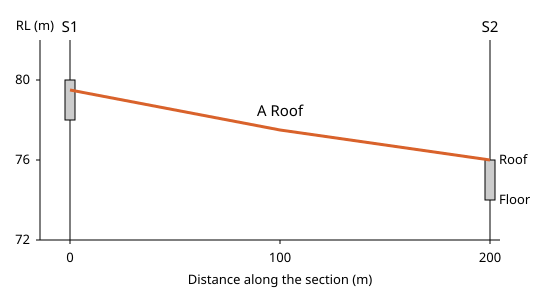
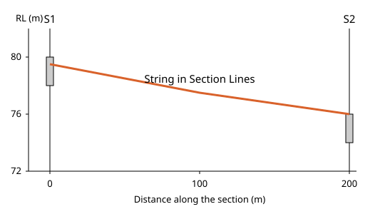
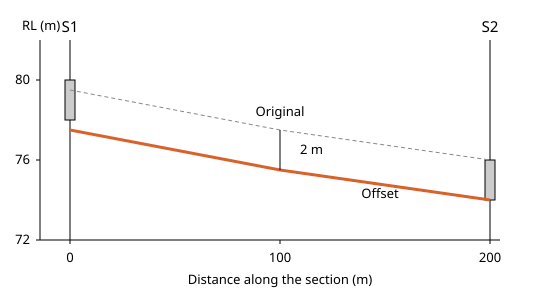

# Sections in Incline Design

Written for Incline Design **v0.4.0-dev**.

This page covers working in a vertical section through the drill holes: seeing where a surface cuts the section, saving those cut lines, and editing strings in the plane of the section. It is for geologists working in the Geology workspace.

## Contents

1. [Concepts](#1-concepts)
2. [Surface Lines on Section](#2-surface-lines-on-section)
3. [Save Surface Lines as Strings](#3-save-surface-lines-as-strings)
4. [Offset, Chamfer and Relimit on a Section](#4-offset-chamfer-and-relimit-on-a-section)

---

## 1. Concepts

Where this fits: these tools serve step 4 of [Modelling](../README.md#modelling), in the Publish Model stage of the geologist's life cycle. A section is where the reference surface is checked against the holes. Next in the flow: [Seam Thickness](../thickness/README.md).

A vertical section is a cut through the ground along a line you choose, seen from the side. Drill holes that lie near the line show as vertical traces with their seam intervals. Height is up the screen, distance along the line is across it.

A geologist checks the reference surface, roof or floor, against the holes in section because a surface can look right in plan and still miss the picks. In section you see at once whether the surface passes through each logged seam interval, or rides above or below it. Where it misses, **Save Surface Lines as Strings** keeps the lines the shown surfaces cut on the section as strings on a new layer. Move each line to its own surface's layer, redraw it in the plane of the section to your interpretation, and build again.

How a section is opened (this is the generic slice view, not geology work):

- Click **Vertical Slice View** on the viewport bar, then click two points for the line of the section. The same button reads **Exit Slice View** while a section is up.
- Drill holes, strings, points and block models show within the width of the slab, with **3D view** ticked or not. Surfaces show as the line where they cross the plane, or as a slab when **3D view** is ticked in the slice options.
- Clicking a hole in a section picks only a part of a hole the section draws.

General drawing tools (**Create Point**, **Create Line**, **Create Polyline**, **Measure Distance**, **Move Design** and the rest) work on a section as they do in plan and are not repeated here. **Drag a Vertex** and **Nudge RL...**, which work on a section too, are in [String Vertices](../string-vertices/README.md).

Where this page says the console, it means the activity console. It is closed at first; **View > Show Console** shows and hides it and remembers your choice. A warning or an error also opens an alert with its words.

## 2. Surface Lines on Section

### What it does
Draws, on the section, the line where each shown surface crosses the section plane, in the surface's own colour.
### Why a geologist uses it
To see, hole by hole, whether the surface runs through the logged seam interval, above it or below it, as Concepts says.
### Where it is
Geology workspace > **Geology Design > Surface Lines on Section**
### Before you start
A section is up, as in [Concepts](#1-concepts), and a surface is loaded and shown. For the example, build `A Roof` as in [Build Surface](../surfaces/README.md#3-build-surface), click **Vertical Slice View**, then click (1000, 1000) and (1200, 1000).
### Steps
1. Choose **Geology Design > Surface Lines on Section**. The entry takes a tick, and the console reads "Set surface lines on section = true".
2. Look at the section. `A Roof` shows as one line. It passes S1 near RL 79.5, because the control string of the example overrides the pick of 80, and S2 at RL 76, where the pick and the string agree. The logged roof is at RL 80 in S1 and 76 in S2, so the line meets it in S2 and sits 0.5 m under it in S1. Choose the entry again to switch the lines off.

### Options and defaults
| Option | Default | What it does |
|---|---|---|
| **Surface Lines on Section** | Off | Ticked: the lines are drawn whenever a section is up. Not saved with the project, so it is off again next session. |

### What it refuses and why
- Nothing is drawn with no section up, or outside the Geology workspace. An unloaded or hidden surface, or one that misses the plane, has no line.
### Related tools
[Save Surface Lines as Strings](#3-save-surface-lines-as-strings), [Build Surface](../surfaces/README.md#3-build-surface).

## 3. Save Surface Lines as Strings

### What it does
Writes the lines the section draws into a new layer as ordinary strings, one string for each line, each in its surface's colour.
### Why a geologist uses it
A drawn line can only be looked at. A string can be edited, offset, plotted and checked against other strings, so the cut becomes something you work with. This is the section check of Modelling step 4, as [Concepts](#1-concepts) describes.
### Where it is
Geology workspace > **Geology Design > Save Surface Lines as Strings**
### Before you start
A section is up and **Surface Lines on Section** is ticked, as in [section 2](#2-surface-lines-on-section), and a project is open. The entry stays grey until the first two hold.
### Steps
1. With `A Roof` drawn on the section from (1000, 1000) to (1200, 1000), choose **Geology Design > Save Surface Lines as Strings**.
2. A new layer `Section Lines` appears and becomes the active layer. If that name is taken the layer is `Section Lines (2)`, and so on.
3. The console reads "Saved 1 string(s) from 1 surface(s) to Section Lines". The string runs the whole crossing, on past the holes to the edge of the surface, about 25 m beyond S1 and S2 here. Ctrl+Z removes the layer in one step.

### Options and defaults
None.
### What it refuses and why
- Entry greyed with no section up or the lines off. The warning for that case is "Turn on Surface Lines on Section with a section up before saving them".
- "Open a project before saving surface lines".
- "No shown surface crosses the section; nothing saved". No layer is made.
### Related tools
[Surface Lines on Section](#2-surface-lines-on-section), [Offset, Chamfer and Relimit on a Section](#4-offset-chamfer-and-relimit-on-a-section).

## 4. Offset, Chamfer and Relimit on a Section

### What it does
**Offset** copies a string parallel to itself, **Chamfer** rounds a corner, and **Relimit** ends a string on another or sets its length. On a section each works in the section's plane, so the result stays on it.
### Why a geologist uses it
A floor is often drawn from a roof and a thickness, and a roof is run out to a fault line. Working in the plane keeps the result where the section shows it.
### Where it is
Geology workspace > **Geology Design > Edit > Offset**, **Relimit Line** and **Chamfer Polyline Corners**. In other workspaces they do not work on a section: in Production their toolbar buttons stay greyed, hover *Offset - not available in the section view*.
### Before you start
A section is up and the string lies on it. For the example, use the string saved in [section 3](#3-save-surface-lines-as-strings).
### Steps
1. Choose **Geology Design > Edit > Offset** and click the string. The panel **Offset Element** shows only **Distance square to the string** and **Collide with Triangulation**. Type 2 and press **Pick Side**. At "Choose offset side" click below the string. The copy lies 2 m away, measured square to the string. The string falls 3.5 m over 200 m, so the copy is about 2.0 m lower: about RL 77.5 near S1 and 74.0 near S2, against a seam A floor of 78 and 74. The console reads "Created offset of 1 object(s)".
2. **Chamfer** and **Relimit**. **Chamfer Polyline Corners**: the panel **Chamfer** reads "Click a corner of a string on the section." Click a corner and press **Apply**, with **Segments** 8 and **Radius** 1 m unless you change them. On a section an inner corner of an open string rounds too. **Relimit Line**: click the string, press **Apply and Pick Target**, click the target at "Select polyline or circle to relimit to", then at "Choose relimit side" click near the end to move. It lands where the two meet in the plane.

### Options and defaults
| Option | Default | What it does |
|---|---|---|
| **Distance square to the string** | 0 m | How far the copy lies from the string. **Pick Side** stays grey at 0. |

### What it refuses and why
- **Offset**: "A circle cannot be offset on a section", since a circle is drawn in plan. A string off the plane gives "A string that does not lie on the section cannot be offset on it".
- **Chamfer**: "This corner cannot be chamfered on the section: the string must lie on it and bend at the corner". End vertices are not corners.
### Related tools
[Save Surface Lines as Strings](#3-save-surface-lines-as-strings), [Control Strings](../control-strings/README.md), [String Vertices](../string-vertices/README.md).
