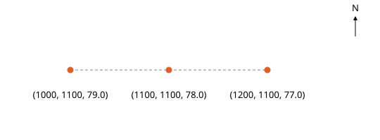
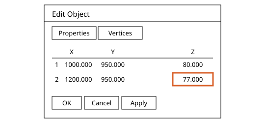
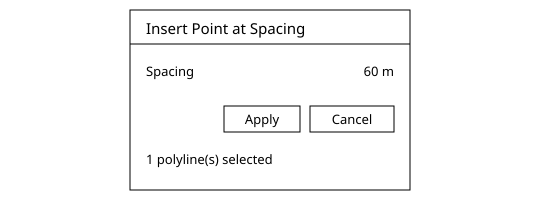
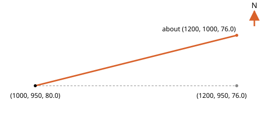
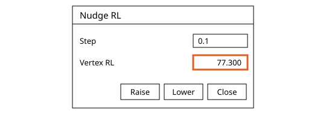
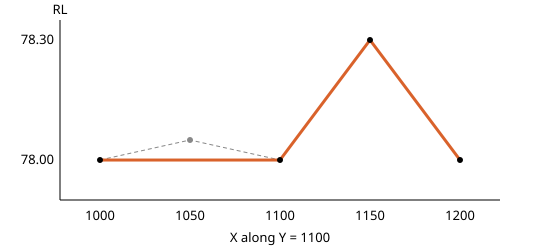
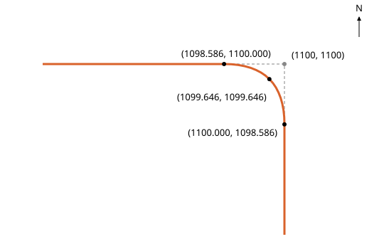
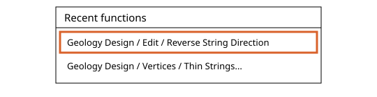
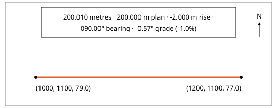

# String Vertices in Incline Design

Written for Incline Design **v0.4.0-dev**.

This page covers the tools that cut control strings where they cross and work on single vertices and the spacing between them, with the **Recent functions** list and the segment readout of **Measure Distance**. It follows [Control Strings](../control-strings/README.md), which says what a control string is and how to draw and clean one.

## Contents

1. [Concepts](#1-concepts)
2. [Split at Crossings](#2-split-at-crossings)
3. [Remove Between Crossings](#3-remove-between-crossings)
4. [Explode Polyline to Points](#4-explode-polyline-to-points)
5. [Edit Vertex](#5-edit-vertex)
6. [Insert Point](#6-insert-point)
7. [Fill Segment](#7-fill-segment)
8. [Insert Points at Spacing](#8-insert-points-at-spacing)
9. [Drag a Vertex](#9-drag-a-vertex)
10. [Nudge RL](#10-nudge-rl)
11. [Thin Strings](#11-thin-strings)
12. [Smooth Strings](#12-smooth-strings)
13. [Recent functions](#13-recent-functions)
14. [Measure Distance segment readout](#14-measure-distance-segment-readout)

---

## 1. Concepts

Where this fits: these tools serve [Modelling](../README.md#modelling), in the Publish Model stage of the geologist's life cycle, its steps 2 and 3. They are the finer tools for the control strings that interpolate a surface between the holes, used as the strings need them. They are the finer strokes of the same drawing: they put one vertex exactly where the interpretation says it goes. Next in the flow: [Surfaces](../surfaces/README.md).

The tools on this page are in the **Geology Design** menu of the Geology workspace, in two of its submenus:

- **Join and Split**: cut strings where they meet, or break one apart.
- **Vertices**: work on single vertices and the spacing between them.

The **Recent functions** list and the segment readout of **Measure Distance** help with both. What a control string is, why the strings of one surface share a layer, and how **Clean Strings** finds crossings that disagree in height are on the [Control Strings](../control-strings/README.md#1-concepts) page.

Tools that work on whole strings take the selected strings. They are always enabled, and a selection only prefills the tool's input; where a tool has a **Polylines** row, **Pick** sets it.

Where this page says the console, it means the activity console. It is closed at first; **View > Show Console** shows and hides it and remembers your choice. A warning or an error also opens an alert with its words.

---

## 2. Split at Crossings
### What it does
Cuts one string into separate strings at every place a second string crosses it.
### Why a geologist uses it
Cut at a crossing, each piece of a string ends exactly on the other string, and you can keep, move or delete the pieces one at a time.
### Where it is
Geology workspace: **Geology Design > Join and Split > Split at Crossings**.
### Before you start
Select a string first if you like, and the tool takes it as the string to cut. Otherwise you click it. Both strings must be shown, not frozen and not on a locked layer.
### Steps
1. Choose **Geology Design > Join and Split > Split at Crossings**. The banner reads "Click the string to split", with "Esc cancels". Click the string to cut, unless you selected it first. The banner now reads "Click the string that crosses it".
2. Click the string that crosses it. The first string is cut at every place the second crosses it, a vertex included, and is replaced by open pieces that each end on the crossing string. An open string crossed at one place gives two pieces. Each new vertex takes its height along the segment of the cut string it lies on; the height of the crossing string is not used. The crossing string is not changed. The console says "Split into", with the number of strings, for example "Split into 2 strings".
3. The tool stays armed for the next string. Press Esc to put it down. One undo gives the string back whole. The pieces keep the layer, colour and fill of the string. A closed string crossed at one place is opened there instead, and the console says "Opened the ring where the string crosses it".

### Options and defaults
None.
### What it refuses and why
- Console "No crossing on that string": the second string does not cross the first, or only meets an open string at its end. Nothing changes and the banner still asks for the crossing string.
- Console "The string changed, pick it again": the first string was edited after you picked it. Nothing is cut and the banner asks for the string to split again.
- Console "No shown, unlocked string under the cursor": the click found no string it may cut; locked, hidden and frozen strings are passed over. Nothing changes, and a string already picked stays picked.
- Console "Click the string that crosses it": the second click was on the string being cut. Nothing changes.
### Related tools
[Remove Between Crossings](#3-remove-between-crossings), [Clean Strings](../control-strings/README.md#2-clean-strings)

---

## 3. Remove Between Crossings
### What it does
Takes out the piece of a string that lies between the crossings either side of the cursor, or between a crossing and the string's end.
### Why a geologist uses it
A string drawn a little too far overshoots the string it should stop at. This trims the overshoot, or a stretch between two strings you do not want, without typing a vertex.
### Where it is
Geology workspace: **Geology Design > Join and Split > Remove Between Crossings**.
### Before you start
Every string that is shown cuts, locked ones too. A hidden string does not. The string you click must be shown and not locked.
### Steps
1. Choose **Geology Design > Join and Split > Remove Between Crossings**. The banner reads "Click the piece to remove", with "Esc cancels".
2. Move the cursor along the string to trim. The piece a click would remove is drawn as a thick amber line, from the crossing on one side of the cursor to the crossing on the other, or from a crossing to the string's end.
3. Click the piece. A piece from the middle of an open string goes and leaves two strings, each ending at a crossing. Only the vertices at the two crossings are added, each with its height along the segment of the clicked string it lies on. The console says "Removed a piece between crossings". At an end, the piece goes and the string stays one string, shorter. A closed string opens and stays one string. One undo puts it back. The tool stays armed.

### Options and defaults
None.
### What it refuses and why
- Console "No crossing on that string": nothing crosses the string you clicked, or it is a closed string crossed only once. No piece is drawn and nothing changes.
- Console "No shown, unlocked string under the cursor": the click found no string it may edit; locked, hidden and frozen strings are passed over, and no piece shows while the cursor is on one. Nothing changes.
### Related tools
[Split at Crossings](#2-split-at-crossings), [Clean Strings](../control-strings/README.md#2-clean-strings)

---

## 4. Explode Polyline to Points
### What it does
Replaces a string by one point on each of its vertices.
### Why a geologist uses it
**Build Surface** passes exactly through the points it keeps. A traced string becomes points you can select, move or delete one at a time. The surface build treats them like any other points and counts them as picks, though they are the string's interpretation, not picks measured at a hole: a control string over them overrides them as it would a pick.
### Where it is
Geology workspace: **Geology Design > Join and Split > Explode Polyline to Points**.
### Before you start
Click the string once the tool is armed. It must be shown and not on a locked layer.
### Steps
1. Choose **Geology Design > Join and Split > Explode Polyline to Points**. The banner reads "Select a polyline". The string under the cursor is highlighted.
2. Click the string. It is gone and a point stands on each of its vertices, at the vertex's X, Y and RL, on the string's layer and in its colour. The console says "Exploded polyline into", with the number of points, for example "Exploded polyline into 3 points".
3. The points are left selected. Points that all lie on one line, as a straight string gives, are not enough for **Build Surface** by themselves, which refuses a line of points. The tool is put down after one string. One undo gives the string back and takes the points away.

### Options and defaults
None.
### What it refuses and why
- Console "No shown, unlocked string under the cursor": what was clicked is a point. Nothing changes and the tool stays armed.
- A click on nothing, a circle, or a locked, hidden or frozen string does nothing, says nothing and the tool stays armed.
- A bulge on an arc gives no point, only its vertices do. A vertex that sits exactly on the one before it gives no second point, nor does a closed string's last vertex when it repeats its first.
### Related tools
[Build Surface](../surfaces/README.md#3-build-surface), [Split at Crossings](#2-split-at-crossings)

---

## 5. Edit Vertex
### What it does
Opens the vertex table of the string you click, at the vertex nearest the click.
### Why a geologist uses it
To read and correct one vertex by its numbers: a height that disagrees with the hole, a position a metre out, or a bulge that bends the segment. You find the vertex on the canvas and retype it in the table.
### Where it is
- Geology workspace: **Geology Design > Vertices > Edit Vertex**, or the **Edit Vertex** button on the left toolbar.
### Before you start
Open a project with a string on a layer that is visible and not locked. Nothing needs to be selected, the tool takes the vertex nearest the click. The entry is greyed while **Fly Mode** is on.
### Steps
1. Choose **Geology Design > Vertices > Edit Vertex**, or click the **Edit Vertex** button on the left toolbar. The canvas says "Select a polyline vertex".
2. Click close to the vertex. The **Edit Object** window opens on its **Vertices** tab with that vertex's row selected, and the tool is put down.
3. Retype the values in the row and choose **OK**. The change is one undo step.

### Options and defaults
None.
### What it refuses and why
- Console "No vertex of a shown, unlocked string under the cursor": no vertex of a string is near the click, or the string is hidden or locked, so its vertices cannot be opened this way. The tool stays armed.
### Related tools
[Insert Point](#6-insert-point), [Drag a Vertex](#9-drag-a-vertex), [Nudge RL](#10-nudge-rl)

---

## 6. Insert Point
### What it does
Adds a vertex where you click a string, on the segment itself, so the string keeps its shape.
### Why a geologist uses it
A vertex is the only place you can move, retype or tie a string. **Insert Point** gives you one exactly where you need it, between two vertices already there, with the height worked out along the segment so nothing else changes.
### Where it is
- Geology workspace: **Geology Design > Vertices > Insert Point**.
### Before you start
Open a project with a string on a layer that is visible and not locked. Nothing needs to be selected. The entry is greyed while **Fly Mode** is on.
### Steps
1. Choose **Geology Design > Vertices > Insert Point**. The canvas says "Click a string where the point goes" and "Esc cancels". Hover the string: a marker shows where the point would go.
2. Click the string where the point goes. The console says "Inserted 1 Segment point(s)". The new vertex lies on the segment where you clicked, next after the segment's first vertex. Its height is worked out along the segment, and on an arc it lies on the arc.
3. The tool stays armed for the next click, and Esc puts it down. Each click is one undo step.

### Options and defaults
None.
### What it refuses and why
- Console "No shown, unlocked string under the cursor": the click is off a string, or on a hidden or locked one. Nothing is added.
- Console "Too close to a vertex: click the segment away from its ends": the click is on a string but close to a vertex that is already there. Nothing is added.
### Related tools
[Fill Segment](#7-fill-segment), [Insert Points at Spacing](#8-insert-points-at-spacing)

---

## 7. Fill Segment
### What it does
Cuts the segment you click into equal parts no longer than a spacing, with a vertex at each cut.
### Why a geologist uses it
A long segment between two far vertices gives you only its two ends to adjust. **Fill Segment** puts evenly spaced vertices along it, with the height worked out along the segment, so the string keeps its shape and you can lift any of them.
### Where it is
- Geology workspace: **Geology Design > Vertices > Fill Segment...**
### Before you start
Open a project with a string on a layer that is visible and not locked. Nothing needs to be selected. A small **Fill Segment** panel with the **Spacing** field docks in the viewport. The entry is greyed while **Fly Mode** is on.
### Steps
1. Choose **Geology Design > Vertices > Fill Segment...** and set **Spacing** in the panel. The canvas says "Click the segment to fill" and "Esc cancels".
2. Hover the segment: markers show the vertices a click would add.
3. Click the segment away from its ends. It is cut into the fewest equal parts no longer than the spacing, measured in 3D and along the arc for an arc, and each new vertex takes its height along the segment. The console says "Filled the segment with", with the number of new vertices. For example, a straight segment 200 m long at **Spacing** 60 is cut into four parts of 50 m, with three new vertices.
4. The tool stays armed for the next segment, and Esc puts it down. Each fill is one undo step.

### Options and defaults
| Option | Default | What it does |
| --- | --- | --- |
| **Spacing** | 5 m | The most the new vertices are apart, in metres, measured in 3D. The least is 0.001 m. It is kept and saved with the project, and changing it marks the project unsaved and is not an undo step. |
### What it refuses and why
- "The segment is no longer than the spacing": nothing is added.
- "No shown, unlocked string under the cursor" for a click off a string or on a hidden or locked one, and "Too close to a vertex: click the segment away from its ends" for a click close to a vertex: nothing is added.
- "That would add", the number of vertices, then "vertices; the most is 1000. Use a larger spacing, or split the segment with Insert Point and fill each part": the spacing would add more than 1000 vertices to the segment. Nothing is added, and the hover shows no markers.
### Related tools
[Insert Point](#6-insert-point), [Insert Points at Spacing](#8-insert-points-at-spacing)

---

## 8. Insert Points at Spacing
### What it does
Cuts every segment of the selected strings into equal parts no longer than a spacing, with a vertex at each cut.
### Why a geologist uses it
To give whole strings evenly spaced vertices in one step, so a later edit or a surface build has points to follow along the full run. Every vertex you drew stays, and the heights are worked out along each segment.
### Where it is
- Geology workspace: **Geology Design > Vertices > Insert Points at Spacing...**
### Before you start
The entry is always enabled. Selecting one or more polylines, open or closed, that are shown and not locked prefills the **Polylines** row; **Pick** can also set it. Otherwise the dialog opens with a count of 0 and **Apply** is greyed.
### Steps
1. Select the strings, or leave the selection empty and use **Pick** in the window.
2. Choose **Geology Design > Vertices > Insert Points at Spacing...** The **Insert Point at Spacing** window opens and its **Polylines** row gives the count, for example "1 polyline(s) selected".
3. Set **Spacing** and choose **Apply**. Every segment of each string is cut into the fewest equal parts no longer than the spacing, measured in 3D, as **Fill Segment** cuts one. The vertices you drew stay, and each new vertex takes its height along its segment. The console says "Inserted", the number of new vertices on all the strings, then "Spacing point(s)", for example "Inserted 3 Spacing point(s)", and the window closes.

### Options and defaults
| Option | Default | What it does |
| --- | --- | --- |
| **Spacing** | 10 m | Most distance between vertices, along the string, measured in 3D. The least is 0.001 m. It then holds the last spacing applied while the program stays open. |
### What it refuses and why
- "This spacing would add", the number of points, then "points, more than 100000; increase the spacing": the spacing would add more than 100000 points on all the strings together. Nothing is added and the window stays open for another spacing.
- "No new Spacing points were found": every segment is already no longer than the spacing. The window closes.
### Related tools
[Fill Segment](#7-fill-segment), [Thin Strings](#11-thin-strings)

---

## 9. Drag a Vertex
### What it does
Arms the **Move** tool so that pressing a vertex and dragging it moves that vertex alone.
### Why a geologist uses it
To pull one vertex into place by eye, such as the end of a roof string out to a subcrop line, while every other vertex of the string stays where it was. In plan the height of the vertex does not change.
### Where it is
- Geology workspace: **Geology Design > Vertices > Drag a Vertex**. It arms the same tool as **Geology Design > Edit > Move Design**, and shares it with [Nudge RL](#10-nudge-rl).
### Before you start
Open a project with a string on a layer that is visible and not locked. Nothing needs to be selected, pressing a vertex selects its string. The entry is greyed while **Fly Mode** is on.
### Steps
1. Choose **Geology Design > Vertices > Drag a Vertex**. While nothing is selected the canvas says "Select an item".
2. Press on the vertex, drag it and release. The string follows the pointer while you drag and stays where you let go, and only that vertex moves. In plan, and in any view but a section, X and Y are where you released and the RL does not change. In a section view the vertex moves in the plane of the section, so its RL can change.
3. Drags and nudges of the same vertex that follow join its undo step.

### Options and defaults
None.
### What it refuses and why
- A press that is not on a vertex is an ordinary click or selection, and nothing is dragged. A press that does not move leaves the string as it was.
- A string on a hidden or locked layer is not dragged. Where one is picked even so, for example in a second open project, the console says "No shown, unlocked string under the cursor".
### Related tools
[Nudge RL](#10-nudge-rl), [Edit Vertex](#5-edit-vertex)

---

## 10. Nudge RL
### What it does
Raises or lowers one vertex of a string by a set step, leaving its X and Y alone.
### Why a geologist uses it
A vertex that sits a few tenths too high or too low is put right by a known amount, without retyping its RL or dragging it. Every press moves it by the same step, so the change is exact and easy to repeat.
### Where it is
Geology workspace: **Geology Design > Vertices > Nudge RL...** It arms **Move Design** and opens the panel **Nudge RL**. The entry is greyed while **Fly Mode** is on.
### Before you start
A project must be open with a string on screen. You click the vertex, so no selection is needed. A string selected as a whole keeps the **Move** panel in place of **Nudge RL** until you click one of its vertices.
### Steps
1. Choose **Geology Design > Vertices > Nudge RL...** The panel shows **Step** and "Click a vertex to nudge it", with **Raise** and **Lower** greyed.
2. Click the vertex. The panel now shows its **Vertex RL**, to three decimals.
3. Click **Raise** or **Lower**, or press the Up or Down arrow. Each press moves the vertex by **Step**, **Vertex RL** follows and the vertex stays held for the next press. For example, three presses of **Raise** at **Step** 0.1 take a vertex at RL 77.000 to 77.300.
4. To take the change back, press Ctrl+Z once: one undo takes back all the nudges and drags made on that vertex.

### Options and defaults
| Option | Default | What it does |
| --- | --- | --- |
| **Step** | 0.1, then the last step used | How far one press of **Raise** or **Lower** moves the vertex, in metres, from 0.001 to 1000. The Up and Down arrows use it while the panel is open. |
### What it refuses and why
- **Raise** and **Lower** are greyed, and the panel says "Click a vertex to nudge it", until a vertex is held.
- With no vertex held, the Up and Down arrows do nothing and the console says "Click a vertex to nudge it".
- A vertex of a hidden or locked string is not picked, so it cannot be nudged. If its string is hidden or locked after it was held, a nudge leaves it where it is and the console says "The held vertex is on a hidden or locked string, so it stays where it is".
### Related tools
[Drag a Vertex](#9-drag-a-vertex), [Edit Vertex](#5-edit-vertex)

---

## 11. Thin Strings
### What it does
Drops the vertices a selected string does not need, so its shape stays within a tolerance you set.
### Why a geologist uses it
A string traced by clicking or draped on a rough surface carries more vertices than its shape needs. A vertex goes only when the string without it stays within the tolerance of it, measured in 3D. The two ends of an open string, both ends of every arc, and the first vertex of a closed string and the vertex farthest from it always stay.
### Where it is
Geology workspace: **Geology Design > Vertices > Thin Strings...** The Geology toolbar has a **Thin Strings** button too.
### Before you start
The entry is always enabled. The button is greyed while no project is open or **Fly Mode** is on. Selecting one or more visible, unlocked strings first prefills the **Polylines** row; **Pick** can also set it. With none selected the dialog opens with a count of 0 and **Apply** is greyed.
### Steps
1. Select the strings, or leave the selection empty and use **Pick** in the dialog.
2. Choose **Geology Design > Vertices > Thin Strings...**, or click the **Thin Strings** button. The dialog gives the vertex count of the strings now and after thinning, for example "Vertices: 5 now, 4 after". The strings are drawn over the scene as they would be left, their kept vertices marked.
3. Set **Tolerance**. The count after and the drawing follow it. Opening the dialog again, or **Done** after **Pick**, keeps the tolerance typed.
4. Click **Apply**. The console says "Thinned", the number of strings, then the number of vertices removed, for example "Thinned 1 string, 1 vertex removed" or "Thinned 2 strings, 5 vertices removed". The dialog closes. Ctrl+Z brings the vertices back.

### Options and defaults
| Option | Default | What it does |
| --- | --- | --- |
| **Tolerance** | 0.1 m, then the last tolerance applied | A vertex goes when the string without it stays within this distance of it, measured in 3D. Typed, or set with the slider under it, which runs up to a little past the tolerance at which nothing more can go. |
### What it refuses and why
- With no editable string selected the dialog still opens, with a count of 0, and **Apply** stays greyed.
- **Apply** is greyed while the vertex count after is not lower than the count now, as at **Tolerance** 0.
### Related tools
[Smooth Strings](#12-smooth-strings), [Clean Strings](../control-strings/README.md#2-clean-strings)

---

## 12. Smooth Strings
### What it does
Rounds the corners of the selected strings with a curve that stays within a tolerance of the original string.
### Why a geologist uses it
A string traced by clicking has sharp corners that a seam does not have, and a surface built through them carries the kinks. Each corner is cut back along its two edges, never past half of the shorter edge, and the cut is replaced by a curve. The two ends of an open string, arcs and the corners beside an arc stay as they are.
### Where it is
Geology workspace: **Geology Design > Vertices > Smooth Strings...**, right after **Thin Strings...**
### Before you start
The entry is always enabled. Selecting one or more visible, unlocked strings first prefills the **Polylines** row; **Pick** can also set it. With none selected the dialog opens with a count of 0 and **Apply** is greyed. Closed strings are rounded at every corner.
### Steps
1. Select the strings, or leave the selection empty and use **Pick** in the dialog.
2. Choose **Geology Design > Vertices > Smooth Strings...** The dialog opens with **Tolerance** and its **Polylines** row gives the count, for example "1 polyline(s) selected".
3. Set **Tolerance** and click **Apply**. Each rounded corner vertex is replaced by up to 17 vertices along the curve, each with its height carried along the edges. Where both edges are long enough, the middle of the curve is the tolerance from the old corner; beside a short edge the curve keeps closer to the corner. The console says "Smoothed", the number of strings, "string(s),", then the number of corners and "corner(s) rounded", for example "Smoothed 1 string(s), 1 corner(s) rounded". The dialog closes. Ctrl+Z brings the corners back.

### Options and defaults
| Option | Default | What it does |
| --- | --- | --- |
| **Tolerance** | 0.5 m, then the last tolerance applied | The most the smoothed string may lie from the original, measured in 3D, from 0.001 m up. **Apply** is greyed unless it is above zero. |
### What it refuses and why
- With no editable string selected the dialog still opens, with a count of 0, and **Apply** stays greyed. The warning "Select one or more visible, unlocked strings before smoothing" shows if you lock the strings while the dialog is open and click **Apply**.
- "No corner to round; nothing smoothed": nothing changes and the dialog closes. A straight string gives this, as does a string of fewer than three vertices or one whose only corners are beside an arc.
### Related tools
[Thin Strings](#11-thin-strings), [Clean Strings](../control-strings/README.md#2-clean-strings)

---

## 13. Recent functions
### What it does
Lists the **Geology Design** functions you used last, so a right click on empty space runs one again.
### Why a geologist uses it
Drawing and cleaning strings repeats a few functions again and again. The list puts them under the cursor, newest first, so you do not go back to the menu each time.
### Where it is
Geology workspace: right click empty space in the view, and the list **Recent functions** opens at the cursor. Right click on a string and the usual menu has a **Recent functions** row just above **Close**. The number of lines is set in **File > Preferences > Interface > Recent functions shown**.
### Before you start
A line enters the list when you run that function from **Geology Design**, from a Geology toolbar button or from the right click menu. Putting an armed tool down again does not count. Opening a function's dialog counts, even when you then cancel it. The Geology list is separate from Production's and is kept when you quit.
### Steps
1. Use the functions as usual from **Geology Design**, the Geology toolbar or the right click menu.
2. With no tool armed, right click empty space. The list shows each function by its menu path, newest first, for example **Geology Design / Vertices / Thin Strings...**. Click a line: that function runs and the list closes.

### Options and defaults
| Option | Default | What it does |
| --- | --- | --- |
| **Recent functions shown** | 10 | How many lines the list shows: 10, 15 or 20. The list remembers the last 20 functions, and a function used again moves to the top and shows once. |
### What it refuses and why
- "No recent functions": the one greyed line shown before any function has been used.
- A line is greyed exactly when its **Geology Design** entry is greyed, for example **Drag a Vertex** while **Fly Mode** is on. With a tool armed, a right click opens no list. On **Create Polyline** it does what Enter does, and on **Create Line** and **Create Circle** it drops the part half drawn. With nothing half drawn, or on any other tool, it puts the tool down.
### Related tools
[Clean Strings](../control-strings/README.md#2-clean-strings), [Thin Strings](#11-thin-strings)

---

## 14. Measure Distance segment readout
### What it does
In the Geology workspace, **Measure Distance** also reads the slope of a string segment: plan length, rise, bearing and grade.
### Why a geologist uses it
A geologist checking the dip of a string or the slope of a seam gets the rise, bearing and grade at once, without working them out by hand.
### Where it is
Geology workspace: **Geology Design > Measure Distance**, on the menu itself after **Strike and Dip**. The **Measure Distance** button of the toolbar along the bottom arms the same tool.
### Before you start
A string must be on screen. No selection is needed. Every other workspace shows the distance only.
### Steps
1. Choose **Geology Design > Measure Distance** and do not click. Move the cursor onto a segment of a string. The segment is drawn over in amber and the message gives its length in 3D, its plan length, rise, bearing, and grade in degrees and per cent, for example "200.010 metres · 200.000 m plan · -2.000 m rise · 090.00° bearing · -0.57° grade (-1.0%)".
2. Rise and grade are positive uphill, taken in the order the string's vertices run, and the bearing is clockwise from grid north. After **Reverse String Direction** the same segment reads the rise and grade with the other sign and the bearing turned by 180°: the segment in the example would read +2.000 m rise, 270.00° bearing and +0.57° grade (+1.0%). A segment straight up or down reads "vertical" in place of plan length and bearing, with no per cent. Two clicks read the line between your two points in the same form.

### Options and defaults
None.
### What it refuses and why
- No readout over empty space or over a segment of no length. After the first click the hover readout stops until you put the tool down with Esc or a right click and arm it again.
- In every other workspace the tool gives the distance only, for example "200.010 metres": no plan length, rise, bearing or grade, and no hover readout.
### Related tools
[Reverse String Direction](../control-strings/README.md#8-reverse-string-direction), [Fill Segment](#7-fill-segment)
