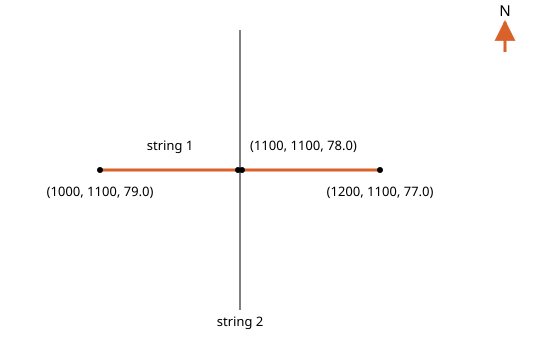
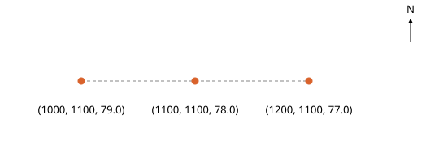
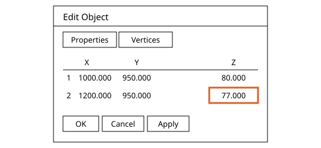
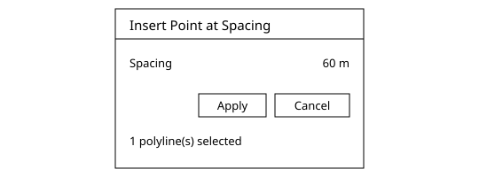
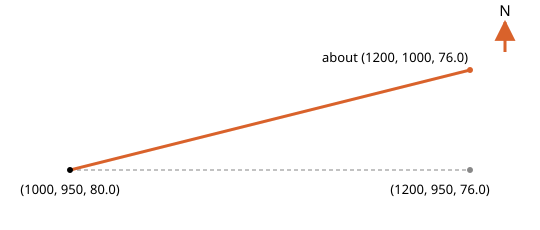
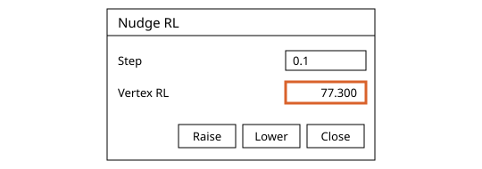
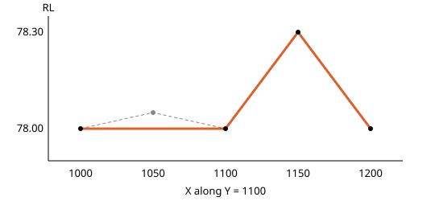
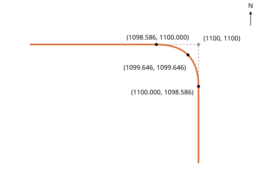
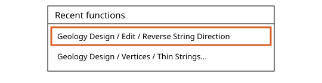
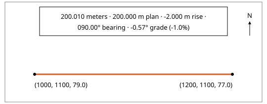

# String Vertices in Incline Design

Written for Incline Design **v0.4.0-dev**.

This page covers the tools that cut control strings where they cross and work on single vertices and the spacing between them, with the Recent functions list and the segment readout of Measure Distance. It follows [Control Strings](../control-strings/README.md), which says what a control string is and how to draw and clean one.

## Contents

1. [Concepts](#1-concepts)
2. [Split at Crossings](#2-split-at-crossings)
3. [Remove Between Crossings](#3-remove-between-crossings)
4. [Explode Polyline to Points](#4-explode-polyline-to-points)
5. [Edit Vertex](#5-edit-vertex)
6. [Insert Point](#6-insert-point)
7. [Fill Segment](#7-fill-segment)
8. [Insert Points at Spacing](#8-insert-points-at-spacing)
9. [Drag a Vertex](#9-drag-a-vertex)
10. [Nudge RL](#10-nudge-rl)
11. [Thin Strings](#11-thin-strings)
12. [Smooth Strings](#12-smooth-strings)
13. [Recent functions](#13-recent-functions)
14. [Measure Distance segment readout](#14-measure-distance-segment-readout)

---

## 1. Concepts

Where this fits: these tools serve [Modelling](../README.md#modelling), in the Publish Model stage of the geologist's life cycle. They shape the control strings that steer a surface between the holes. Next in the flow: [Surfaces](../surfaces/README.md).

The tools on this page are in the Geology Design menu of the Geology workspace, in two of its submenus:

- **Join and Split**: cut strings where they meet, or break one apart.
- **Vertices**: work on single vertices and the spacing between them.

The Recent functions list and the segment readout of Measure Distance help with both. What a control string is, why the strings of one surface share a layer, and how Clean Strings finds crossings that disagree in height are on the [Control Strings](../control-strings/README.md#1-concepts) page.

Select first, then act: tools that work on whole strings take the selected strings.

Each example draws its own strings. Before each one, delete the strings of the example before it, and the three strings of the Clean Strings example, so a click finds the string the example names.

---

## 2. Split at Crossings
### What it does
Cuts one string into separate strings at every place a second string crosses it.
### Why a geologist uses it
Cut at a crossing, each piece of a string ends exactly on the other string, and you can keep, move or delete the pieces one at a time.
### Where it is
Geology workspace: Geology Design > Join and Split > Split at Crossings.
### Before you start
Select a string first if you like, and the tool takes it as the string to cut. Otherwise you click it. Both strings must be shown, and the string to cut must not be on a locked layer. The string that cuts may be locked. For the example, on the layer "Seam A roof" draw string 1 from (1000, 1100, 79.0) to (1200, 1100, 77.0) and string 2 from (1100, 1000, 78.4) to (1100, 1200, 78.4).
### Steps
1. Choose Geology Design > Join and Split > Split at Crossings. The banner reads "Click the string to split", with "Esc cancels". Click string 1. The banner now reads "Click the string that crosses it".
2. Click string 2. String 1 is replaced by two open strings, (1000, 1100, 79.0) to (1100, 1100, 78.0) and (1100, 1100, 78.0) to (1200, 1100, 77.0). The new vertex takes its height along string 1, 78.0. String 2 is not changed. The console says "Split into 2 strings".
3. The tool stays armed for the next string. Press Esc to put it down. One undo gives string 1 back whole. The pieces keep the layer, colour and fill of the string. A closed string crossed once is opened there instead, and the console says "Opened the ring where the string crosses it".

### Options and defaults
None.
### What it refuses and why
- Console "No crossing on that string": the second string does not cross the first, or only meets an open string at its end. Nothing changes and the banner still asks for the crossing string.
- Console "The string changed, pick it again": the first string was edited after you picked it. Nothing is cut and the banner asks for the string to split again.
- A locked, hidden or frozen string cannot be picked to be cut, and the click does nothing.
### Related tools
[Remove Between Crossings](#3-remove-between-crossings), [Clean Strings](../control-strings/README.md#2-clean-strings)

---

## 3. Remove Between Crossings
### What it does
Takes out the piece of a string that lies between the crossings either side of the cursor, or between a crossing and the string's end.
### Why a geologist uses it
A string drawn a little too far overshoots the string it should stop at. This trims the overshoot, or a stretch between two strings you do not want, without typing a vertex.
### Where it is
Geology workspace: Geology Design > Join and Split > Remove Between Crossings.
### Before you start
Every string that is shown cuts, locked ones too. A hidden string does not. The string you click must be shown and not locked. For the example, with no other strings shown, draw string 1 from (1000, 1100, 79.0) to (1200, 1100, 77.0), string 2 from (1100, 1000, 78.4) to (1100, 1200, 78.4) and string 3 from (1150, 1000, 77.5) to (1150, 1200, 77.5).
### Steps
1. Choose Geology Design > Join and Split > Remove Between Crossings. The banner reads "Click the piece to remove", with "Esc cancels".
2. Move the cursor along string 1. The piece a click would remove is drawn as a thick amber line. Between X 1100 and X 1150 it runs from string 2 to string 3.
3. Click there. String 1 becomes two strings, (1000, 1100, 79.0) to (1100, 1100, 78.0) and (1150, 1100, 77.5) to (1200, 1100, 77.0). Only the two vertices at the crossings are added. The console says "Removed a piece between crossings". At an end, the piece goes and the string stays one string, shorter. A closed string opens and stays one string. One undo puts it back. The tool stays armed.

### Options and defaults
None.
### What it refuses and why
- Console "No crossing on that string": nothing crosses the string you clicked, or it is a closed string crossed only once. No piece is drawn and nothing changes.
- A locked, hidden or frozen string is not taken, and the click does nothing. No piece shows while the cursor is on it.
### Related tools
[Split at Crossings](#2-split-at-crossings), [Clean Strings](../control-strings/README.md#2-clean-strings)

---

## 4. Explode Polyline to Points
### What it does
Replaces a string by one point on each of its vertices.
### Why a geologist uses it
Build Surface takes points as exact picks. A traced string becomes points you can select, move or delete one at a time, and the surface build treats them like any other points.
### Where it is
Geology workspace: Geology Design > Join and Split > Explode Polyline to Points.
### Before you start
Click the string once the tool is armed. It must be shown and not on a locked layer.
### Steps
Set-up: on the layer "Seam A roof" draw one open string with vertices (1000, 1100, 79.0), (1100, 1100, 78.0) and (1200, 1100, 77.0).
1. Choose Geology Design > Join and Split > Explode Polyline to Points. The banner reads "Select a polyline". The string under the cursor is highlighted.
2. Click the string. It is gone and three points stand at (1000, 1100, 79.0), (1100, 1100, 78.0) and (1200, 1100, 77.0), on the string's layer and in its colour. The console says "Exploded polyline into 3 points".
3. The three points are left selected, ready for Build Surface. The tool is put down after one string. One undo gives the string back and takes the points away.

### Options and defaults
None.
### What it refuses and why
- A locked, hidden or frozen string, a circle, or anything that is not a polyline: the click does nothing, says nothing and the tool stays armed.
- A bulge on an arc gives no point, only its vertices do. A vertex that sits exactly on the one before it gives no second point, nor does a closed string's last vertex when it repeats its first.
### Related tools
[Build Surface](../surfaces/README.md#3-build-surface), [Split at Crossings](#2-split-at-crossings)

---

## 5. Edit Vertex
### What it does
Opens the vertex table of the string you click, at the vertex nearest the click.
### Why a geologist uses it
To read and correct one vertex by its numbers: a height that disagrees with the hole, a position a metre out, or a bulge that bends the segment. You find the vertex on the canvas and retype it in the table.
### Where it is
- Geology workspace: Geology Design > Vertices > Edit Vertex, or the Edit Vertex button on the left toolbar.
### Before you start
Open a project with a string on a layer that is visible and not locked. Nothing needs to be selected, the tool takes the vertex nearest the click. The entry is greyed while Fly Mode is on.
### Steps
1. On layer "Seam A roof", away from the other strings, draw an open polyline and set its two vertices in the vertex table as X, Y and RL: (1000, 950, 80.0) and (1200, 950, 76.0).
2. Choose Geology Design > Vertices > Edit Vertex. The canvas says "Select a polyline vertex".
3. Click close to the second vertex. The Edit Object window opens on its Vertices tab with row 2 selected, and the tool is put down.
4. Change the Z of row 2 to 77.0 and choose OK. Vertex 2 is now (1200, 950, 77.0). The change is one undo step.

### Options and defaults
None.
### What it refuses and why
- A click with no vertex of a string near it does nothing, and says nothing.
- A string on a hidden or locked layer is not picked, so its vertices cannot be opened this way.
### Related tools
[Insert Point](#6-insert-point), [Drag a Vertex](#9-drag-a-vertex), [Nudge RL](#10-nudge-rl)

---

## 6. Insert Point
### What it does
Adds a vertex where you click a string, on the segment itself, so the string keeps its shape.
### Why a geologist uses it
A vertex is the only place you can move, retype or tie a string. Insert Point gives you one exactly where you need it, between two vertices already there, with the height worked out along the segment so nothing else changes.
### Where it is
- Geology workspace: Geology Design > Vertices > Insert Point.
### Before you start
Open a project with a string on a layer that is visible and not locked. Nothing needs to be selected. The entry is greyed while Fly Mode is on.
### Steps
1. On layer "Seam A roof", away from the other strings, draw an open polyline and set its two vertices in the vertex table as X, Y and RL: (1000, 950, 80.0) and (1200, 950, 76.0).
2. Choose Geology Design > Vertices > Insert Point. The canvas says "Click a string where the point goes" and "Esc cancels". Hover the string: a marker shows where the point would go.
3. Click the string halfway along. The console says "Inserted 1 Segment point(s)". The new vertex is vertex 2 and lies where you clicked. At X 1100 its Z is 78.00. The tool stays armed for the next click, and Esc puts it down. Each click is one undo step.

### Options and defaults
None.
### What it refuses and why
- A click off a string, or close to a vertex that is already there, does nothing, and says nothing.
- A string on a hidden or locked layer is not picked.
### Related tools
[Fill Segment](#7-fill-segment), [Insert Points at Spacing](#8-insert-points-at-spacing)

---

## 7. Fill Segment
### What it does
Cuts the segment you click into equal parts no longer than a spacing, with a vertex at each cut.
### Why a geologist uses it
A long segment between two far vertices gives you only its two ends to adjust. Fill Segment puts evenly spaced vertices along it, with the height worked out along the segment, so the string keeps its shape and you can lift any of them.
### Where it is
- Geology workspace: Geology Design > Vertices > Fill Segment...
### Before you start
Open a project with a string on a layer that is visible and not locked. Nothing needs to be selected. A small "Fill Segment" panel with the Spacing field docks in the viewport. The entry is greyed while Fly Mode is on.
### Steps
1. On layer "Seam A roof", away from the other strings, draw an open polyline and set its two vertices in the vertex table as X, Y and RL: (1000, 950, 80.0) and (1200, 950, 76.0).
2. Choose Geology Design > Vertices > Fill Segment... and set Spacing to 60 in the panel. The canvas says "Click the segment to fill" and "Esc cancels". Hover the segment: three markers show the vertices a click would add. Click the segment away from its ends. The console says "Filled the segment with 3 new vertices". The string now has five vertices, at X 1000, 1050, 1100, 1150 and 1200, with Z 80.00, 79.00, 78.00, 77.00 and 76.00. The four parts are each about 50 m, under the 60 m spacing.

### Options and defaults
| Option | Default | What it does |
| --- | --- | --- |
| Spacing | 5 m | The most the new vertices are apart, in metres, measured in 3D. The least is 0.001 m. It is kept and saved with the project, and changing it marks the project unsaved and is not an undo step. |
### What it refuses and why
- "The segment is no longer than the spacing": nothing is added. A click off a string, or close to a vertex, does nothing and says nothing.
- "That would add 2000 vertices; the most is 1000. Use a larger spacing, or split the segment with Insert Point and fill each part": at Spacing 0.1 on the string above. Nothing is added, and the hover shows no markers.
### Related tools
[Insert Point](#6-insert-point), [Insert Points at Spacing](#8-insert-points-at-spacing)

---

## 8. Insert Points at Spacing
### What it does
Cuts every segment of the selected strings into equal parts no longer than a spacing, with a vertex at each cut.
### Why a geologist uses it
To give whole strings evenly spaced vertices in one step, so a later edit or a surface build has points to follow along the full run. Every vertex you drew stays, and the heights are worked out along each segment.
### Where it is
- Geology workspace: Geology Design > Vertices > Insert Points at Spacing...
### Before you start
Select first, then act: select one or more polylines, open or closed, on layers that are visible and not locked. The entry is greyed while no polyline is selected.
### Steps
1. On layer "Seam A roof", away from the other strings, draw an open polyline, set its two vertices in the vertex table as X, Y and RL: (1000, 950, 80.0) and (1200, 950, 76.0), and select it.
2. Choose Geology Design > Vertices > Insert Points at Spacing... The Insert Point at Spacing window opens and says "1 polyline(s) selected". Set Spacing to 60 and choose Apply. The console says "Inserted 3 Spacing point(s)" and the window closes. The string has five vertices, at X 1000, 1050, 1100, 1150 and 1200, with Z 80.00, 79.00, 78.00, 77.00 and 76.00.

### Options and defaults
| Option | Default | What it does |
| --- | --- | --- |
| Spacing | 10 m | Most distance between vertices, along the string, measured in 3D. The least is 0.001 m. It then holds the last spacing applied while the program stays open. |
### What it refuses and why
- "This spacing would add 200039 points, more than 100000; increase the spacing": at Spacing 0.001 on the string above. Nothing is added and the window stays open for another spacing.
- "No new Spacing points were found": every segment is already no longer than the spacing. The window closes.
### Related tools
[Fill Segment](#7-fill-segment), [Thin Strings](#11-thin-strings)

---

## 9. Drag a Vertex
### What it does
Arms the Move tool so that pressing a vertex and dragging it moves that vertex alone.
### Why a geologist uses it
To pull one vertex into place by eye, such as the end of a roof string out to a subcrop line, while every other vertex of the string stays where it was. In plan the height of the vertex does not change.
### Where it is
- Geology workspace: Geology Design > Vertices > Drag a Vertex. It arms the same tool as Geology Design > Edit > Move Design, and shares it with [Nudge RL](#10-nudge-rl).
### Before you start
Open a project with a string on a layer that is visible and not locked. Nothing needs to be selected, pressing a vertex selects its string. The entry is greyed while Fly Mode is on.
### Steps
1. On layer "Seam A roof", away from the other strings, draw an open polyline and set its two vertices in the vertex table as X, Y and RL: (1000, 950, 80.0) and (1200, 950, 76.0).
2. Choose Geology Design > Vertices > Drag a Vertex. While nothing is selected the canvas says "Select an item".
3. Press on the second vertex, drag it north about 50 m and release. The string follows the pointer while you drag and stays where you let go. The vertex table now shows row 2 at about (1200, 1000, 76.0): X and Y are where you released and Z is still 76.0. Drags and nudges of the same vertex that follow join its undo step.

### Options and defaults
None.
### What it refuses and why
- A press that is not on a vertex is an ordinary click or selection, and nothing is dragged. A press that does not move leaves the string as it was.
- A string on a hidden or locked layer is not dragged.
### Related tools
[Nudge RL](#10-nudge-rl), [Edit Vertex](#5-edit-vertex)

---

## 10. Nudge RL
### What it does
Raises or lowers one vertex of a string by a set step, leaving its X and Y alone.
### Why a geologist uses it
A vertex that sits a few tenths too high or too low is put right by a known amount, without retyping its RL or dragging it. Every press moves it by the same step, so the change is exact and easy to repeat.
### Where it is
Geology workspace: Geology Design > Vertices > Nudge RL... It arms Move Design and opens the panel "Nudge RL". The entry is greyed while Fly Mode is on.
### Before you start
A project must be open with a string on screen. You click the vertex, so no selection is needed. A string selected as a whole keeps the Move panel in place of Nudge RL until you click one of its vertices.
### Steps
1. Draw one open string on layer "Seam A roof" from (1000, 1100, 79.0) to (1200, 1100, 77.0). Choose Geology Design > Vertices > Nudge RL... The panel shows Step 0.1 and "Click a vertex to nudge it", with Raise and Lower greyed. Click the vertex (1200, 1100, 77.0). The panel now shows Vertex RL 77.000.
2. Click Raise three times, or press the Up arrow three times. Vertex RL reads 77.300 and the vertex stays held. Press Ctrl+Z once: the vertex is back at 77.000, as one undo takes back all the nudges and drags made on that vertex.

### Options and defaults
| Option | Default | What it does |
| --- | --- | --- |
| Step | 0.1 | How far one press of Raise or Lower moves the vertex, in metres, from 0.001 to 1000. The Up and Down arrows use it while the panel is open. |
### What it refuses and why
- Raise and Lower are greyed, and the panel says "Click a vertex to nudge it", until a vertex is held.
- A vertex of a hidden or locked string is not picked, so it cannot be nudged. Nothing is said.
### Related tools
[Drag a Vertex](#9-drag-a-vertex), [Edit Vertex](#5-edit-vertex)

---

## 11. Thin Strings
### What it does
Drops the vertices a selected string does not need, so its shape stays within a tolerance you set.
### Why a geologist uses it
A string traced by clicking or draped on a rough surface carries more vertices than its shape needs. A vertex goes only when the string without it stays within the tolerance of it, measured in 3D. The two ends of an open string, both ends of every arc and the first vertex of a closed string always stay.
### Where it is
Geology workspace: Geology Design > Vertices > Thin Strings... The Geology toolbar has a Thin Strings button too.
### Before you start
Select first, then act: one or more visible, unlocked strings. The entry and the button are greyed while no string is selected. The dialog works on the strings selected when it opened.
### Steps
1. Draw one open string on layer "Seam A roof" with the vertices (1000, 1100, 78.00), (1050, 1100, 78.05), (1100, 1100, 78.00), (1150, 1100, 78.30) and (1200, 1100, 78.00), select it and choose Geology Design > Vertices > Thin Strings... The dialog opens with Tolerance 0.1 m and says "Vertices: 5 now, 4 after". The string is drawn over the scene as it would be left, its kept vertices marked.
2. Click Apply. Vertex 2 (1050, 1100, 78.05) is 0.05 m off the line between its neighbours and goes, and the other four stay. The console says "Thinned 1 string(s), 1 vertices removed". Ctrl+Z brings the vertex back.

### Options and defaults
| Option | Default | What it does |
| --- | --- | --- |
| Tolerance | 0.1 m, then the last tolerance applied | A vertex goes when the string without it stays within this distance of it, measured in 3D. Typed, or set with the slider under it, which runs up to a little past the tolerance at which nothing more can go. |
### What it refuses and why
- "Select one or more visible, unlocked strings before thinning": none of the selected strings can be edited, so the dialog does not open.
- Apply is greyed while the vertex count after is not lower than the count now, as at Tolerance 0.
### Related tools
[Smooth Strings](#12-smooth-strings), [Clean Strings](../control-strings/README.md#2-clean-strings)

---

## 12. Smooth Strings
### What it does
Rounds the corners of the selected strings with a curve that stays within a tolerance of the original string.
### Why a geologist uses it
A string traced by clicking has sharp corners that a seam does not have, and a surface pulled through them carries the kinks. Each corner is cut back along its two edges, never past half of the shorter edge, and the cut is replaced by a curve. The two ends of an open string, arcs and the corners beside an arc stay as they are.
### Where it is
Geology workspace: Geology Design > Vertices > Smooth Strings..., right after Thin Strings...
### Before you start
Select first, then act: one or more visible, unlocked strings. The entry is greyed while no string is selected. Closed strings are rounded at every corner.
### Steps
1. Draw one open string on layer "Seam A roof" with the vertices (1000, 1100, 78.0), (1100, 1100, 78.0) and (1100, 1000, 78.0), select it and choose Geology Design > Vertices > Smooth Strings... The dialog opens with Tolerance 0.5 m and "1 polyline(s) selected".
2. Click Apply. The console says "Smoothed 1 string(s), 1 corner(s) rounded". The corner vertex (1100, 1100, 78.0) is replaced by 17 vertices from (1098.586, 1100.000, 78.0) to (1100.000, 1098.586, 78.0), so the string has 19. The middle one, (1099.646, 1099.646, 78.0), is 0.5 m from the old corner. Ctrl+Z brings the corner back.

### Options and defaults
| Option | Default | What it does |
| --- | --- | --- |
| Tolerance | 0.5 m, then the last tolerance applied | The most the smoothed string may lie from the original, measured in 3D, from 0.001 m up. Apply is greyed unless it is above zero. |
### What it refuses and why
- "Select one or more visible, unlocked strings before smoothing": none of the selected strings can be edited, so the dialog does not open. The same line shows if you lock the strings while the dialog is open and click Apply.
- "No corner to round; nothing smoothed": nothing changes and the dialog closes. A straight string gives this.
### Related tools
[Thin Strings](#11-thin-strings), [Clean Strings](../control-strings/README.md#2-clean-strings)

---

## 13. Recent functions
### What it does
Lists the Geology Design functions you used last, so a right click on empty space runs one again.
### Why a geologist uses it
Drawing and cleaning strings repeats a few functions again and again. The list puts them under the cursor, newest first, so you do not go back to the menu each time.
### Where it is
Geology workspace: right click empty space in the view, and the list "Recent functions" opens at the cursor. Right click on a string and the usual menu has a "Recent functions" row just above "Close". The number of lines is set in File > Preferences > Interface > Recent functions shown.
### Before you start
A line enters the list when you run that function from Geology Design, from a Geology toolbar button or from the right click menu. Putting an armed tool down again does not count. The Geology list is separate from Production's and is kept when you quit.
### Steps
1. Draw one open string on layer "Seam A roof", select it and choose Geology Design > Vertices > Thin Strings..., then Cancel. Choose Geology Design > Edit > Reverse String Direction.
2. Right click empty space. The list shows "Geology Design / Edit / Reverse String Direction" on top and "Geology Design / Vertices / Thin Strings..." under it. Click a line: that function runs and the list closes.

### Options and defaults
| Option | Default | What it does |
| --- | --- | --- |
| Recent functions shown | 10 | How many lines the list shows: 10, 15 or 20. The list remembers the last 20 functions, and a function used again moves to the top and shows once. |
### What it refuses and why
- "No recent functions": the one greyed line shown before any function has been used.
- A line is greyed exactly when its Geology Design entry is greyed, for example Reverse String Direction while no string is selected. With a tool armed, a right click puts the tool down and opens no list.
### Related tools
[Clean Strings](../control-strings/README.md#2-clean-strings), [Thin Strings](#11-thin-strings)

---

## 14. Measure Distance segment readout
### What it does
In the Geology workspace, Measure Distance also reads the slope of a string segment: plan length, rise, bearing and grade.
### Why a geologist uses it
A geologist checking the dip of a string or the slope of a seam gets the rise, bearing and grade at once, without working them out by hand.
### Where it is
Geology workspace: Geology Design > Measure Distance, on the menu itself after Strike and Dip. The Measure Distance button of the toolbar along the bottom arms the same tool.
### Before you start
A string must be on screen. No selection is needed. Production shows the distance only. For the example, draw string 1 on the layer "Seam A roof" from (1000, 1100, 79.0) to (1200, 1100, 77.0).
### Steps
1. Choose Geology Design > Measure Distance and do not click. Move the cursor onto the segment of string 1 of layer "Seam A roof" from (1000, 1100, 79.0) to (1200, 1100, 77.0). The segment is drawn over in orange and the message reads "200.010 meters · 200.000 m plan · -2.000 m rise · 090.00° bearing · -0.57° grade (-1.0%)".
2. Rise and grade are positive uphill, taken in the order the string's vertices run, so this segment falls. After Reverse String Direction the same segment reads +2.000 m rise, 270.00° bearing and +0.57° grade (1.0%). A segment straight up or down reads "vertical" in place of plan length and bearing. Two clicks read the line between your two points in the same form.

### Options and defaults
None.
### What it refuses and why
- No readout over empty space or over a segment of no length. After the first click the hover readout stops until you put the tool down with Esc or a right click and arm it again.
- In the Production workspace the tool gives the distance only, in the form "200.010 meters": no plan length, rise, bearing or grade, and no hover readout.
### Related tools
[Reverse String Direction](../control-strings/README.md#8-reverse-string-direction), [Fill Segment](#7-fill-segment)
