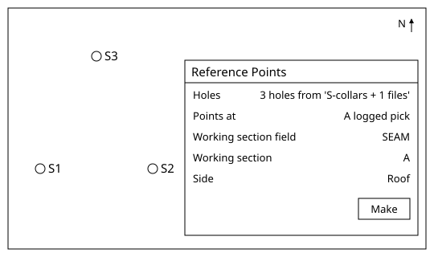
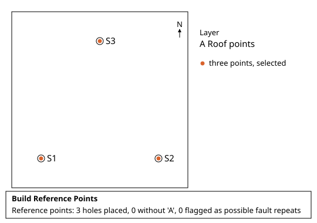
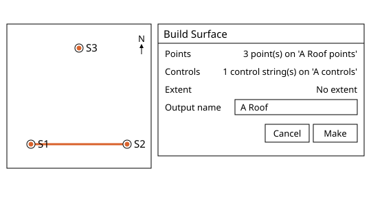
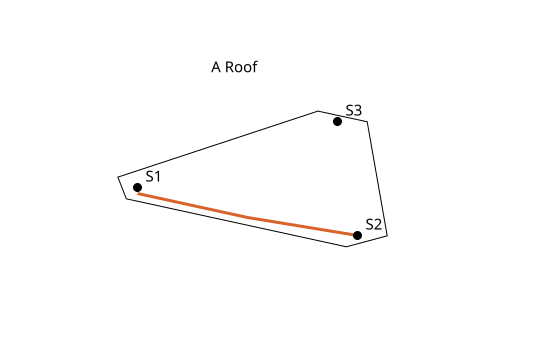
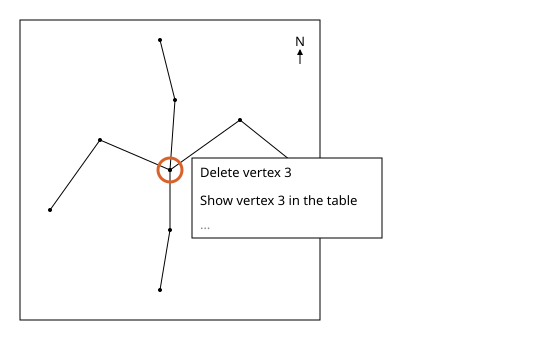
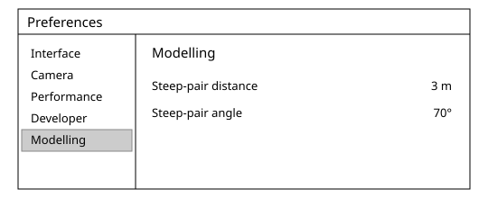

# Surfaces in Incline Design

Written for Incline Design **v0.4.0-dev**.

This page covers making the reference surface of a seam in the Geology workspace: one point per hole, then a surface through those points and any control strings you drew. It is for geologists and students doing the work by hand.

## Contents

1. [Concepts](#1-concepts)
2. [Reference Points](#2-reference-points)
3. [Build Surface](#3-build-surface)
4. [Rings after a Build Surface refusal](#4-rings-after-a-build-surface-refusal)
5. [Modelling settings](#5-modelling-settings)

---

## 1. Concepts

Where this fits: these tools serve steps 1 to 3 of [Modelling](../README.md#modelling), in the Publish Model stage of the geologist's life cycle. The reference surface is the base the published seam model is built on. Next in the flow: [Sections](../sections/README.md).

A seam has a roof (its top) and a floor (its base). Each drill hole that cuts the seam gives one point on the roof and one on the floor, at the height the log gives. The reference surface is the first of the two built, the better-defined, usually the roof: a smooth surface through its points and the strings. The other surface comes from the seam's thickness, on [Seam Thickness](../thickness/README.md).

Points alone leave gaps between the holes. Strings interpolate the surface between the holes: a control string is an open polyline drawn where you know, or have decided, where the surface runs, and every vertex carries a height. The surface runs through the string at the string's own heights. A pick is the stronger evidence: it was measured from the hole's log and downhole geophysics, where most strings are interpreted. Where a string and a pick sit at the same place in plan, **Build Surface** uses the string's height and reports the pick it overrode and by how much, so check every override against the hole: a string should only win where an observation stands behind it.

A closed string is the extent: the deposit, or the area being mined, and the finished surface is cut to it. Keep the control strings of one surface on one layer. The extent is the one closed string you select with the points, and **Build Surface** shows it on its own **Extent** line. Points outside the extent still shape the surface, so distant holes keep carrying the trend.

**Build Surface** is an exact interpolator, a thin plate spline with a height every 5 m in plan: it passes exactly through what it keeps. So the surface is only as good as the points and strings, and the build reports what it cleaned, left out and overrode, for you to judge. It joins small disagreements where strings cross in its own copy, and rings on the strings what it left out or refused.

Drawing the control string and the extent uses **Create Polyline** and the vertex tools. **Clean Strings** fixes small disagreements in the strings themselves and rings the rest for you to fix by hand; it is on its own page, [Clean Strings](../control-strings/README.md#2-clean-strings).

Where this page says the console, it means the activity console. It is closed at first; **View > Show Console** shows and hides it and remembers your choice. A warning or an error also opens an alert with its words.

The synthetic set-up used below is the S1 to S3 set loaded as in [Import drill holes](../drill-holes/README.md#2-import-drill-holes): three vertical holes, collars at 100 m, seams A and B. The roof of seam A is at 20.0 m in S1, 24.0 m in S2 and 22.0 m in S3, which gives points at heights 80, 76 and 78 m.

## 2. Reference Points

### What it does
Places one point per selected hole on the roof or floor of a seam, as a new layer of points.
### Why a geologist uses it
The hole logs say where the seam is down the hole; the surface needs where it is in space. The point is the first pick you can look at, move your eye along and question, before any surface exists.
### Where it is
Geology workspace > **Modelling > Reference Points...**
### Before you start
Select first, then act: select the holes you want points on, either the whole drill hole dataset or single holes. For the example, select S1, S2 and S3. The seam you chose last time is remembered.
### Steps
1. Select S1, S2 and S3 and open **Modelling > Reference Points...** The dialog is titled **Reference Points** and its **Holes** line reads "3 holes from" the dataset name.
2. Leave **Points at** on **A logged pick**.
3. Under **Working section field** choose the field that carries the seam code. Under **Working section** choose the code A. A working section named A, made as in [Working Sections](../drill-holes/README.md#4-working-sections), is offered first as **A (working section)**: it gives the same points and layer, and the console names it that way. Under **Side** choose **Roof**.
4. Press **Make**. A layer `A Roof points` appears with three points at (1000, 1000, 80), (1200, 1000, 76) and (1100, 1200, 78). The three points are left selected, ready for **Build Surface**.
5. For a ground surface, open the dialog again, set **Points at** to **The collars** and press **Make**: a layer `Collars` gets one point per hole at the collar.

### Options and defaults
| Option | Default | What it does |
|---|---|---|
| **Holes** | The holes selected when the dialog opened | Read only. Close the dialog to pick others. |
| **Points at** | **A logged pick** | Or **The collars**, one point per hole at its collar. |
| **Working section field** | The first categorical field | The field that carries the seam or working section. |
| **Working section** | The first section the holes log, else the first code | A named working section, or one code. |
| **Side** | **Roof** | **Roof** is the top of the seam, **Floor** its base. |

### What it refuses and why
- Menu entry greyed, hover *Select drillholes first*: no hole is selected.
- Warning alert "Select the holes to place reference points on": the dialog was opened with no holes.
- **Make** greyed: no working section is chosen.
- Warning alert "No hole holds 'A' in that field": none of the holes logs that value; nothing is made.
- A hole that logs the seam twice gives its upper run and is named: "Uppermost run used, flagged: S2". Two or more datasets with differing working sections: "Working section 'A' is not the same in every selected dataset; each dataset's own was used." Each is a warning: an alert titled **Build Reference Points** opens, with the run's other lines under **Details**.
- The result line, in the console under **Build Reference Points**, reads, for example, "Reference points: 3 holes placed, 0 without 'A', 0 flagged as possible fault repeats".
### Related tools
[Build Surface](#3-build-surface), [Import drill holes](../drill-holes/README.md#2-import-drill-holes), [Thickness Points](../thickness/README.md#2-thickness-points).

## 3. Build Surface

### What it does
Grids the selected points, and any selected control strings, into a new surface with a thin plate spline, a height every 5 m in plan, passing exactly through what it keeps.
### Why a geologist uses it
It turns picks into a surface you can cut, measure thickness against and check. Control strings interpolate the surface between the holes where you know more than the holes say; the extent says where the surface should stop.
### Where it is
Geology workspace > **Modelling > Build Surface...**
### Before you start
Select first, then act: select the points and, if you want them, the control strings (open polylines) and one extent (a closed polyline). The selected points and the vertices of the selected control strings must number at least 3, or the entry stays grey. For the example, with the three points of `A Roof points` still selected, draw one open string on a new layer `A controls`, with vertices (1000, 1000, 79.5), (1100, 1000, 77.5) and (1200, 1000, 76), then hold Shift and click it to add it to the selection.
### Steps
1. Open **Modelling > Build Surface...** The dialog **Build Surface** shows **Points** "3 point(s) on 'A Roof points'", **Controls** "1 control string(s) on 'A controls'", **Extent** "No extent", and the settings line with "Change these in Preferences, Modelling" under it.
2. Type `A Roof` in **Output name**. It is offered already when the points were made by **Reference Points** in this session; points made in an earlier session offer their layer's name, `A Roof points`.
3. Press **Make**. A progress line "Building surface…" runs, then a new surface appears.
4. The run warns, so when it ends an alert titled **Build Surface** opens. Its top line is the run's last line, "Warning: Created triangulation 'A Roof' (...) from surface type Surface"; open **Details**, or the console, for the rest. With no extent it warns "No mask selected; the surface is clipped to the points' outline plus 25 m". The run record reads, for example, "Run record: ... point(s) used of 3 pick(s) given, 0 merged, 2 under control strings left out (1 at another height)". The string passes through S1 and S2: "Control string overrides the pick at (1000.000, 1000.000): pick 80.00 m, control 79.50 m, difference -0.50 m". S2 matches the string within 0.05 m and is left out without a warning.
5. To clip, draw a closed string round the holes, select it with the points and build again: each build adds a surface, nothing is replaced.

### Options and defaults
| Option | Default | What it does |
|---|---|---|
| **Points** | The points selected at open | Read only. Points outside the extent still shape the surface. |
| **Controls** | The open strings selected at open | Read only. The surface runs through them at their own heights. |
| **Extent** | The one closed string selected, else none | The surface is cut to it. Without one: the points' outline plus 25 m. |
| **Output name** | The seam's roof or floor name for reference points made this session, else the name of the points' one layer, else `Surface` | Name of the new surface. |

### What it refuses and why
- Entry greyed, hover *Select at least 3 points*.
- "2 point(s) selected; a surface needs at least 3", or with strings "1 point(s) and 1 control string vertex(es) selected; a surface needs at least 3 between them".
- More than one closed string selected: "Select exactly one closed string to clip the surface to".
- Extent: "The extent string crosses itself in plan"; "No part of the surface falls inside the extent"; "1 point(s) inside the extent; a surface needs at least 3".
- "Open a project before building a surface" with no project.
- Strings: the build cleans its own copy (**Clean Strings**, **Join all at halfway**; the strings in your project are unchanged) and says what it changed. A string that clashes is left out by name, for example "String 2 left out: it runs along string 1 at (1100.000, 1000.000)". Too many points: "The control strings do not fit the budget of 4000 points for one surface"; nothing is built. Refusals ring the places, see [section 4](#4-rings-after-a-build-surface-refusal).
- Error alert "Build Surface failed: ..." carries any other reason.
- Steep pairs: "1 pair(s) of points closer than 5 m in plan are steeper than 80 degrees" is a warning only, in the **Build Surface** alert; the surface is built.
### Related tools
[Reference Points](#2-reference-points), [Modelling settings](#5-modelling-settings), [Clean Strings](../control-strings/README.md#2-clean-strings), [Thickness Points](../thickness/README.md#2-thickness-points).

## 4. Rings after a Build Surface refusal

### What it does
Marks, on the canvas, each place in the control strings that stopped **Build Surface** or got a string left out, and gives you the repair on a right click.
### Why a geologist uses it
A refusal that says "somewhere" is no use. The ring puts the problem under the cursor, so you repair it by hand and build again.
### Where it is
Geology workspace, plan or 3D view. Rings are drawn on the canvas only. Right-click a ring for its repair rows; the ring menu and its rules are described once, under [Rings and the ring menu](../control-strings/README.md#rings-and-the-ring-menu) in **Clean Strings**. The view toolbar button **Unhide All** shows hidden strings again.
### Before you start
A **Build Surface** that refused, or that built with strings left out. **Clean Strings** rings places too, with the same ring menu.
### Steps
1. After a refusal an error alert titled **Build Surface** opens and lists the strings, as the console does: "2 refused control string(s) are now selected", and "The other 1 control string(s) are hidden; Unhide All on the view toolbar brings them back". The view frames the refused strings and each bad place is ringed.
2. Right-click a ring and repair the place from the ring menu: read the ringed vertex in the table and delete it if it is wrong, or edit the string there by hand. The build has already joined, in its own copy, every crossing that missed by 5 m or less, so a ring from a build does not offer **Join here at halfway**.
3. Click **Unhide All** on the view toolbar; the console says "Showed 1 hidden object(s) again".
4. Start the next build: it clears the old rings itself.
5. When a build succeeds with strings left out, those strings stay selected and ringed beside the new surface, and a **Build Surface** alert lists them under **Details**: "1 control string(s) left out of this build, each ringed and selected; the surface is built from the rest:".

### Options and defaults
| Option | Default | What it does |
|---|---|---|
| **Rings** | Drawn at every refused place | How long they stay: see [Rings and the ring menu](../control-strings/README.md#rings-and-the-ring-menu). |
| **Other strings** | Hidden after a refusal | Hidden in one undo step; **Unhide All** brings them back, as does one undo, which also clears every ring. |

### What it refuses and why
- A ring offers only the rows its strings allow, hidden and locked strings included: see [Rings and the ring menu](../control-strings/README.md#rings-and-the-ring-menu).
### Related tools
[Build Surface](#3-build-surface), [Clean Strings](../control-strings/README.md#2-clean-strings).

## 5. Modelling settings

### What it does
Holds the project settings **Build Surface** reads: when to warn of steep pairs of points.
### Why a geologist uses it
Two picks close together and far apart in height make a grid ripple. The warning names them so you can ask whether the picks are right; it never refuses or repairs.
### Where it is
**File > Preferences**, tab **Modelling**. Saved with the project.
### Before you start
Open a project. Without one the tab reads "No open project".
### Steps
1. Open **File > Preferences** and choose the **Modelling** tab.
2. Set **Steep-pair distance** to 3 m and **Steep-pair angle** to 70 degrees. Each change is sent when you finish typing or dragging.
3. The console reports "Modelling settings set." and the settings line.
4. **Build Surface** now shows the same line in its dialog, read only: "Method: thin plate spline, exact", then "steep pairs under 3 m steeper than 70 degrees".

### Options and defaults
| Option | Default | What it does |
|---|---|---|
| **Steep-pair distance** | 5 m | Pairs of points closer than this in plan are examined. |
| **Steep-pair angle** | 80 degrees | Pairs steeper than this are named when a build succeeds. |

### What it refuses and why
- Distance must be above 0: "The steep-pair distance must be a positive number of metres".
- Angle must be above 0 and at most 90: "The steep-pair angle must be more than 0 and at most 90 degrees".
- The two fields hold their values inside these limits, so an invalid set is never sent; a project that stores one stops a build with the same words, in a **Build Surface** error alert.
### Related tools
[Build Surface](#3-build-surface).
