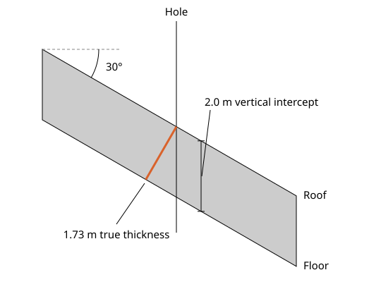
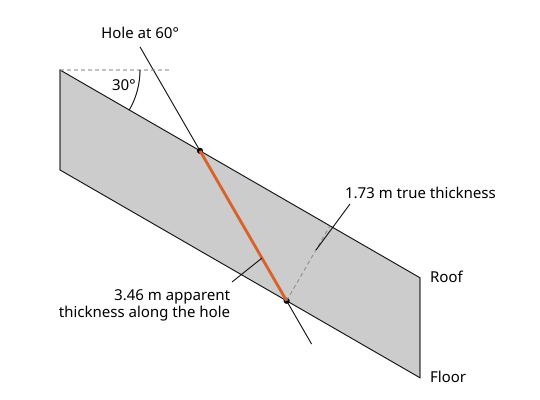
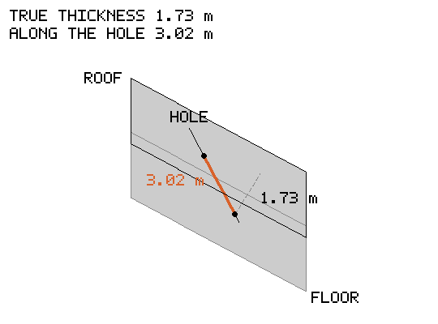
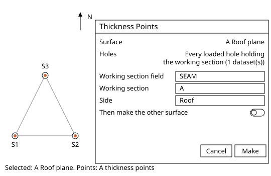
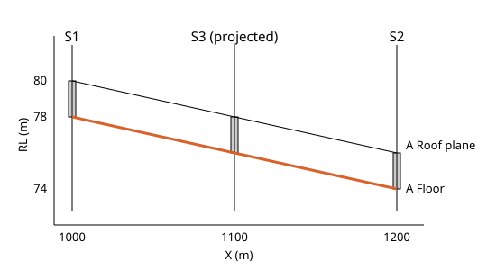
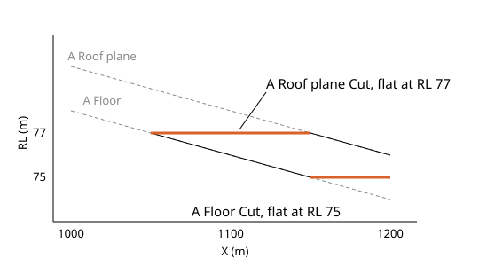
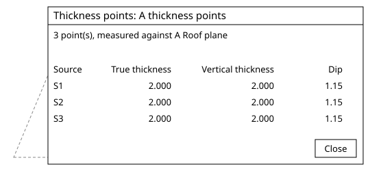

# Seam Thickness in Incline Design

Written for Incline Design **v0.4.0-dev**.

This page covers how to measure a seam's true thickness at the drill holes, how to build the seam's second surface from those measurements, how to limit the seam's roof and floor to a top and a bottom you choose, and how to reopen the results. It is for geologists and students working the seam model by hand.

## Contents

1. [Concepts](#1-concepts)
2. [Thickness Points](#2-thickness-points)
3. [Thickness Surfaces](#3-thickness-surfaces)
4. [Clip to Surface](#4-clip-to-surface)
5. [Show thickness table](#5-show-thickness-table)

---

## 1. Concepts

Where this fits: these tools serve steps 5 and 6 of [Modelling](../README.md#modelling), in the Publish Model stage of the geologist's life cycle. The seam's thickness, roof and floor are the part of the published model the mine plans against. Next in the flow: [Publishing](../README.md#publishing).

A seam has a roof (its upper surface) and a floor (its lower surface). A vertical hole drills through both and logs the distance between them: the apparent vertical thickness, the vertical distance from roof to floor at a point in plan. If the seam is flat, that is the true thickness. If the seam dips, the hole cuts it on a slant and logs more than the seam is thick.

True thickness is the seam measured square to its bedding, the shortest distance from roof to floor. For a vertical hole through a seam dipping at an angle, it is the apparent vertical thickness multiplied by the cosine of the dip. A seam with 2.0 m of apparent vertical thickness, dipping 30 degrees, is 1.73 m thick.

A hole need not be vertical. Incline places the roof and floor on the hole's own path, from its hole survey, and measures the distance between those two points square to the bedding, so one rule serves a hole at any angle. No angle between the hole and the dip direction is needed, because the two points already carry it. The straight distance between those two points is the apparent thickness along the hole.

The same rule holds for a hole drilled across the dip, which a flat section cannot show. Turned in three dimensions, a hole at 60 degrees drilled north-east into a seam dipping east logs 3.02 m along the hole, and the seam is still 1.73 m thick.

Incline takes the bedding from the reference surface you select: the seam's roof or its floor, the better-defined of the two, usually the roof, built first with **Build Surface**. The local dip and strike of that surface under each hole set the bedding there, so true thickness follows the seam as it rolls. The surface decides the answer: a poor surface gives a poor thickness.

From the reference surface, the other surface follows in five steps:

1. Start from the reference surface, built and checked on the [surfaces page](../surfaces/README.md) and the [sections page](../sections/README.md).
2. **Thickness Points** measures the true thickness at each hole that logs the seam inside the reference surface, square to its bedding, whichever way the hole runs, and saves it on the hole.
3. **Thickness Surfaces** grids those true thicknesses at the same points in plan as the reference surface's heights.
4. At each point of the true thickness grid it turns the true thickness into apparent vertical thickness, using the reference surface's dip and strike at that point.
5. It subtracts the apparent vertical thickness from a roof to give the floor, or adds it to a floor to give the roof.

The reference surface holds one height at each point in plan, which is why the fourth of these steps turns the thickness vertical: the other surface is the reference surface moved straight up or down by the apparent vertical thickness.

Then **Clip to Surface**, step 6 of [Modelling](../README.md#modelling), limits the pair, as [section 4](#4-clip-to-surface) describes. **Build Surface** is on the [surfaces page](../surfaces/README.md#3-build-surface). A limit surface for **Clip to Surface** is built with it from points placed with **Create Point**, or made with **Create Triangulation** from a drawn polyline.

Where this page says the console, it means the activity console. It is closed at first; **View > Show Console** shows and hides it and remembers your choice. A warning or an error also opens an alert with its words.

Worked example used below: the S1 to S3 set, loaded as in [Import drill holes](../drill-holes/README.md#2-import-drill-holes), and a roof for seam A built from the three hole picks alone, with no control string and no extent, named `A Roof plane`. Set it up so:

1. If the layer `A Roof points` is already there from [Reference Points](../surfaces/README.md#2-reference-points), use it. If not, make it as that page does: seam A, **Side** **Roof**, three points at RL 80 in S1, 76 in S2 and 78 in S3.
2. Select only those three points and choose **Modelling > Build Surface...** Type `A Roof plane` in **Output name**, whatever it offers, and choose **Make**.

`A Roof plane` sits beside `A Roof`, the surface of the [Build Surface](../surfaces/README.md#3-build-surface) example, if you made it, and replaces nothing. That one runs through a control string and so does not lie in one plane; this one does.

A thin plate spline through three points and nothing else is the flat plane through them. From S1 east to S2 the roof falls 4 m in 200 m, a slope of 0.02. Halfway between them it is at 78, and S3, 200 m due north of that halfway point, is at 78 too, so the roof is level north to south. The roof dips 1.15 degrees to the east (the angle whose tangent is 0.02 is 1.1458 degrees). Seam A has 2.0 m of apparent vertical thickness in each hole, so true thickness is 2.0 m multiplied by the cosine of that dip, 2.0 x 0.99980 = 1.9996 m, the same in every hole.

## 2. Thickness Points

### What it does
Measures the true thickness of one seam at each hole that logs it inside the reference surface, square to the bedding its dip and strike give there, whichever way the hole runs.
### Why a geologist uses it
A hole logs the true thickness only where it crosses the seam square on; otherwise it logs more, the apparent thickness along the hole. True thickness is the figure for volumes, seam quality cut-offs and mining height, and it is saved on each hole as a column you can colour and filter by.
### Where it is
Geology workspace: **Modelling > Thickness Points...**
### Before you start
Select first, then act. Select the one reference surface, the seam's roof or floor (here `A Roof plane`), in the explorer or the view. Holes selected with it are measured; if no hole is selected, every loaded hole is used. Drill holes must be loaded and must log the seam.
### Steps
1. Select `A Roof plane`, the roof of the worked example, and nothing else. Choose **Modelling > Thickness Points...**
2. The dialog **Thickness Points** opens. **Surface** shows `A Roof plane`. **Holes** shows "Every loaded hole holding the working section (1 dataset(s))".
3. Set **Working section field** to the field that holds the seam names, **Working section** to A, and **Side** to **Roof** (the selected surface is seam A's roof).
4. Switch off **Then make the other surface** for now; the next section makes it as its own step.
5. Choose **Make**. The console says under **Thickness Points** (click the row for every line): "Thickness points A thickness points: 3 from holes, 0 measured, 0 left out, 0 hole(s) without the seam; measured against A Roof plane". It then says: 'Saved 3 true thickness value(s) to column "True thickness" of' your dataset name, 'on each roof interval'.
6. A layer `A thickness points` appears, with one point at the roof of each hole. Open the hole's interval table to see the new `True thickness` column. Expected: the cell reads 2 in each hole, the saved 1.9996 m rounded to three decimals, against an apparent vertical thickness of 2.0 m.

### Options and defaults
| Option | Default | What it does |
| --- | --- | --- |
| **Surface** | The one selected surface | Shown only. Its slope at each hole gives the bedding. |
| **Holes** | The holes selected with the surface, else every loaded hole | Shown only. Each hole that logs the seam gives a point. |
| **Working section field** | The first categorical field | The field that holds the seam names. |
| **Working section** | A named working section if one is logged, else the first code | The seam to measure. |
| **Side** | **Roof** | Whether the selected surface is the seam's roof or its floor. |
| **Field measurements: Measured pairs** | None | Optional CSV (**Choose CSV...**, **Clear**) of surveyed roof and floor points, with columns `id`, `roof_x`, `roof_y`, `roof_z`, `floor_x`, `floor_y`, `floor_z`. |
| **Then make the other surface** | On | After the points, makes the seam's other surface, as **Thickness Surfaces** does. |

When the surface was built this session, the dialog opens on the seam it was built from; otherwise on the last seam chosen.
### What it refuses and why
- Greyed menu entry, hover *Select one grid surface*: it needs exactly one surface selected.
- **Make** stays greyed while the dialog says "Checking the surface...", while no working section is chosen, and when the surface cannot serve as a reference: "A Roof plane cannot be measured against: it is not one regular grid of square cells, as Build Surface makes". Other reasons: "two of its vertices share a grid node at different heights", "its grid would pass the node budget of 4000000". A clipped or imported mesh may fail this; a **Build Surface** result does not.
- A hole is left out, not measured, and an alert titled **Thickness Points** opens with the list under **Details**: "Left out (1):" and a line "hole S4: no floor" (the hole ends inside the seam). Other reasons: "overturned: out of scope", "outside the reference surface", "no trace to place it on", and for measured pairs "a roof or floor coordinate is blank or not a number".
- A hole that logs the seam twice uses the upper run, with a warning in the **Thickness Points** alert: "Uppermost run used, flagged: S5".
- A `True thickness` column that came in with the data is never overwritten, and the **Thickness Points** alert says: 'Drillholes already holds a column "True thickness" that came with the data, so no thickness was saved to it. The points were made all the same.' (your dataset's name stands in for `Drillholes`)
- A bad pairs file stops the run with an error alert "Thickness points failed:", then "Could not read" and the file name, "is not a readable CSV", or "lacks column(s)" naming them. In the browser, a file that cannot be read gives "Could not read the measured pairs file" when it is chosen.
- Warning alert "The project changed while thickness points were made; nothing was added".
### Related tools
[Thickness Surfaces](#3-thickness-surfaces), [Show thickness table](#5-show-thickness-table), [Build Surface](../surfaces/README.md#3-build-surface).

## 3. Thickness Surfaces

### What it does
Grids the true thickness of the latest thickness points of the selected surface at the same points in plan as its heights, turns it at each point into apparent vertical thickness with the surface's dip and strike there, and makes the seam's other surface: it subtracts that from a roof to give the floor, or adds it to a floor to give the roof.
### Why a geologist uses it
The holes give thickness at points. The seam model needs the second surface everywhere, and it must sit on the same grid as the first so the pair can be clipped and reported node for node.
### Where it is
Geology workspace: **Modelling > Thickness Surfaces...**
### Before you start
Select the one reference surface, the same one used for the thickness points (`A Roof plane`). Make its thickness points first, this session. Rebuilding the surface afterwards makes the points out of date, so make them again.
### Steps
1. With `A Roof plane` selected, choose **Modelling > Thickness Surfaces...**
2. The dialog **Thickness Surfaces** opens. **Surface**: `A Roof plane`. **Thickness points**: "A thickness points, 3 point(s)". **Makes**: `A Floor`.
3. Choose **Make**. A progress line "Making thickness surface" runs, then the console says "Made A Floor: ... from 3 thickness point(s), 0 merged, ... reference surface A Roof plane, thickness points A thickness points".
4. `A Floor` appears in the surfaces list and becomes the selection. In the example it lies about 2.0 m vertically under `A Roof plane` at every node, because the three true thicknesses agree.
5. Right-click `A Floor` and choose **Show thickness table** to see the grid: reference z, true thickness, apparent vertical thickness, other surface z.

### Options and defaults
| Option | Default | What it does |
| --- | --- | --- |
| **Surface** | The one selected surface | Shown only. The new surface follows its grid and outline. |
| **Thickness points** | The last run on this surface this session | Shown only. |
| **Makes** | The floor under a roof surface, or the roof over a floor surface | Shown only. Named from the seam and whether it is the roof or the floor, for example `A Floor`. |

Each run adds a surface: a second run on the same points makes `A Floor (2)`. Away from the points, the thickness trend carries on for a short reach and then holds; the console says how many nodes were held this way.
### What it refuses and why
- Greyed menu entry, hover *Select one grid surface*.
- Warning alert "A Roof plane has no thickness points yet: make thickness points for it first" (nothing made this session for that surface; thickness points are not kept when a project is reopened).
- Warning alert "A Roof plane was built again after its thickness points were made: make thickness points again".
- **Make** stays greyed while the surface is checked, and when it is not one regular grid (same reasons as **Thickness Points**).
- Error alert "Thickness surface failed: 2 thickness point(s); a thickness surface needs at least 3".
- Error alert "Thickness surface failed:" followed by "1 pair(s) of thickness points share a place with different thicknesses; an exact surface cannot pass through both:", naming both points and their thicknesses. Two holes at one place cannot both be right.
- Error alert "Thickness surface failed: Not enough memory for the thickness grid".
### Related tools
[Thickness Points](#2-thickness-points), [Clip to Surface](#4-clip-to-surface), [Show thickness table](#5-show-thickness-table).

## 4. Clip to Surface

### What it does
Trims a seam's roof and floor to a top (**Keep below**) and a bottom (**Keep above**) you choose, such as the base of weathering, and closes the solid between them. It makes cut copies of the roof and floor and a solid, and the originals stay as they are.
### Why a geologist uses it
A seam is limited by what lies over and under it: the base of weathering, a subcrop, a mining limit, a fault block's edge. Clipping carries those limits into the roof, floor and volume without editing either original.
### Where it is
Geology workspace: **Modelling > Clip to Surface...** Also in the **Triangulation** menu of the Production workspace.
### Before you start
Select the seam's roof and floor, two grid surfaces on one grid, and nothing else (`A Roof plane` and `A Floor`). The higher is the roof. Have the limit surfaces loaded if you use surfaces: make them with **Build Surface** from points placed with **Create Point**, covering the seam's outline. Or type a level.
### Steps
1. Select `A Roof plane` and `A Floor`. Choose **Modelling > Clip to Surface...**
2. The dialog **Clip to Surface** opens. **Seam** shows "2 surface(s)".
3. For **Keep below** choose the source **RL** and type **RL (m)** 77. For **Keep above** choose **RL** and type **RL (m)** 75. (A surface, or for **Keep above** a depth below a surface, works the same way.)
4. Choose **Clip**.
5. Three surfaces are made and selected: `A Roof plane Cut`, `A Floor Cut` and the solid `A Roof plane Solid`. The console says "Made A Roof plane Cut, A Floor Cut and A Roof plane Solid from A Roof plane and A Floor: ...; solid ... m3; limits: keep below RL 77, keep above RL 75".
6. Check the result. The roof is laid flat at RL 77 where it rose above it, and the floor at RL 75 where it dropped below. Where the roof and floor both lie outside a limit, that part of the seam is removed: here the floor is still above RL 77 west of about X 1050 (it is at 78 under S1), so that strip is gone, and the console counts its nodes as "removed where roof and floor both lay outside". The originals stay.

### Options and defaults
| Option | Default | What it does |
| --- | --- | --- |
| **Seam** | The two selected surfaces | Shown only. |
| **Keep below** | **Surface**, none chosen | Nothing stays above this limit. Source **Surface** or **RL**. Empty clips from below only. |
| **Keep above** | **Surface**, none chosen | Nothing stays below this limit. Source **Surface**, **RL**, or **Depth below a surface**. Empty clips from above only. |
| **Surface** | None | The limit surface. Choose it in the dialog or click it in the view. |
| **RL (m)** | Empty | A level in metres; the limit is flat at that height. |
| **Depth (m)** | The depth last used in this project | Metres below the surface chosen, for **Keep above**; kept with the project. |

**Keep below** is applied first, then **Keep above**.
### What it refuses and why
- Greyed menu entry, hover *Select a seam's roof and floor, two grid surfaces*.
- On opening with another selection, a warning alert: "Select a seam's roof and floor, two grid surfaces on one lattice, to clip".
- **Clip** stays greyed until one row is complete and none is half typed. Notes: "The RL must be a number of metres"; "The cut depth must be a number of metres above 0". Error alert: "Command failed: Choose Keep below, Keep above, or both".
- The seam's own surfaces are not offered as limits; clicking one in the view warns "A surface being clipped cannot also be its own limit".
- Warning alerts: "A Floor cannot be measured against: it is not one regular grid of square cells, as Build Surface makes", and "Triangulation operation failed: The roof and floor do not share a lattice: select a seam's roof and floor built on one grid". A floor from **Thickness Surfaces** shares its roof's grid.
- Warning alert "Triangulation operation failed: Nothing of the seam is left between the limits, so nothing was made".
- If every node already lies within the limits, the console says "A Roof plane and A Floor not clipped: every node already lies within keep below RL 77, so no surface was made".
- Warning alert "A Roof plane and A Floor: 12 node(s) have no limit surface under them and were left as they were": the limit surface does not cover the seam there; the "Made ..." line is under **Details**.
### Related tools
[Thickness Surfaces](#3-thickness-surfaces), [Build Surface](../surfaces/README.md#3-build-surface).

## 5. Show thickness table

### What it does
Reopens the table of what **Thickness Points** or **Thickness Surfaces** made.
### Why a geologist uses it
To check each value against the logs: which hole gave which true thickness, at what dip, before trusting the surface built from them.
### Where it is
Geology workspace, explorer: right-click the layer `A thickness points` or the surface `A Floor`, then **Show thickness table**.
### Before you start
The table is kept in memory for the session, so the entry shows only for results made since the project was opened, while the layer or surface is loaded.
### Steps
1. Right-click the layer `A thickness points` in the explorer and choose **Show thickness table**.
2. The table "Thickness points: A thickness points" opens: "3 point(s), measured against A Roof plane". Columns: **Source**, **X**, **Y**, **True thickness**, **Vertical thickness**, **Along hole**, **Dip**, **Dip direction**, **Roof (depth or z)**, **Floor (depth or z)**. **Vertical thickness** is the apparent vertical thickness, and **Along hole** the apparent thickness along the hole.
3. Read S1: **True thickness** 2.000 (1.9996 before rounding), **Vertical thickness** 2.000, **Dip** 1.15, roof depth 20.000, floor depth 22.000. S2 and S3 show the same thickness and dip, at their own depths.
4. Right-click `A Floor` for its grid table, "Thickness grid: A Floor": **X**, **Y**, **Reference z**, **True thickness**, **Vertical thickness**, **Other surface z**.
5. Choose **Close**.

### Options and defaults
| Option | Default | What it does |
| --- | --- | --- |
| **Close** | Not applicable | Closes the table. |

### What it refuses and why
- The entry is missing, not greyed, when no table is kept: results from before the project was opened, or a layer or surface that is unloaded.
### Related tools
[Thickness Points](#2-thickness-points), [Thickness Surfaces](#3-thickness-surfaces).
