# Pit Optimization in Incline Design

*A hands-on tutorial on the McLaughlin gold deposit*

Written for Incline Design **v0.3.3**.

> **Data source.** The block model in this tutorial is the McLaughlin instance from
> [MineLib](https://mansci-web.uai.cl/minelib/), a public library of open pit mining problems.
> It was converted to a regular Incline block model of 140 × 296 × 68 blocks (7.62 × 7.62 × 6.096 m),
> with the cells outside the original model filled as air. Please cite:
>
> Espinoza, D., Goycoolea, M., Moreno, E., Newman, A. (2013). *MineLib: a library of open pit mining problems.*
> Annals of Operations Research 206(1), 93–114. https://doi.org/10.1007/s10479-012-1258-3

> **Solver.** Pit shells are solved with Incline's Rust port of [MineFlow](https://github.com/MineFlowCSM/MineFlow),
> an open-source ultimate pit solver by Matthew Deutsch (Colorado School of Mines), MIT licence. Please cite:
>
> Deutsch, M., Dağdelen, K., Johnson, T. (2022). *An Open-Source Program for Efficiently Computing Ultimate Pit Limits: MineFlow.*
> Natural Resources Research. https://doi.org/10.1007/s11053-022-10035-w

## Contents

0. [About this tutorial](#0-about-this-tutorial)
1. [Concepts](#1-concepts)
2. [Open the tutorial project](#2-open-the-tutorial-project)
3. [The scenarios list](#3-the-scenarios-list)
4. [Set up the starting scenario](#4-set-up-the-starting-scenario)
5. [Run 1: a 61-shell sensitivity](#5-run-1-a-61-shell-sensitivity)
6. [Choose the pushbacks](#6-choose-the-pushbacks)
7. [Directional shells: radial](#7-directional-shells-radial)
8. [Directional shells: a straight front](#8-directional-shells-a-straight-front)
9. [Pushback analysis in the block model](#9-pushback-analysis-in-the-block-model)
10. [Reports](#10-reports)
11. [Good to know](#11-good-to-know)
12. [Appendix](#12-appendix)

---

## 0. About this tutorial

You will take a gold block model from nothing to a set of pushbacks you can design from:

1. Fill in a scenario with the deposit's costs, recoveries, price and slopes.
2. Run a 61-shell price sensitivity and read it in the Results window.
3. Pick the shells that make good pushbacks, and turn them into a new scenario in one click.
4. Build directional shells: rings growing from a starting point, and a straight front.
5. Write the shells into the block model and look at the pushbacks in plan and section.
6. Export the report as CSV for your own spreadsheets.

**What you need**

- Incline Design v0.3.3 or later, desktop (Windows, macOS, Linux) or the web version.
- The tutorial download, `Incline-Optimization-Tutorial-v1.0.zip`, which holds:
  - `McLaughlin tutorial.omf`: the block model and a **Starting scenario** with its constants filled in,
  - this manual as a PDF.
- About 4 GB of free memory. The model has 2.8 million blocks.

Every scenario you build is saved **inside the project file**. Save the project (Ctrl+S) to keep your work.

---

## 1. Concepts

This chapter explains the ideas behind the buttons. If you already know Whittle-style pit optimization, skim the headings and go to [chapter 2](#2-open-the-tutorial-project).

### 1.1 The ultimate pit problem

A block model divides the deposit into blocks. Each block, if mined, brings money in (the metal it contains) and costs money (mining, haulage, processing). The **ultimate pit** is the set of blocks that, mined together, gives the largest total value, while keeping the pit walls no steeper than the rock allows.

You can't mine a block without first mining the blocks above it that the wall slope requires. So a rich block deep down is only worth taking if it pays for all the waste above it. The optimizer weighs every such trade-off at once.

This is a **geometric problem with undiscounted money**: *which* blocks, not *when*. A dollar earned in year 10 counts the same as a dollar earned in year 1. Time value of money (NPV) needs a mining schedule and comes in a later release; see [1.9](#19-what-optimization-does-not-do).

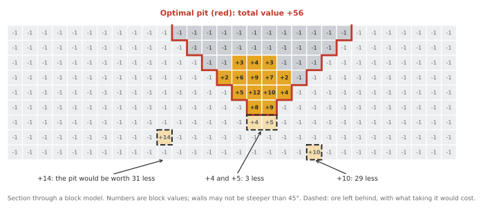

*Figure C1. A section through a block model. The red line is the most valuable pit with 45° walls: it takes the ore lens and the waste above it, but leaves the dashed blocks behind. Each would pay for itself, but not for the waste the walls need to reach it. Taking the deep +14 would make the pit worth 31 less, the +10 worth 29 less, and the +4 and +5 below the floor, which need a wider pit with 12 more waste blocks, worth 3 less.*

### 1.2 Block value

Incline turns every block into **one number**: the cash flow it brings if mined, sent to its best destination. It works like Whittle's cash-flow mode.

For each block:

- **Tonnes** = block volume × density. The density comes from the density field, or the *Default density* when no field is chosen or the value is blank, zero or negative.
- **As waste**, the block costs:
  `− tonnes × (mining + waste haulage + rehabilitation)`
- **As ore through a processing method**, it earns:
  `recovered metal × (price − selling cost)`
  `− tonnes × (mining + processing + G&A + ore haulage × haulage factor)`
  `− contained metal × element cost`
- A method can only take a block if the block's rock type matches and its main grade is inside the method's grade window: minimum ≤ grade < maximum.
- The block goes wherever its value is **highest**: waste, or one of the methods. That is its **destination**.

**Recovered metal** = tonnes × (grade − threshold) × unit factor × recovery %. The **threshold** lowers the grade that pays, for example the grade the plant cannot recover. **Contained metal** uses the full grade.

#### Worked example

These are McLaughlin's numbers from the Starting scenario:
- price 810 per oz, selling cost (royalty) 64.2 per oz,
- mining 1.45 per t (hard rock), waste haulage 1.21 per t, rehabilitation 0.34 per t of waste, ore haulage 2.10 per t,
- Mill: 20.9 per t, recovery 84 %, threshold 0.12 g/t, accepts grades from 1.5 g/t,
- Heap Leach accepts grades from 0.3 to 1.5 g/t, so neither block below is eligible for it,
- G&A 5.32 per t of ore.

One block weighs 7.62 × 7.62 × 6.096 m × 2.7 t/m³ = **955.7 t**. 1 g/t over a tonne is 0.03215 oz.

| | Block A, 3.0 g/t | Block B, 1.5 g/t |
|---|---:|---:|
| As waste: 955.7 × (1.45 + 1.21 + 0.34) | −2,867 | −2,867 |
| Recovered gold: 955.7 × (grade − 0.12) × 0.03215 × 0.84 | 74.33 oz | 35.62 oz |
| Revenue: recovered × (810 − 64.2) | 55,438 | 26,564 |
| Costs: 955.7 × (1.45 + 20.9 + 5.32 + 2.10) | −28,451 | −28,451 |
| Element cost: contained oz × 0.012 | −1 | −1 |
| **As Mill ore** | **+26,985** | **−1,888** |
| Destination | Mill | Mill |

Block B loses money even as ore. But it loses *less* than it would as waste (−1,888 against −2,867). So once the pit has to dig it up anyway, it goes to the mill. This is why the optimizer works with **cash flow** rather than "ore or not".

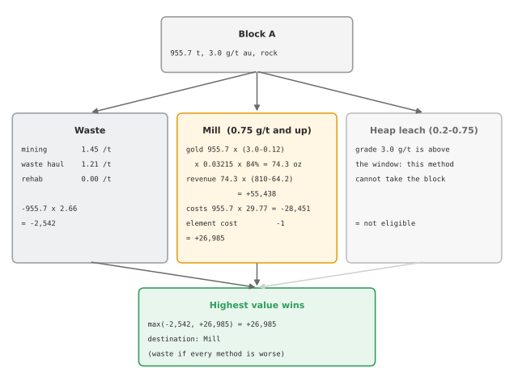

*Figure C2. Block A from the worked example: valued as waste and through each method it is eligible for; the highest value decides the destination.*

### 1.3 Slopes and precedence

Pit walls have a maximum **overall slope angle (OSA)**. For every block, the blocks inside an upside-down cone above it must be mined first. These are its **precedences**.

Incline offers three ways to set the slope:

- **Default angle**: one angle everywhere.
- **Use rosettes**: a different angle by bearing (direction in plan), for example steeper in strong rock to the south. Between rows the angle can step (sectors) or blend: linear, cosine or cubic.
- **Read from block model field**: each block carries its own angle.

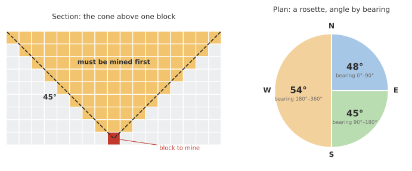

*Figure C3. Left: to reach the red block, every block in the 45° cone above it must be mined first. Right: the tutorial's rosette, with the wall angle by bearing.*

### 1.4 Revenue factors and nested shells

Run the optimizer at a lower price and you get a smaller pit. Run it at a higher price and the pit grows. A **revenue adjustment factor (RAF)** multiplies the revenue: RAF 0.5 is half price, RAF 1 is the base price, RAF 1.5 is 50 % above it.

Because value only grows as the price rises, the pits **nest**: each one sits inside the next. This nested set of **pit shells** shows how the deposit grows, from the most profitable core outwards.

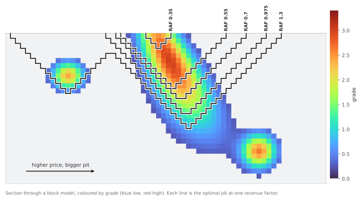

*Figure C4. Optimal pits on a small example section at five revenue factors, over grade coloured from blue (low) to red (high). Each pit contains the smaller ones; the RAF 1.3 pit also takes the small western lens.*

### 1.5 From shells to pushbacks

A schedule doesn't mine dozens of shells one after another. It mines a few **pushbacks**, each a usable slice of the pit. Choosing them is about reading the shell-by-shell numbers:

- **Look for jumps.** Where tonnes leap between two shells, a small price change opens a large area. A pushback boundary there separates two distinct mining zones.
- **Watch cash flow at base price.** All shells are valued at RAF 1 in the report. The total cash flow usually rises, flattens and then falls; past the peak, extra pit loses money at today's price.
- **Mind the width.** A pushback must be wide enough for equipment. Very close shells make slivers that can't be mined.

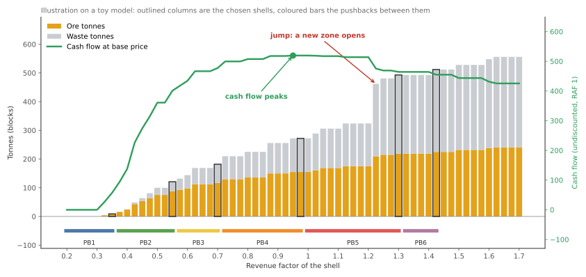

*Figure C5. A 61-shell sensitivity on the same example (not McLaughlin). Tonnes grow steadily until a new zone opens; the base-price cash flow peaks well before the largest shell. The outlined columns are chosen shells, and the coloured bars below are the pushbacks between them.*

### 1.6 Radial and directional shells

Ordinary nested shells grow wherever the money is, often in several places at once. Mines usually start in one place and **advance**. Directional shells add that:

- You pick a **starting point** on the block model.
- Shell *k* of *N* uses the *k*-th revenue factor, and lets ore count only up to *k*/*N* of the way across the final pit, measured from the starting point.
  - **Radial (out from the point)**: the limit is a circle around the point that grows with each shell.
  - **A compass direction**, for example West: the limit is a straight line at right angles to that direction, moving that way. Blocks behind the starting point count as distance 0, so they are open from the first shell.
- Beyond the limit, blocks are valued as **waste**, not zero: they can't earn as ore, but they still cost money to mine. The shell only goes there when its walls have to.

**The limit is a line or a circle, but the shells are still pits.** Each shell is an optimal pit inside its limit, so:
- its walls slope back on every side,
- it follows the shape of the ore,
- its revenue factor rises too.

So the increments come out **rounded**, and they reach past the straight line where the walls need room. A West run gives pit-shaped increments that move west step by step, not flat strips.

The shells are named with their share, for example `PS-W_RAF 0.50 DIR 60%`.

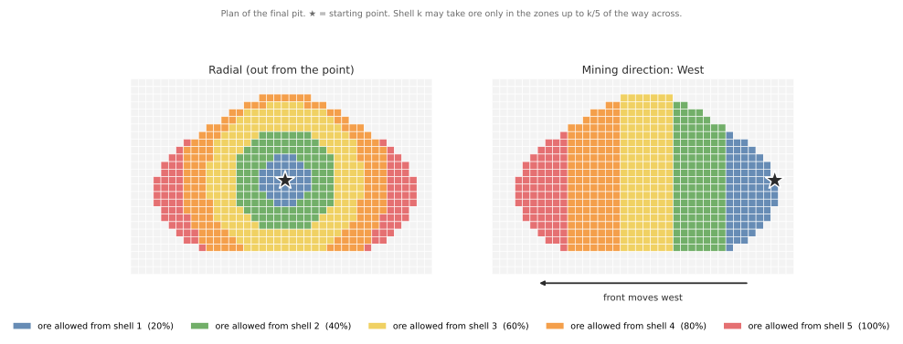

*Figure C6. The ore limits of five directional shells, in plan over the final pit: each colour is the zone where that shell may first take ore. Left: rings out from the starting point (Radial). Right: straight bands as the front moves west. These are the limits, not the shells. Each shell is a pit inside its limit, so its edges are rounded and reach past the limit where its walls need room.*

### 1.7 Air

A block model is a box. Above the topography it holds **air** blocks, which cost nothing and earn nothing. Air must not be valued as rock, or the optimizer would "pay" to mine the sky. Incline excludes air in one of two ways:

- by a **rock type value** (here, rock type `air`),
- by a **topography** surface: blocks above it are air.

Cells with no block at all are treated as air too.

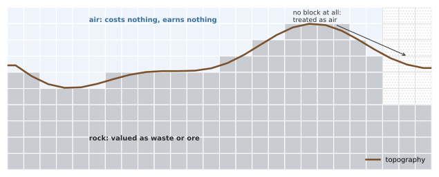

*Figure C7. Blocks whose centre is above the topography are air, and so are cells with no block at all. Only rock is valued as waste or ore.*

### 1.8 The solver

Incline solves each shell **exactly**, with the pseudoflow algorithm (the method behind modern commercial optimizers). The solver is `mineflow`, Incline's Rust port of the open-source **MineFlow** library by Matthew Deutsch, Kadri Dağdelen and Thys Johnson (Colorado School of Mines); see [12.4](#124-data-and-citation). The result is not an approximation: it is the most valuable pit for those values and slopes. For many shells, Incline solves the largest one first and then only the bands between shells, so 61 shells take seconds, not minutes.

### 1.9 What optimization does not do

- **No time value of money.** The optimizer solves a purely geometric task: the set of blocks with the greatest
  *undiscounted* value under the slope constraints. It does not know when each block is mined, so it can't discount
  cash flows. Every figure in this manual is undiscounted cash flow at base price. Mining the high-value core first,
  which is what makes nested shells and pushbacks matter for NPV, is left to your judgement for now.
- **NPV is coming.** Scheduling (best, worst and fixed-lag sequences) with discounted cash flow and NPV will come in a
  later release of the optimizer. This tutorial will be updated then.
- **A shell is not a design.** Shells have block-stepped walls and no ramps or berms. Use them as a guide for the pit design.
- **Regular, unrotated block models only.** Sub-blocked or rotated models can't be optimized yet.

---

## 2. Open the tutorial project

1. Start Incline and open `McLaughlin tutorial.omf` (**File → Open**).
2. Make sure you are on the **Production** workspace (the workspace tabs at the top).
3. On the top menu, select **Block Model → Pit Optimization...**
4. In the explorer, find the block model `mclaughlin_bm`. Double-click it to load it if it's greyed out.

The block model has four fields:

| Field | Kind | Meaning |
|---|---|---|
| `au` | number | gold grade, g/t |
| `density` | number | t/m³ |
| `rocktype` | category | `air` above and around the deposit, and the rock |
| `hardness` | category | `hard` or `soft`; used here to set different mining costs |

5. Colour the model by `au`: choose the field in the viewport's variable picker (*Choose the active block model variable*). The legend appears in the viewport. Drag its minimum to the right to hide the low-grade blocks and see the ore.

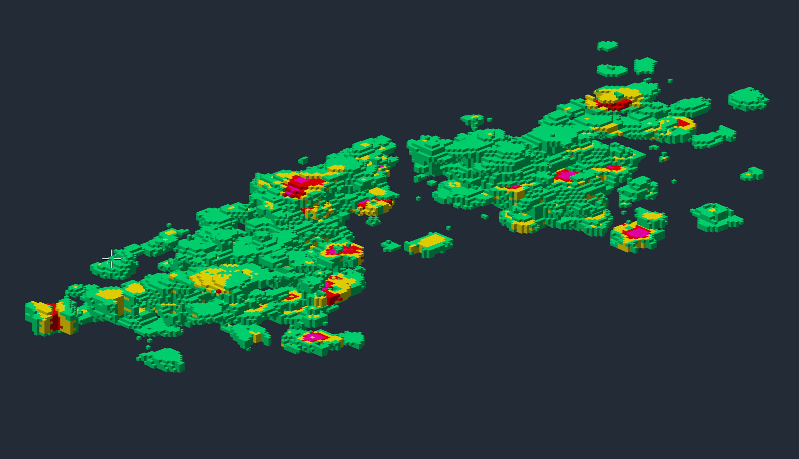

---

## 3. The scenarios list

A **scenario** is everything you type before a run: inputs, costs, prices, slopes and outputs. A project can hold any number of them.

To open the list, select **Block Model → Pit Optimization...** on the top menu.

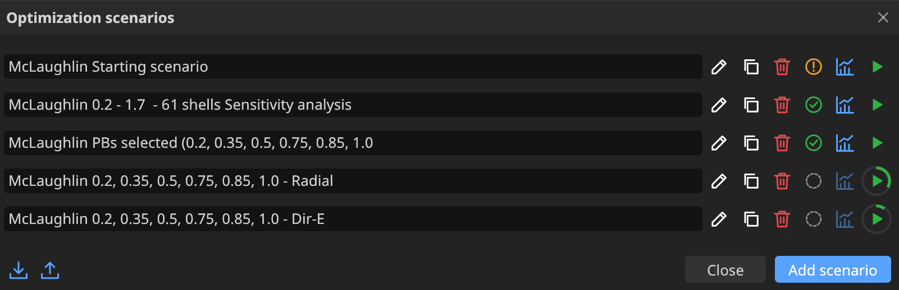

> **An example list.** The picture shows a list with several scenarios. The tutorial project starts with only one,
> *McLaughlin Starting scenario*.

Each row, left to right:

- **Name**: click it to rename it in place.
- **Edit**: opens the scenario editor.
- **Duplicate**: makes a copy right below, named `… copy`, then `… copy_2`, and so on.
- **Delete**.
- **State**: *Not run yet*, *Run, and unchanged since*, *Changed since the last run - run it again*, *Queued* or *Running*.
- **Results**: opens the Results window. It's available once the scenario has run in this session.
- **Run**: the green play button. While a scenario runs, a ring around it shows progress; click it again to cancel.

Several scenarios can run at once: two on desktop, one in the browser; the rest wait in the queue. A run always uses the **saved** scenario, not unsaved changes in the editor.

At the bottom left, **Import scenarios from JSON** and **Export scenarios to JSON** move scenarios between projects or computers. Imported scenarios are added to the list, renamed if a name is taken.

> **Where scenarios are stored.** Scenarios are part of the project: they are saved inside the `.omf` file.
> Saving a scenario marks the project as changed (`*` in the title); **save the project** (Ctrl+S) to keep them.
> Another project has its own scenarios.

---

## 4. Set up the starting scenario

Select **McLaughlin Starting scenario** and click **Edit**. The editor has one section per area, chosen from the menu on the right: Inputs, Constants, Mining costs, Processing costs, Revenues, Constraints and Outputs.

**Use constants.** Every number field can hold a typed value **or a constant**: a named value from the Constants section. Click the field's constant button (*Use a constant*) to choose one. When the price of haulage changes, you change one constant, and every field that uses it follows.

### 4.1 Inputs

| Field | Set to |
|---|---|
| Block model | `mclaughlin_bm` |
| Default density | 2.7 |
| Density field | `density` |
| Main quality field | `au` |
| Rock type field | `rocktype` |
| Exclude air blocks | on |
| Air exclusion | **Use rock type value**: `air` |

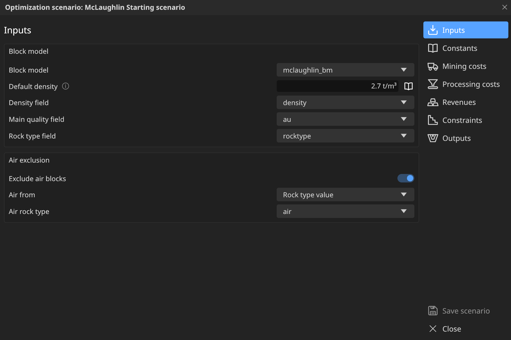

### 4.2 Constants

The Starting scenario already holds the deposit's mining and processing constants, in two groups:

| Group | Constant | Value | Description |
|---|---|---:|---|
| Mining | Base ore haulage costs | 2.10 | per ton |
| Mining | Waste haulage costs | 1.21 | per ton |
| Process | Mill processing costs | 20.90 | per ton |
| Process | Mill recovery | 84 | % |
| Process | Heap Leach recovery | 74 | % |
| Process | Heap leach processing costs | 6.21 | per ton |

**Add the third group yourself:**

1. Click **Add group**, name it `Other`, and confirm. A new coloured group band appears at the end of the grid.
2. Select the `Other` group row and click **Add** twice. **Add** puts a new row right below the selected one, so both constants go into `Other`.
3. Fill them in:

| Name | Type | Value | Description |
|---|---|---:|---|
| Selling costs | Number | 64.2 | Royalty, per oz |
| G&A costs | Number | 5.32 | per ton of ore |

Constants under a group carry the group's colour down their left edge. If a constant lands in the wrong group, drag it, or move it with **Up**/**Down**.

A constant is a **Number**, **Text** or **Yes/No**. A blank or duplicate name is outlined in red. You use these two constants in Processing costs (4.4) and Revenues (4.5).

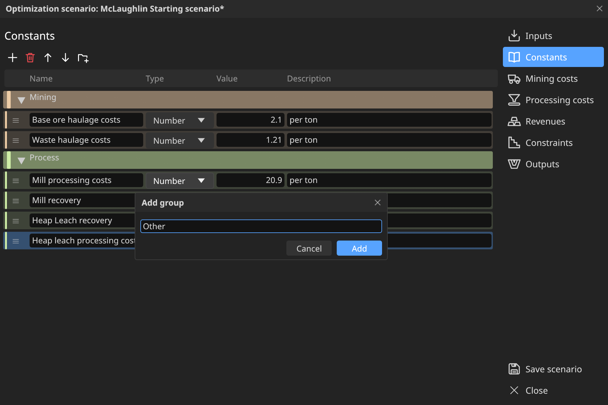

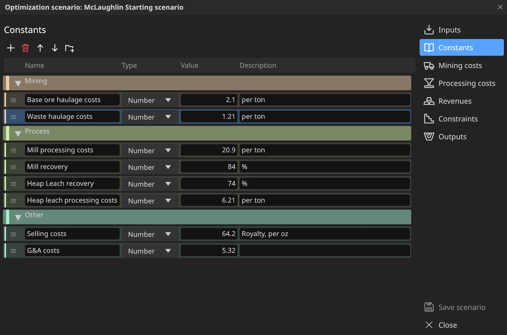

### 4.3 Mining costs

| Field | Set to |
|---|---|
| Default mining cost | 1.45 |
| Use different costs based on BM field | `hardness`: `soft` 1.17, `hard` 1.45 |
| Rehabilitation costs | Value or constant: 0.34 |
| Waste haulage costs | Value or constant: constant *Waste haulage costs* |
| Ore haulage costs | Value or constant: constant *Base ore haulage costs* |

*Use different costs based on BM field* sets the mining cost by the values of a field, here by rock hardness; a value without a row uses the default. Each haulage and rehabilitation cost can also come from a block model field instead of one value. Costs are plain numbers in any currency; use the same currency everywhere.

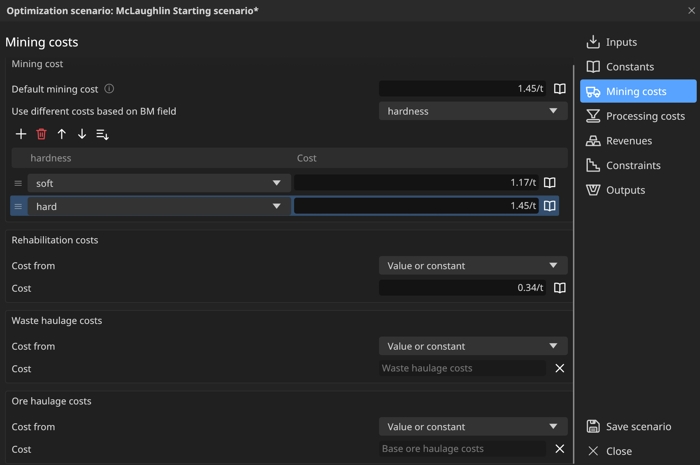

### 4.4 Processing costs

Two methods. Add the second with **Add** in the methods grid.

| Name | Rock type | Minimum grade | Maximum grade | Threshold | Processing cost |
|---|---|---:|---:|---:|---|
| Heap Leach | Any rock type | 0.3 | 1.5 | 0 | constant *Heap leach processing costs* |
| Mill | Any rock type | 1.5 | 1,000,000 | 0.12 | constant *Mill processing costs* |

Select a method to edit its **elements** in the grid below:

| Method | Element | Recovery (%) | Element cost |
|---|---|---|---:|
| Mill | au | constant *Mill recovery* | 0.012 |
| Heap Leach | au | constant *Heap Leach recovery* | 0 |

Under **Other costs**:
- **Haulage cost adjustment factor**: 1.0 for Mill and 1.05 for Heap Leach (the leach pad is farther away).
- **G&A costs**: constant *G&A costs*, with **Same for all** on.

The grade windows don't overlap, so every block has at most one ore method. If two methods take the same material, Incline warns and sends each block where it pays better.

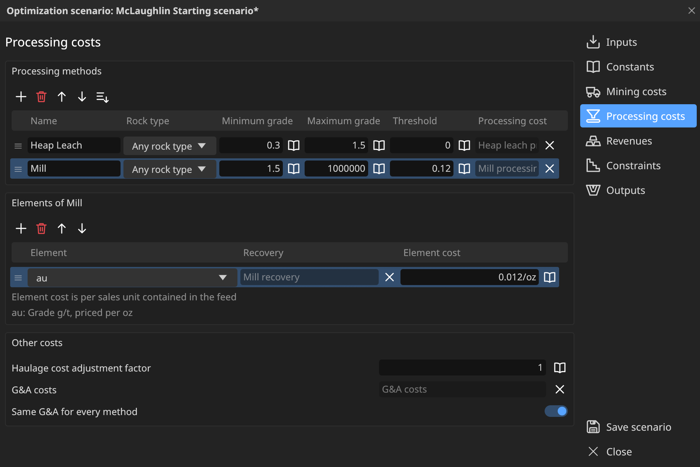

### 4.5 Revenues

| Element | Grade unit | Sales unit | Price | Selling costs |
|---|---|---|---:|---|
| au | g/t | oz | 810 | constant *Selling costs* |

The **grade unit** is how the field is stored. The **sales unit** is what the price, selling cost and element costs are per. Incline converts between them: 1 g/t over one tonne is 0.03215 oz.

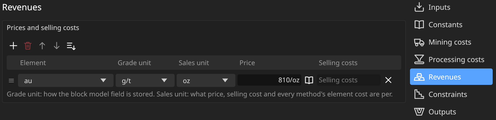

### 4.6 Constraints

Choose **Use rosettes**, set **Between rows** to *Step (sectors)*, and add three rows:

| Bearing | Angle |
|---:|---:|
| 0 | 48 |
| 90 | 45 |
| 180 | 54 |

Each row's angle applies from its bearing up to the next row's bearing, so: 48° from north to east, 45° from east to south, and 54° from south round to north. The diagram on the right shows the sectors in plan.

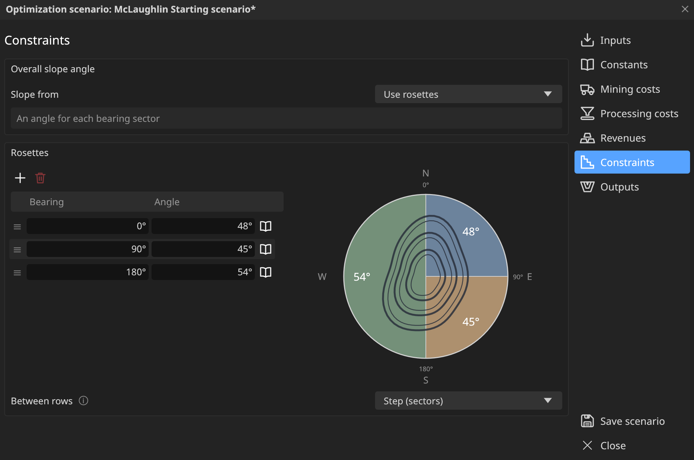

### 4.7 Outputs

For the first run:

| Field | Set to |
|---|---|
| Shells | **Multiple shells using RAFs** |
| Factors from | **From, to and step** |
| Revenue factor from / to | 0.2 / 1.7 |
| Step / Number of shells | 0.025 / 61 (each updates the other) |
| Use directional shells | off |
| Create shell solids / Create shell surfaces | both off: we only want the numbers for now |
| Write shell value into BM | off |
| Create reports | off |

Both ends of the range get a shell, so 0.2 to 1.7 in steps of 0.025 makes 61 shells. If you type the number of shells instead, the step is rounded to three decimals and the number is corrected to what that step makes when you leave the box.

Click **Save scenario** and close the editor.

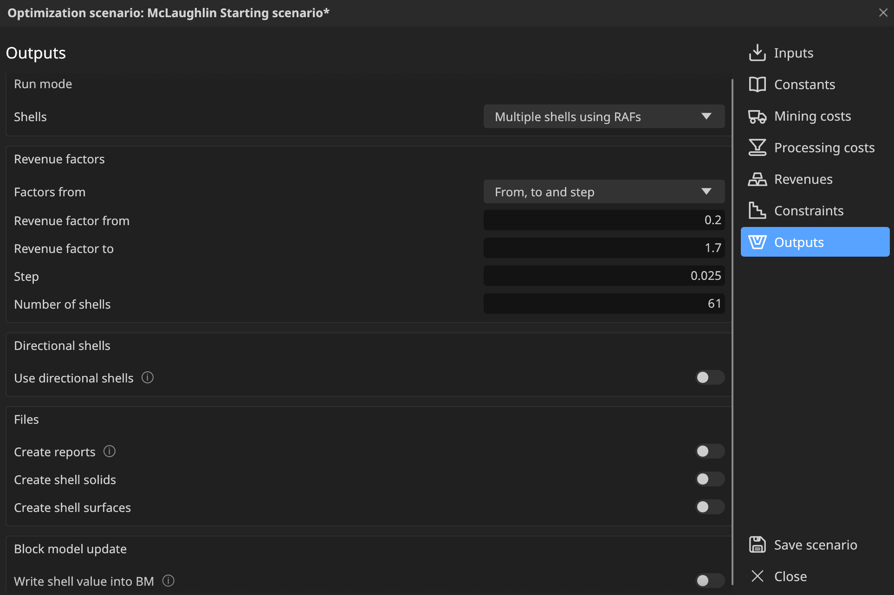

---

## 5. Run 1: a 61-shell sensitivity

1. In the scenarios list, rename *McLaughlin Starting scenario* to **McLaughlin 0.2 - 1.7 - 61 shells**.
2. Click its **Run** button.
3. The ring fills as it works. The console reports when it finishes: *Scenario … finished: 61 shell(s) in 2.2 s* on our machine.
4. Click the scenario's **Results** button.

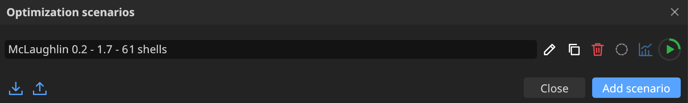

### 5.1 The Results window

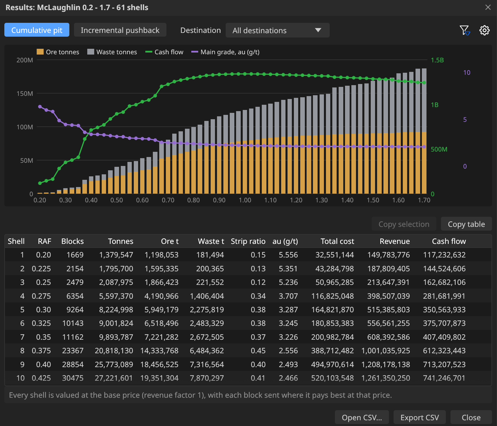

- **Cumulative pit / Incremental pushback**:
  - *Cumulative* shows each shell's whole pit.
  - *Incremental* shows what each shell adds to the one before it.
- **Destination**: *All destinations*, or one of *Waste*, *Mill* or *Heap Leach*.
- **The chart**, one column per shell:
  - stacked ore (amber) and waste (grey) tonnes on the left axis,
  - **cash flow** (green line) on the right axis,
  - the **main grade** (`au`, violet line) on its own scale.
  - Hover a column for its numbers; click a column to select it.
- **The table** lists the same shells. The cog button (*Choose the table's columns*) picks the columns from every figure in the report: grades, contained and recovered metal, every cost, revenue and cash flow. Your choice is saved with the project.
- **Export CSV** saves the report you are looking at.

**Every shell is valued at the base price (RAF 1).** The revenue factor only decides each shell's *shape*. The numbers always tell you what that pit is worth at today's price.

You should see the RAF 1.00 shell at about **125.1 Mt**: 79.0 Mt of ore and 46.1 Mt of waste, with an undiscounted cash flow of about **1,341 million**. The cash flow peaks exactly at RAF 1.00. That is no coincidence: the RAF 1 pit is by definition the most valuable pit at the base price. Smaller shells leave money in the ground, and larger shells add material that does not pay for itself at today's price; by RAF 1.70 the cash flow has fallen to about 1,244 million.

---

## 6. Choose the pushbacks

Sixty-one shells are too many to design. You now pick the handful that make good pushbacks.

1. In the Results window, click the **funnel** button (*Show chosen shells only*). A bar appears: *Click shells in the chart to choose them*.
2. Click the columns of the shells you want. Click a chosen one again to take it out. In this tutorial choose:
   **0.325, 0.425, 0.575, 0.70, 0.85, 1.00**
3. Click **Apply**. The chart and table now show only those shells.
   - In *Incremental pushback*, each row is now measured from the **previous chosen shell**: these are your pushbacks.

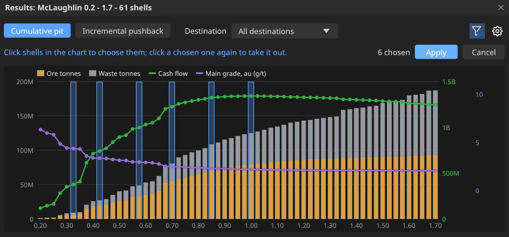

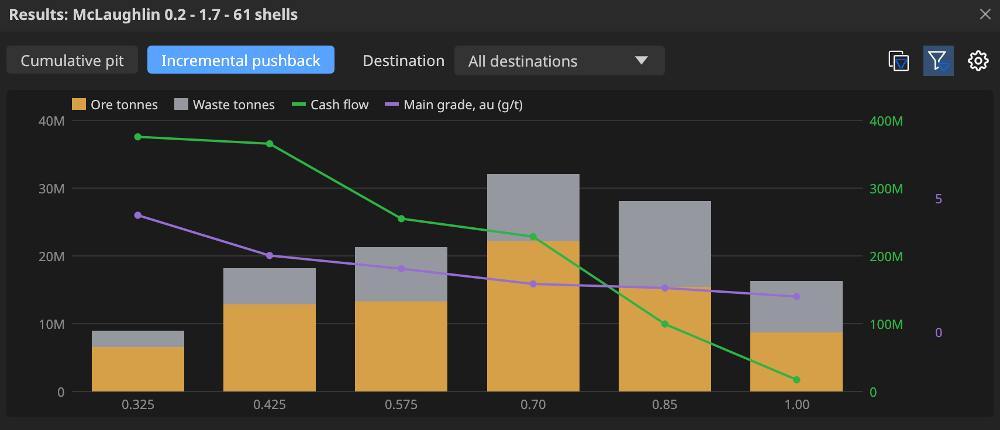

**Why these shells?** Look at two things in the chart. Where the bars jump between neighbouring shells, a small price change opens a new zone, so a pushback boundary there separates two mining areas. Where the cash flow line goes flat, extra tonnes add little value, so shells close together there would make thin pushbacks that are not worth mining separately. The six shells above sit at those breaks, and they end at RAF 1.00, the most valuable pit.

### 6.1 Copy the chosen shells into a new scenario

With the filter applied, click **Copy filtered shells into a new optimization scenario** (the button right of the funnel).

Incline creates a copy of the scenario right below the original, with:
- Outputs set to **Type factors manually** with the six factors,
- the name `McLaughlin 0.2 - 1.7 - 61 shells (0.325, 0.425, 0.575, 0.70, 0.85, 1.00)`,
- its own shell name prefix, `PS-copy`.

A message confirms it.

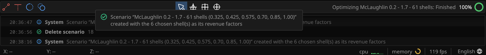

1. Rename the new scenario to **McLaughlin - 6 PBs (0.325, 0.425, 0.575, 0.70, 0.85, 1.00)**.
2. Edit it: on **Outputs**, turn on **Create shell surfaces** and set **Shell name prefix** to `PS`.
3. Save and run it.

You get six surfaces in the Triangulations collection `McLaughlin - 6 PBs (…) PS surface`, named `PS_RAF 0.325` to `PS_RAF 1.00`.

> **Try it yourself.** Look at the surfaces in 3D. Some may not make a good pushback once you see them, for example
> two that are very close on one side. Drop or replace that factor in the list and run again.

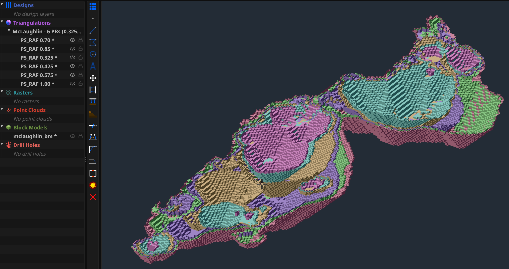

---

## 7. Directional shells: radial

Now make the pit grow outwards from a starting point.

1. **Duplicate** the 61-shell scenario and rename the copy **McLaughlin directional - Radial**.
2. Edit it, and on **Outputs**:

| Field | Set to |
|---|---|
| Factors from | **Type factors manually** |
| Revenue factors | `0.2, 0.35, 0.5, 0.65, 1.0` |
| Use directional shells | on |
| Mining direction | **Radial (out from the point)** |
| Starting point | click **Pick** (below) |
| Create shell surfaces | on |
| Shell name prefix | `PS-R` |

3. **Pick the starting point.** Click **Pick**. The editor steps aside, the view goes to plan over the block model, and everything else is hidden. Click the block where mining should start. The button now reads **Picked**; hover it to see the point's X and Y, and click it again to pick another point.
   Use the outcrop of the high-grade core; this tutorial used **X 413.3, Y 990.6**.
4. **Save scenario** and **Run**.

You get five surfaces in the collection `McLaughlin directional - Radial PS-R surface`, named `PS-R_RAF 0.20 DIR 20%` to `PS-R_RAF 1.00 DIR 100%`. (A name ends in ` surface` only when a run makes solids and surfaces both.)

A **surface** is the shell without its cap: the pit floor and walls, open where the pit meets the air. A **solid** is closed.

<p align="center">
  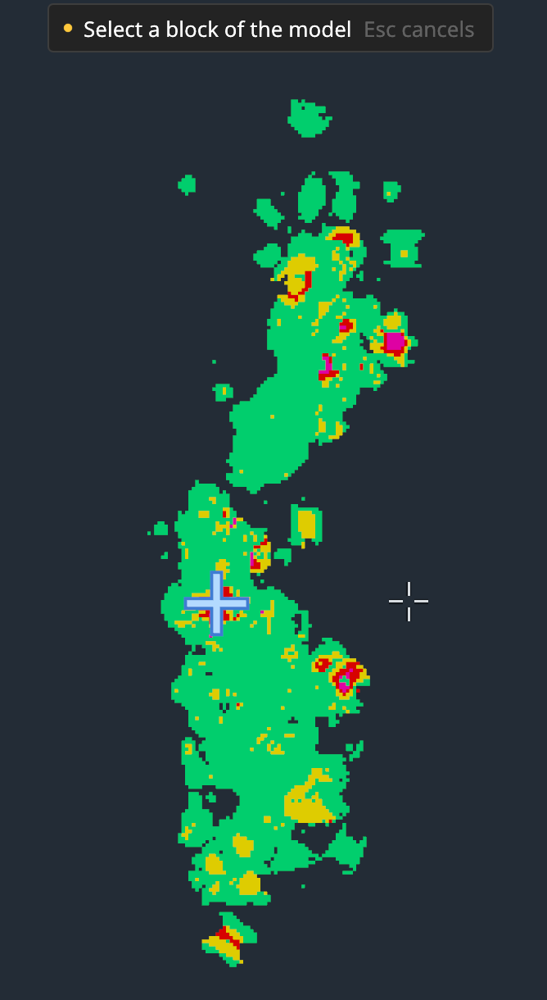
  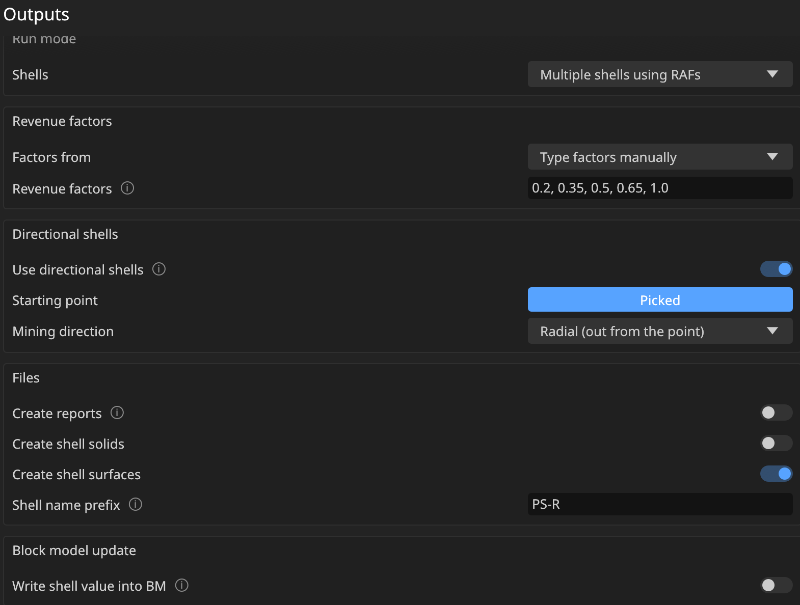
</p>

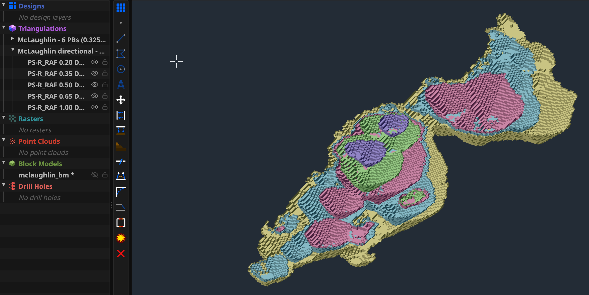

**Rerunning overwrites.** Run the scenario again after a change and its shells are **replaced** in place. They keep their colours, and shells it no longer makes are removed, so a sensitivity study never piles up copies. Each scenario needs its **own prefix**, which the editor enforces, so two scenarios never overwrite each other's shells.

---

## 8. Directional shells: a straight front

1. Duplicate *McLaughlin directional - Radial* and rename the copy **McLaughlin directional - East**.
2. On **Outputs**:
   - **Mining direction**: **East**.
   - **Shell name prefix**: `PS-E`.
   - **Pick** a starting point where mining should begin. This tutorial uses the high-grade zone, the same area as the radial start: mining the best grade first is what a good schedule, and later NPV, will reward.
3. Save and run.

The limit on ore now moves across the deposit from west to east as a straight north–south line. The shells are still pits, so each increment is rounded: a first bite near the starting point, then bites that move progressively east (figure C6 shows the same idea moving west).

Compare the two sets in plan:
- **Radial** increments spread out from the point in every direction.
- **East** increments advance one way.

> **Good to know.** Everything behind the starting point counts as distance 0. With an East front, ore west of the
> starting point is open from shell 1, so the first shells can also grow west of the start; the front then advances
> east. To make every shell move one way only, start at the western edge instead.

<p align="center">
  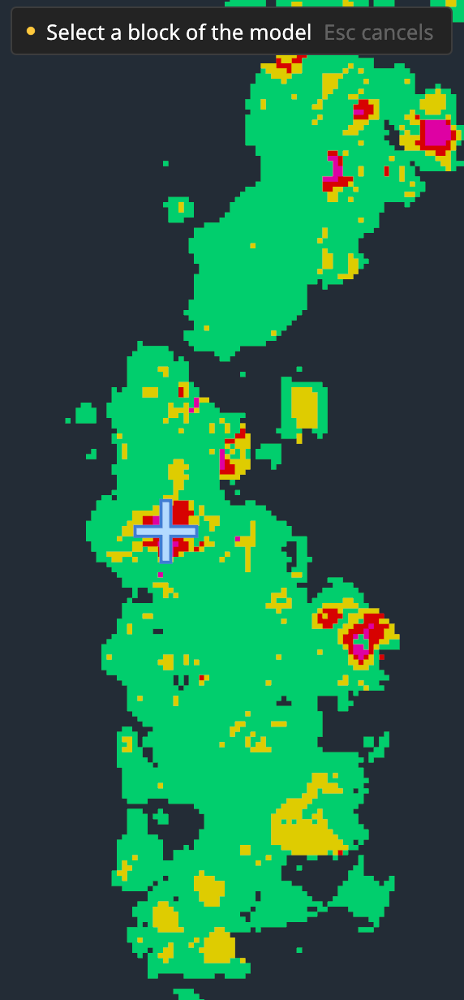
  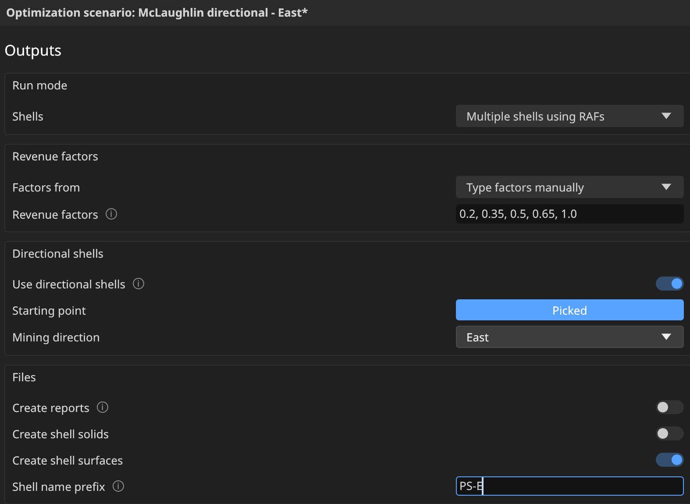
</p>

On McLaughlin the direction makes only a small difference, because of the shape of this gold deposit. Another MineLib deposit, Marvin, shows it much more clearly: its shells change a lot as the mining direction changes.

<p align="center">
  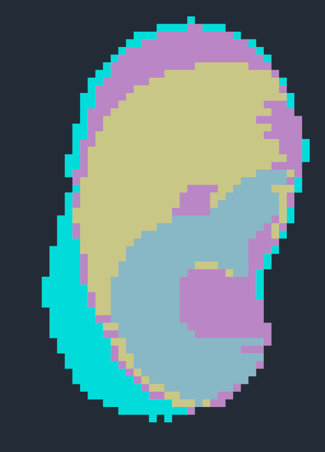
  
</p>

---

## 9. Pushback analysis in the block model

Shell surfaces show the shape. Writing the shells into the **block model** lets you see which pushback every block belongs to, in plan, section and 3D.

1. Edit the scenario *McLaughlin directional - East*.
2. On **Outputs**, turn on **Write shell value into BM**:
   - value: **Sequence number** (1 = the smallest shell) or **RAF value**,
   - field: **New field**, named `pushback`.
3. Save and run. The console says *Wrote 5 shell(s) into field 'pushback' of block model 'mclaughlin_bm'*.
4. Colour the block model by `pushback`.

The field is a **category** field, so each shell gets its own colour: **the same colour as its shell triangulation**. Each block gets the **smallest** shell it belongs to. Blocks outside every shell, and air, stay blank.

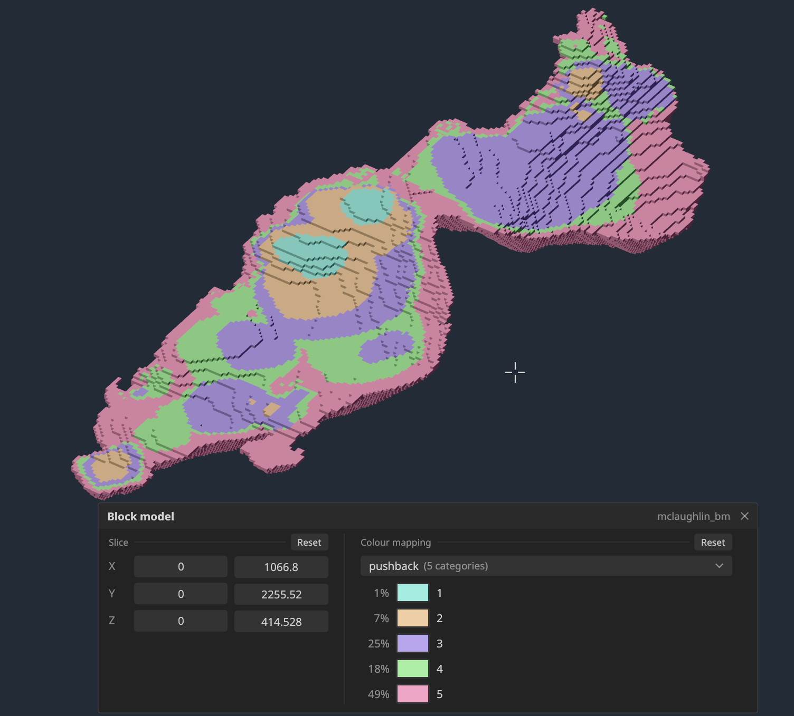

**The legend** lists every pushback with its share of blocks.
- Click a colour swatch (*Edit this category colour*) to recolour a pushback. Your colours are kept when you rerun the scenario.

**Look at it in section.** Turn on **Vertical Slice View** and cut east–west through the deposit. Each pushback appears as a band, and you can check:
- each pushback is wide enough to mine,
- the first pushback reaches ore early,
- no pushback is a thin sliver.

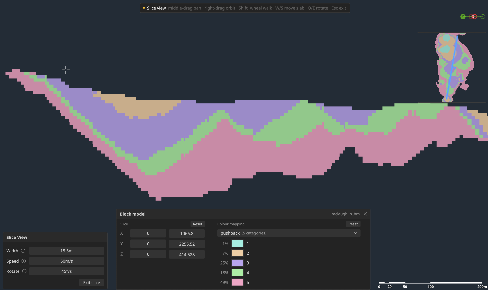

Rerun with different factors and the same field is **updated**, not duplicated.

---

## 10. Reports

To keep the numbers outside Incline, turn on **Create reports** on **Outputs** and **Browse…** for a folder. Each run writes:

```
<reports folder>/<scenario name>/optimization_results.csv
```

It replaces that scenario's earlier report. In the browser, the report is downloaded instead.

The CSV is "tidy":
- one row per basis (`cumulative`, `incremental`), shell and destination, plus a `Total` row per shell;
- headers in fixed English, with `.` as the decimal mark.

Columns:
- `scenario, basis, shell, raf, dir_pct, destination, blocks, tonnes, ore_tonnes, waste_tonnes, strip_ratio`,
- then, per element, `grade`, `contained`, `recovered`, `revenue` and `cost`,
- then `mining_cost, waste_haulage_cost, rehab_cost, ore_haulage_cost, processing_cost, ga_cost, element_cost, total_cost, revenue, cash_flow`.

Revenue is net of selling costs; cash flow is undiscounted.

**Open CSV…** in the Results window reads a report back, from any earlier session, with its chart and table.

---

## 11. Good to know

- **Unloaded inputs.** If the block model (or the topography) is unloaded when you run, Incline asks to load it. It stays loaded but hidden for later runs. A **hidden** block model runs as it is.
- **Missing references.** If a scenario names a field, block model or constant the project no longer has, the editor lists each one so you can fix it.
- **Stale results.** Change a scenario after running it and its state shows *Changed since the last run*. Results and shells are from the old settings until you run it again.
- **Run checks.** Before running, Incline checks the scenario and lists everything that stops it, for example a missing price or a grade window whose maximum is not above its minimum. See [12.3](#123-common-messages).
- **Browser version.**
  - One run at a time.
  - Reports are downloads, not written to a folder.
  - Big models need a desktop-class amount of memory.
- **Results are per session.** The Results button needs a run in this session. Reports (CSV) and shells are kept.

---

## 12. Appendix

### 12.1 Field reference

| Section | Field | What it does |
|---|---|---|
| Inputs | Default density | Density when no field is chosen, or the field's value is blank, zero or negative. Must be above 0. |
| Inputs | Main quality field | The grade the methods' windows and the threshold apply to. Reported as the main grade. |
| Inputs | Exclude air blocks | Air by a rock type value, or above a topography. |
| Mining costs | Use different costs based on BM field | Mining cost per value of a field; other values use the default. |
| Processing costs | Threshold | Grade that is not paid for: recovered = grade − threshold. Main element only. |
| Processing costs | Element cost | Per sales unit of contained metal fed to the method. |
| Processing costs | Haulage cost adjustment factor | Multiplies the ore haulage cost for this method. |
| Processing costs | G&A costs | Per tonne of ore processed. *Same for all* uses one value for every method. |
| Constraints | Between rows | Step (sectors), Linear, Cosine or Cubic; the last three need 2, 2 and 4 rows. |
| Outputs | Single shell | One pit at RAF 1. |
| Outputs | Type factors manually | Numbers above 0, separated by commas or spaces; sorted, repeats dropped. |
| Outputs | Shell name prefix | Starts every shell name; must differ from every other scenario's. |
| Outputs | Write shell value into BM | Category field; existing text fields or a new one; overwritten on rerun. |

### 12.2 Glossary

- **RAF (revenue adjustment factor)**: multiplier on revenue used to make smaller or larger pits.
- **Shell**: the optimal pit at one RAF (and, for directional shells, one front position).
- **Pushback**: the material between two chosen shells, mined as one stage.
- **OSA**: overall slope angle of the pit wall.
- **Rosette**: slope angles by bearing.
- **Strip ratio**: waste tonnes / ore tonnes.
- **Base price**: RAF 1, the prices typed in Revenues.

### 12.3 Common messages

| Message | Fix |
|---|---|
| *Method …: the maximum grade must be above the minimum* | Fix the method's grade window. |
| *… costs more to sell than it sells for* | Selling cost is above the price. |
| *The rock type value that means air is not chosen* | Pick the air value in Inputs, or turn off *Exclude air blocks*. |
| *Directional shells need a starting point* | Click **Pick** in Outputs. |
| *The shell name prefix … is empty or used by another scenario* | Give the scenario its own prefix. |
| *This block model is sub-blocked …* / *… is rotated* | Not supported yet; regularise the model first. |

### 12.4 Data and citation

McLaughlin data from MineLib: Espinoza, D., Goycoolea, M., Moreno, E., Newman, A. (2013). *MineLib: a library of open pit mining problems.* Annals of Operations Research 206(1), 93–114. https://doi.org/10.1007/s10479-012-1258-3

Ultimate pit solver from MineFlow: Deutsch, M., Dağdelen, K., Johnson, T. (2022). *An Open-Source Program for Efficiently Computing Ultimate Pit Limits: MineFlow.* Natural Resources Research. https://doi.org/10.1007/s11053-022-10035-w

Source: [github.com/MineFlowCSM/MineFlow](https://github.com/MineFlowCSM/MineFlow), MIT licence, © 2022 Matthew Deutsch. Incline's Rust port lives in `crates/mineflow` of the Incline repository and keeps the original licence notice.
